# IT SYSTEM DEVELOPMENT — BUSINESS REQUIREMENT ASSESSMENT

**Project:** Mata Air Hub  
**Module:** Employee Status Change  
**Document:** Business Requirement Assessment  
**Document version (footer):** 1.1

## Business Requirement Record

| Start Date | End Date | Author | Version Doc | Change Reference |
| --- | --- | --- | --- | --- |
| 16 Jul 2026 |  | Maheswara Sinatriyo | 0.1 | Drafting |
| 20 Jul 2026 |  | Maheswara Sinatriyo | 1.0 | Issued for Review |
| 06 Aug 2026 |  | Maheswara Sinatriyo | 1.1 | Update based on review |
| 22 Aug 2026 |  | Maheswara Sinatriyo | 1.2 | Update based on review |

## Log Changes

Describe the changes which impact to the Module

**Guidance:**

- Provide the name, detail changes and severity of the changes, e.g. Mr. X request for change on workflow due to new policy on dd/mmm/yyyy, etc

- Please identify all the changes clearly include impact to another module or infrastructure (if any).

### Change Record

| Date | Requested by | Description | Severity (major/minor) | Status |
| --- | --- | --- | --- | --- |
|  |  |  |  |  |
|  |  |  |  |  |

## Project Information

- **Project Description:** Mata Air Hub
- **Business User Expert:** Anny Nasution/Irna Hasibuan
- **Assessment Date:** 15 Juli 2026
- **Module Description:** Employee Status Change

## Requirement Identification

### WHY — Objectives and Benefits

*Explain why this module is needed.*

**Guidance:**

- Module Objectives/Goals: Your expected objectives on this module

e.g. decreasing numbers of paper used

- Module Benefits: The outcome of successful objectives/goals e.g. reducing the paper consumption cost

| Module Objectives/Goals | Module Benefits |
| --- | --- |
| Menstandarkan proses Employee Status Change melalui satu sistem terpusat untuk pengajuan, review, persetujuan, dan dokumentasi perubahan status karyawan. | Seluruh pengajuan Promotion, Transfer, Re-classification, dan perubahan lainnya menggunakan proses yang konsisten sehingga lebih mudah dipahami dan dikelola. |
| Memastikan setiap perubahan status karyawan mengikuti proses approval yang sesuai. | Mengurangi risiko perubahan data tanpa persetujuan serta memastikan setiap perubahan telah disetujui oleh pihak yang berwenang. |
| Mendokumentasikan seluruh riwayat perubahan status karyawan secara lengkap. | HR dan manajemen dapat dengan mudah menelusuri histori perubahan status karyawan kapan pun diperlukan. |

### WHAT — Scope

*Describe the expected function or features on the app*

**Guidance:**

- In scope: Explain the expected function / feature to be included e.g.the reporting must in excel, must be easy to use in mobile, etc

- Out scope: Explain what function that exist on the current/manual system that should not be considered e.g. no need to add 3rd party account on login, etc

- Make sure to put anything that you can think about the scope

#### In Scope

Pembuatan form pengajuan Employee Status Change untuk:

- Re-classification
- Transfer
- Working Hours & Working Schedule Change
- Contract Renewal
- Promotion
- Demotion

Fungsi attachment Position Detail (staff & non-staff) & Competency Assessment Matrix (untuk non-staff)

Fungsi perhitungan otomatis percentage increase berdasarkan perbedaan salary lama dan baru

Approval workflow:

- Proses review dan approval dengan sistem workflow.
- Penentuan approver pada workflow approval oleh HR Admin.
- Penggantian approver oleh HR Admin pada workflow approval untuk approver yang belum melakukan approval.
- Delegasi approver.

Notification & Reminder:

- Notifikasi kepada next approver selama proses approval.
- Reminder berkala kepada approver yang belum memberikan keputusan.
- Notifikasi kepada approver yang sudah melakukan approval ketika terjadi Send Back.
- Notifikasi kepada HR Admin ketika requestor melakukan withdraw (configurable).

Employee Status Change Monitoring:

- Monitoring status pengajuan.
- Informasi current approval stage dan pending approver.
- Activity log dan histori proses approval.

Document Generation:

- Generate & Download Employee Status Change Document dengan digital signature (PDF).
- Download Employee Status Change Report (.xlsx).
- Generate & Download Memorandum berdasarkan periode tertentu dengan digital signature (PDF & .docx).

Data Migration:

- Migrasi data historis Employee Status Change 2021-latest

Integration

Organization Structure:

- Chart berubah menyesuaikan hasil ESC

Position Management:

- Job information berubah sesuai hasil ESC
- Line reporting/atasan berubah sesuai dengan hasil ESC

Payroll & Compensation:

- Grade & gaji berubah sesuai hasil ESC
- Roster, Shift, & Time management:
- Roster berubah sesuai hasil ESC

PMGM:

- Transfer memberikan flagging transfer pada PMGM
- Promotion memberikan flagging promotion pada PMGM

#### Out Scope

Employee Termination:

- Proses pengunduran diri.
- Pemberhentian karyawan.
- Pemutusan hubungan kerja (Termination).
- Exit clearance.

**Seluruh proses tersebut akan dikelola pada modul Manage Termination.**

Payroll Processing:

- Perhitungan gaji.
- Perhitungan bonus.
- Perhitungan tunjangan.
- Perhitungan pajak.

Recruitment Process:

- Recruitment Requisition.
- Candidate Management.
- Hiring Process.

Performance Evaluation

- Performance Review.
- Goal Management.
- Talent Assessment.

**Modul ESC hanya memberikan informasi perubahan yang diperlukan ke PMGM.**

Organization

- Pembuatan struktur organisasi baru.
- Pembuatan posisi baru.
- Penghapusan posisi.

**Perubahan tersebut dikelola melalui modul Organization Structure dan Position Management.**

Employee Self-Service di luar ESC

- Perubahan data pribadi karyawan.
- Leave.
- Attendance.
- Claims.
- Personal Information.

Backdate Request ESC

Backdate Approval ESC

### WHEN — Milestones

*Describe the expected completion dates on required milestone.*

**Guidance:**

- Explain the expected milestone complete with expected start and end dates e.g. system must ready to used in dd/mm/yyyy, should be presented on management meeting on dd/mm/yyyy

| Milestones | Due Date | Remarks |
| --- | --- | --- |
| User Requirement | 15 Jul 2026 | Employee Status Change |

### WHO — Roles & Accessibilities

*Describe how many roles will be interact with this Module*

**Guidance:**

- Provide the role, assigned to and accessibilities on each role that will be included in the module e.g. HR as admin apps will be responsible to provide setting on the current process.

- Please identify all the participated person in your area to have a clear roles assignment.

#### HR Admin

ESC:

- Update Form
- Approve ESC
- Send Back ESC
- View full ESC history
- Generate Individual Report
- Generate Memorandom
- Generate Monitoring Report

Workflow:

- Set Approval Workflow
- Update Approval Workflow
- Delegate approval

#### Requestor

ESC:

- Create & Submit ESC form

#### Approver

ESC:

- Update Form
- Approve ESC
- Send Back ESC

Workflow:

- Delegate approval

#### OD-TD

ESC:

- Update Form
- Approve ESC
- Send Back ESC

Workflow:

- Delegate approval

#### Dept Head

ESC:

- View subordinate’s full ESC history

#### Employee

ESC:

- View self latest ESC Summary & Individual PDF Report

### WHAT IF — Risks and Mitigation

*Identify the risk and impact of the module*

**Guidance:**

- Explain the risk that might be a barrier / obstacle for this module. e.g. the procedure does not exist, need to be confirmed by BOD, etc

- Please think of any risk that might be impacted related to this module

| Risks | Level (Hi, Med, Low) |
| --- | --- |
| Pengajuan Employee Status Change yang bersamaan (multiple ESC) untuk karyawan yang sama dapat menyebabkan inkonsistensi data. | Hi |
| Keterlambatan proses approval dapat menyebabkan perubahan status karyawan tidak berlaku sesuai Effective Date yang direncanakan. | Med |
| Kesalahan pengisian data atau dokumen pendukung yang tidak lengkap dapat menyebabkan perubahan data karyawan menjadi tidak akurat. | Med |

#### Mitigasi

- Mencegah pengajuan ESC baru apabila masih terdapat Employee Status Change yang berstatus In Progress untuk karyawan yang sama.
- Menyediakan reminder notifikasi otomatis kepada approver setiap 2 hari hingga proses approval selesai.
- Menerapkan validasi mandatory field serta kewajiban upload dokumen pendukung sebelum pengajuan dapat dikirim.

## Current System Business Flow

***Guidance:***

- Please describe the current system that running / being used in essay.

- To maximize the understanding of current system, consider explaining with process flow in mind.

- Do it step by step from beginning to the end of process

- Example on essay (in Bahasa) :

> “Mr. X mengisi formulir exit form kemudian memintakan approval kepada department head. Setelah di approve, form kemudian diserahkan pada security pada saat user x berada di gerbang dan akan keluar dari area camp.”

- More complete the explanation will affect the next visual modelling process.

### Employee Status Change Visibility

Pada sistem saat ini, **Employee dapat melihat ESC terbaru tanpa adanya mekanisme publikasi atau pengaturan visibilitas secara terpisah**.

Setiap kali terdapat ESC baru, ESC tersebut menjadi informasi terbaru yang dapat dilihat oleh Employee sesuai dengan data ESC yang tersedia pada sistem. Dengan demikian, perubahan ESC dapat terlihat oleh Employee meskipun proses ESC tersebut belum melalui mekanisme publikasi khusus.

1. **Superintendent / Department Head** mengajukan Employee Status Change.
2. **HR Admin** melakukan review awal dan menentukan **Workflow Approval**.
3. Pengajuan diproses melalui approval berjenjang hingga **Vice President** (tergantung workflow yang ditentukan **HR Admin**).
4. Setiap approver dapat **Approve** atau **Send Back**.

   1. Jika **Send Back**, form akan dikirim kembali kepada pengaju dan semua approver yang sudah melakukan approval akan diberikan notifikasi, setelah itu pengaju dapat melakukan revisi dan **Submit** ulang, atau melakukan **Withdraw** pengajuan tersebut.

      1. Jika Pengaju melakukan **Submit**, maka flow kembali ke point 2.
      2. Jika Pengaju melakukan Withdraw, maka form akan berubah statusnya menjadi **Withdrawed** dan tidak bisa di-submit kembali.
5. Setelah seluruh approval selesai, **HR Admin** dapat melakukan generate dan mendistribusikan **Individual Employee Status Change Report** via email.
6. Sistem menampilkan status proses serta mengirimkan notifikasi selama proses approval berlangsung.

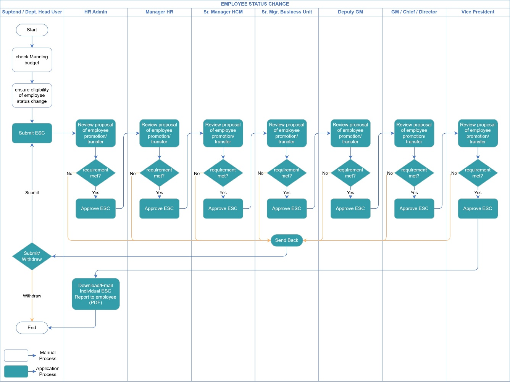

## Expected New System Business Flow

***Guidance:***

- Please describe the expected improved system flow.

- To maximize the understanding of expected new system, consider explaining with process flow in mind.

- Do it step by step from beginning to the end of process

- More complete the explanation will affect the next visual modelling process.

### Employee Status Change (Standard Workflow)

1. **Superintendent / Department Head** mengajukan Employee Status Change.
2. **HR Admin** melakukan review awal dan menentukan **Workflow Approval**.
3. Pengajuan diproses melalui approval berjenjang hingga **Vice President** (tergantung workflow yang ditentukan **HR Admin**).
4. Setiap approver dapat **Approve** atau **Send Back**.

   1. Jika **Send Back**, form akan dikirim kembali kepada pengaju dan semua approver yang sudah melakukan approval akan diberikan notifikasi, setelah itu pengaju dapat melakukan revisi dan **Submit** ulang, atau melakukan **Withdraw** pengajuan tersebut.

      1. Jika Pengaju melakukan **Submit**, maka flow kembali ke point 2.
      2. Jika Pengaju melakukan Withdraw, maka form akan berubah statusnya menjadi **Withdrawed** dan tidak bisa di-submit kembali.
5. Setelah seluruh approval selesai, **HR Admin** dapat melakukan generate **Individual Employee Status Change Report**.
6. Sistem menampilkan status proses serta mengirimkan notifikasi selama proses approval berlangsung.

### Employee Status Change (Promotion & Transfer)

1. **Superintendent / Department Head** mengajukan Employee Status Change.
2. **OD Section** melakukan review pengajuan terhadap manning budget dan eligibility karyawan untuk diberikan Promosi atau Transfer

   1. Jika **Send Back**, form akan dikirim kembali kepada pengaju dan semua approver yang sudah melakukan approval akan diberikan notifikasi, setelah itu pengaju dapat melakukan revisi dan **Submit** ulang, atau melakukan **Withdraw** pengajuan tersebut.

      1. Jika Pengaju melakukan **Submit**, maka pengajuan kembali ke **OD Section** (point 2).
      2. Jika Pengaju melakukan Withdraw, maka form akan berubah statusnya menjadi **Withdrawed** dan tidak bisa di-submit kembali.
3. **HR Admin** melakukan review awal dan menentukan **Workflow Approval**.
4. Pengajuan diproses melalui approval berjenjang hingga **Vice President** (tergantung workflow yang ditentukan **HR Admin**).
5. Setiap approver dapat **Approve** atau **Send Back**.

   1. Jika **Send Back**, form akan dikirim kembali kepada pengaju dan semua approver yang sudah melakukan approval akan diberikan notifikasi, setelah itu pengaju dapat melakukan revisi dan **Submit** ulang, atau melakukan **Withdraw** pengajuan tersebut.

      1. Jika Pengaju melakukan **Submit**, maka pengajuan langsung menuju ke **HR Admin** (point 3) melewati/bypass **OD Section**.
      2. Jika Pengaju melakukan Withdraw, maka form akan berubah statusnya menjadi **Withdrawed** dan tidak bisa di-submit kembali.
6. Setelah seluruh approval selesai, **HR Admin** dapat melakukan generate **Individual Employee Status Change Report**.
7. Sistem menampilkan status proses serta mengirimkan notifikasi selama proses approval berlangsung.

### Employee Status Change (Standard Workflow) Activity Diagram

### Employee Status Change (Promotion & Transfer) Activity Diagram

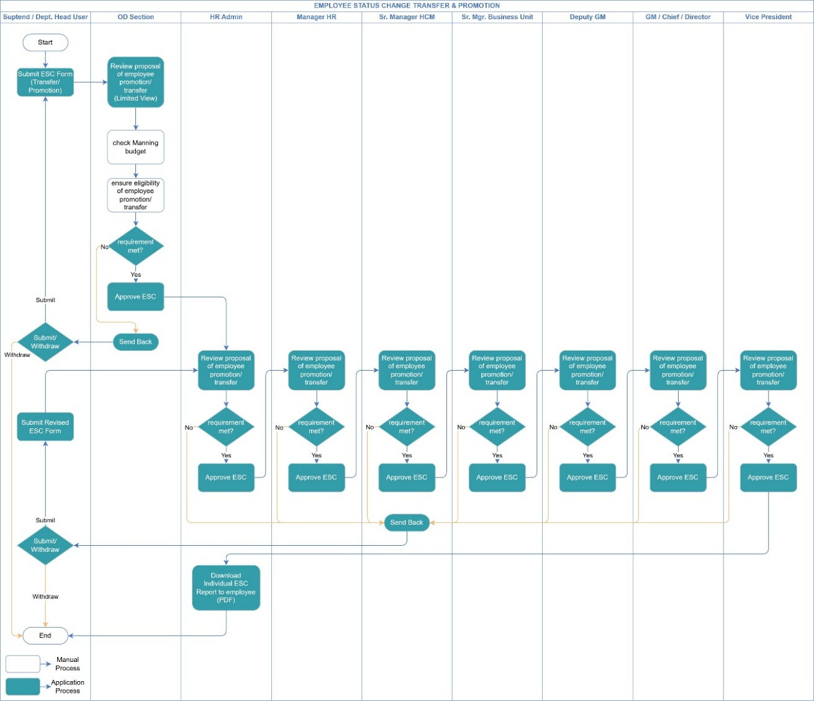

## Business Rules

### Employee Status Changes Policies / Business Rules

- Seluruh perubahan Employee Status Change disimpan sebagai histori.
- Riwayat approval dan komentar tidak dapat dihapus.
- Employee hanya dapat melihat Employee Status Change terakhir miliknya.
- Delegate hanya dapat mendelegasikan approval miliknya sendiri.
- Sistem mengirimkan notifikasi kepada approver berikutnya setiap kali terjadi Submit atau Approve.
- Reminder via email & in apps dikirim setiap dua hari hingga approver memberikan keputusan.
- Send Back mengirimkan notifikasi kepada Requester dan approver yang telah menyelesaikan approval sebelumnya.
- Withdraw hanya mengirimkan notifikasi kepada Role sesuai konfigurasi (Default: HR Admin).
- Employee Status Change baru hanya dapat diajukan apabila tidak ada pengajuan lain atas nama & id karyawan tersebut
- Seluruh field pada Employee Status Change bersifat mandatory, kecuali Competency Assessment Matrix (CAM) yang hanya wajib untuk karyawan Non-Staff.
- Approve tidak mewajibkan pengisian komentar.
- Send Back mewajibkan pengisian komentar.
- Pengajuan yang berstatus Send Back hanya dapat direvisi oleh Requester.
- HR Admin dapat mengubah Next Approver kapan saja selama proses approval masih berlangsung.
- Perubahan data hanya akan berlaku setelah approval selesai dan effective date berlangsung
- Annual Bonus & Vehicle Allowance hanya muncul ketika mengajukan ESC untuk Senior Manager dan role di atasnya
- ESC yang diajukan oleh Dept Head, tidak dapat diakses oleh karyawan yang bersangkutan

### Demotion Policy

Employee Status Change dengan tipe Demotion merupakan proses perubahan posisi karyawan yang bertujuan untuk memastikan karyawan ditempatkan pada posisi yang sesuai dengan kompetensi, kualifikasi, dan kebutuhan organisasi.

Demotion dapat dilakukan melalui dua mekanisme:

- Voluntary Demotion, yaitu demosi yang dilakukan atas persetujuan atau permintaan karyawan.
- Involuntary Demotion, yaitu demosi yang dilakukan berdasarkan keputusan perusahaan.

Adapun alasan pelaksanaan demosi dapat meliputi:

- Discipline-based
- Ethics-based
- Performance-based

Perubahan akibat proses demosi dapat memengaruhi:

- Grade karyawan
- Posisi dan tanggung jawab pekerjaan
- Compensation & Benefits

Sebelum keputusan demosi dilakukan, perusahaan harus terlebih dahulu mengupayakan tindakan perbaikan yang sesuai, seperti komitmen tertulis untuk melakukan perbaikan kinerja maupun perilaku. Apabila upaya tersebut tidak memberikan hasil yang diharapkan, maka demosi dapat menjadi alternatif penyelesaian sesuai kebijakan perusahaan.

## Functional Requirements

### ESC Request

#### Create Employee Status Change

Sistem harus memungkinkan Requestor membuat pengajuan Employee Status Change untuk jenis perubahan berikut:

- Re-classification
- Transfer
- Working Hours & Working Schedule Change
- Contract Renewal
- Promotion
- Demotion

Pada saat membuat pengajuan, Requestor harus melengkapi seluruh informasi yang diwajibkan, termasuk dokumen pendukung sesuai ketentuan yang berlaku.

Sistem hanya mengizinkan satu Employee Status Change yang masih berstatus **In Progress** untuk setiap karyawan.

#### Edit Employee Status Change

Sistem harus memungkinkan Requestor melakukan perubahan terhadap Employee Status Change yang telah dikembalikan (**Send Back**) oleh approver.

Seluruh perubahan yang dilakukan harus tersimpan pada Activity Log sebagai histori perubahan.

#### Withdraw Employee Status Change

Sistem harus memungkinkan Requestor membatalkan (Withdraw) pengajuan Employee Status Change selama proses approval belum selesai.

Setelah status berubah menjadi **Withdraw**, proses approval dihentikan dan pengajuan tidak dapat diproses kembali.

Sistem akan mengirimkan notifikasi kepada HR Admin ketika pengajuan di-withdraw.

### Approval

#### Approve

Setiap approver dapat melakukan persetujuan apabila pengajuan telah memenuhi persyaratan.

Setelah approval diberikan, sistem akan meneruskan pengajuan kepada approver berikutnya sesuai workflow.

Komentar bersifat opsional pada proses approval.

#### Send Back

Approver dapat mengembalikan pengajuan kepada Requestor apabila diperlukan revisi.

Komentar wajib diisi ketika melakukan Send Back.

Setelah pengajuan dikirim kembali, Requestor dapat memperbaiki data dan mengirimkan ulang pengajuan melalui sistem.

Sistem akan mengirimkan notifikasi kepada Requestor serta seluruh approver yang telah menyelesaikan proses approval sebelumnya.

#### Override Approver

HR Admin dapat mengubah approver berikutnya selama proses approval masih berlangsung apabila diperlukan.

Seluruh perubahan approver harus tercatat pada Activity Log.

#### Delegate Approval

Approver dapat mendelegasikan tugas approval kepada pengguna lain sesuai kewenangan yang dimiliki.

Delegasi hanya berlaku untuk approval milik approver tersebut.

### Employee Status Change Form

Sistem menyediakan satu formulir **Employee Status Change (ESC)** yang digunakan untuk seluruh jenis Employee Status Change.

Form yang ditampilkan kepada pengguna akan disesuaikan dengan peran (role) masing-masing selama proses Employee Status Change.

#### Requestor

Pada tahap pengajuan, Requestor hanya dapat mengisi atau mengubah informasi berikut:

- Employee Status
- Position Title
- Department
- Report To
- Working Schedule & Hours

#### Organization Development (OD)

Pada tahap review, tim Organization Development (OD) hanya dapat melakukan review terhadap informasi berikut:

- Position Title
- Report To
- Position Detail (PD)
- Competency Assessment Matrix (CAM)

#### HR Admin

Pada tahap review, HR Admin memiliki akses untuk:

- Melakukan review seluruh informasi Employee Status Change.
- Mengisi atau memperbarui informasi **Annual Bonus** dan **Vehicle Allowance**, apabila diperlukan.
- Mengubah (override) Next Approver sesuai kebutuhan.

Field **Annual Bonus** dan **Vehicle Allowance** hanya ditampilkan kepada HR Admin.

#### ESC Field Details

| Column/field Name | Data Type | Editable | Mandatory | Default Value | Validation | Data Source |
| --- | --- | --- | --- | --- | --- | --- |
| Name | - | No | No |  |  |  |
| ID Number | - | No | No |  |  |  |
| Date of Hire | - | No | No |  |  |  |
| Reason | Picklist | Yes | Yes |  |  | Reasons |
| Position Description | Attachment | Yes | Yes |  |  |  |
| CAM (Non-staff) | Attachment | Yes | No |  |  |  |
| Justification | Text | Yes | Yes |  |  |  |

#### Employee Old Status

| Column/field Name | Data Type | Editable | Mandatory | Default Value | Validation | Data Source |
| --- | --- | --- | --- | --- | --- | --- |
| Employment Status | - | No | No | Current user data |  |  |
| Position Title | - | No | No | Current user data |  |  |
| Department | - | No | No | Current user data |  |  |
| Report To | Picklist | Yes | No | Current user data |  | User |
| Base Salary | - | No | No | Current user data |  |  |
| Wage Classification | - | No | No | Current user data |  |  |
| Work Schedule | - | No | No | Current user data |  |  |
| Work hours | Picklist | Yes | No | Current user data |  | WorkHours |
| Effective date | - | No | No | Current user data |  |  |

#### Employee New Status

| Column/field Name | Data Type | Editable | Mandatory | Default Value | Validation | Data Source |
| --- | --- | --- | --- | --- | --- | --- |
| Employment Status | Picklist | Yes | Yes |  |  | EmploymentStatus |
| Position Title | Picklist | Yes | Yes |  |  | Positions |
| Department | Text | Yes | Yes |  |  |  |
| Report To | Picklist | Yes | Yes |  |  | User |
| Pay Grade | Picklist | Yes | Yes |  |  | PayGrade |
| Wage Classification | Picklist | Yes | Yes |  |  | WageClassification |
| Work Schedule | Picklist | Yes | Yes |  |  | WorkSchedule |
| Work hours | Picklist | Yes | Yes |  |  | WorkHours |
| Effective date | Date Picker | Yes | Yes |  |  |  |
| Annual Bonus | Numeric | Yes | No |  |  |  |
| Vehicle Allowance | Numeric | Yes | No |  |  |  |
| Base Salary (Filled by HR Only) | Numeric | Yes | Yes |  |  |  |
| Percentage Increase (Filled by HR Only) | Numeric | Yes | Yes |  |  |  |
| Reference Number (Filled by HR Only) | Text | Yes | Yes |  |  |  |

### Attachment

Sistem harus menyediakan fasilitas upload dokumen pendukung pada Employee Status Change.

#### Position Description (PD)

Position Description (PD) merupakan dokumen wajib yang harus dilampirkan pada seluruh jenis Employee Status Change. Format file PDF.

#### Competency Assessment Matrix (CAM)

Competency Assessment Matrix (CAM) wajib dilampirkan untuk Employee Status Change yang diajukan bagi karyawan Non-Staf. Format file PDF.

Untuk karyawan Staff, dokumen CAM tidak diwajibkan.

### Document Generation

Sistem harus menyediakan fasilitas untuk menghasilkan dokumen Employee Status Change setelah proses approval selesai.

#### Individual Employee Status Change Report

HR Admin dapat menghasilkan (generate), dan mengunduh Individual Employee Status Change Report dalam format PDF. Dokumen akan include **digital signature** yang telah diunggah dan tersimpan dan terenkripsi dalam sistem.

Dokumen ini merupakan dokumen resmi hasil Employee Status Change yang telah memperoleh persetujuan.

Dokumen ini juga dapat diakses oleh karyawan yang bersangkutan.

#### Employee Status Change Monitoring Report

HR Admin dapat menghasilkan (generate), dan mengunduh Employee Status Change List Report dalam format XLSX berdasarkan periode yang dipilih.

Dokumen ini merupakan dokumen list dari Employee Status Change yang masih pending maupun yang sudah selesai.

#### Memorandum

Sistem menyediakan fasilitas generate Memorandum berdasarkan periode yang dipilih oleh HR Admin. Dokumen akan include **digital signature** yang telah diunggah dan tersimpan dan terenkripsi dalam sistem.

Memorandum dapat dihasilkan dalam format PDF & DOC.

### Monitoring

Sistem harus menyediakan informasi mengenai status dan perkembangan proses Employee Status Change.

#### Status Monitoring

Sistem menampilkan status terkini setiap Employee Status Change, termasuk posisi approval terakhir.

#### Pending Approval

Sistem menampilkan approver yang sedang memiliki tugas approval sehingga pengguna dapat mengetahui proses sedang berada pada tahapan siapa.

#### History

Requester dapat melihat seluruh histori Employee Status Change yang pernah diajukan.

Employee hanya dapat melihat Employee Status Change terakhir miliknya.

#### Activity Log

Sistem mencatat seluruh aktivitas yang terjadi selama proses Employee Status Change, termasuk:

- Submit
- Approval
- Send Back
- Withdraw
- Override Approver
- Perubahan data pada pengajuan
- Komentar

### Search & Filter

Sistem menyediakan fasilitas pencarian dan penyaringan data Employee Status Change berdasarkan informasi yang tersedia.

Minimal pencarian dapat dilakukan berdasarkan:

- Employee ID
- Employee Name
- Department
- Position
- Employee Status Change Type
- ESC Status
- Request Date
- Effective Date

Sistem juga menyediakan filter berdasarkan periode untuk kebutuhan monitoring maupun pelaporan.

### Integration Trigger

Setelah Employee Status Change memperoleh persetujuan akhir, sistem akan memperbarui data pada modul terkait sesuai jenis perubahan yang diajukan.

Integrasi dapat mencakup:

- Organization Structure
- Position Management
- Employee Job Information
- Reporting Line
- Payroll & Compensation
- Time Management
- Performance Management (PMGM)

Perubahan hanya dilakukan setelah seluruh proses approval selesai.

### Execption Handling

Sistem harus menangani kondisi khusus yang dapat terjadi selama proses Employee Status Change.

#### Multiple Employee Status Change

Sistem tidak mengizinkan Requestor membuat Employee Status Change baru apabila masih terdapat pengajuan lain dengan status **In Progress** untuk karyawan yang sama.

Employee Status Change baru hanya dapat diajukan setelah pengajuan sebelumnya berstatus **Approved** atau **Withdraw**.

#### Withdraw

Apabila Requestor melakukan Withdraw, sistem akan:

- Mengubah status pengajuan menjadi **Withdraw**.
- Mengirimkan notifikasi kepada HR Admin.
- Menyimpan aktivitas tersebut pada Activity Log.

### Notification/Notifikasi

#### 1. Employee Status Change Submitted

**Trigger** : Requestor berhasil mengirim Employee Status Change.

**Recipient** : Next Approver

**Subject** : Employee Status Change Request for **{Employee Name}** Requires Your Approval

##### Email Body :

---

Hello **{Approver Name}**,

An Employee Status Change request for **{Employee Name}** has been submitted by **{Requester Name}** on **{Submission Date}**.

Please review and take the necessary action through the Employee Status Change application.

##### Employee Information

- Employee Name : {Employee Name}
- Employee ID : {Employee ID}
- ESC Type : {ESC Type}
- Effective Date : {Effective Date}

Please review and approve or send back the request.

**Application Link**  
{Application URL}

#### 2. Employee Status Change Approved

**Trigger** : Current approver approves the request.

**Recipient** : Next Approver

**Subject** : Employee Status Change Request for **{Employee Name}** Requires Your Approval

##### Email Body :

---

Hello **{Approver Name}**,

The Employee Status Change request for **{Employee Name}** has been approved by **{Previous Approver}** and is awaiting your review.

Please review the request and take the necessary action.

**Application Link**  
{Application URL}

#### 3. Employee Status Change Sent Back

**Trigger** : Approver melakukan Send Back.

**Recipient** :

- Requester
- Semua approver yang sudah melakukan approval sebelumnya

**Subject** : Employee Status Change Request for **{Employee Name}** Has Been Sent Back

##### Email Body :

---

Hello **{Recipient Name}**,

The Employee Status Change request for **{Employee Name}** has been sent back by **{Approver Name}** on **{Action Date}**.

##### Remarks :

{Send Back Remarks}

Please review the comments, update the request as necessary, and resubmit it through the system.

**Application Link**  
{Application URL}

#### 4. Employee Status Change Resubmitted

**Trigger** : Requester melakukan Submit ulang setelah Send Back.

**Recipient** : First Approver (atau approver sesuai workflow)

**Subject** : Employee Status Change Request for **{Employee Name}** Has Been Resubmitted

##### Email Body :

---

Hello **{Approver Name}**,

The Employee Status Change request for **{Employee Name}** has been revised and resubmitted by **{Requester Name}**.

Please review the updated request.

**Application Link**  
{Application URL}

#### 5. Approval Reminder

**Trigger** : Approval belum diproses selama 2 hari. (configurable)

**Recipient**: Current Approver

**Subject** : Reminder: Employee Status Change Request Awaiting Your Approval

##### Email Body :

---

Hello **{Approver Name}**,

This is a reminder that an Employee Status Change request for **{Employee Name}** is still awaiting your action.

Please review and take the necessary action as soon as possible.

##### Pending Since

{Pending Date}

##### Application Link

{Application URL}

#### 6. Employee Status Change Completed

**Trigger** : Seluruh approval telah selesai.

**Recipient** :

- Requester
- Employee
- HR Admin

**Subject** : Employee Status Change for **{Employee Name}** Has Been Approved

##### Email Body

---

Hello **{Recipient Name}**,

The Employee Status Change request for **{Employee Name}** has been fully approved.

The Individual Employee Status Change Report is now available.

##### Application Link

{Application URL}

#### Notification Matrix

| Event | Recipient |
| --- | --- |
| Submit ESC | Next Approver |
| Approve ESC | Next Approver |
| Send Back | Requester & Previous Approvers |
| Resubmit ESC | Next Approver |
| Withdraw ESC | HR Admin |
| Reminder | Current Approver |
| Completed | Requester / HR Admin |

## User Interface

### Manage My Team

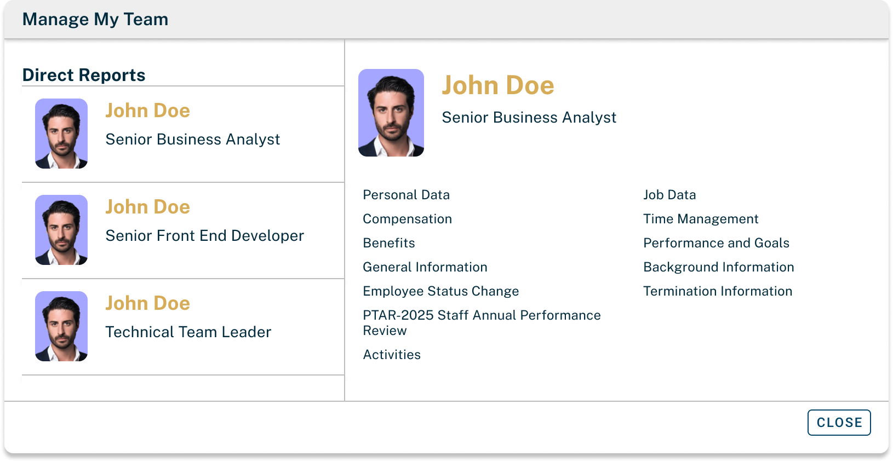

### Employee Files – Employee Status Change (No Data)

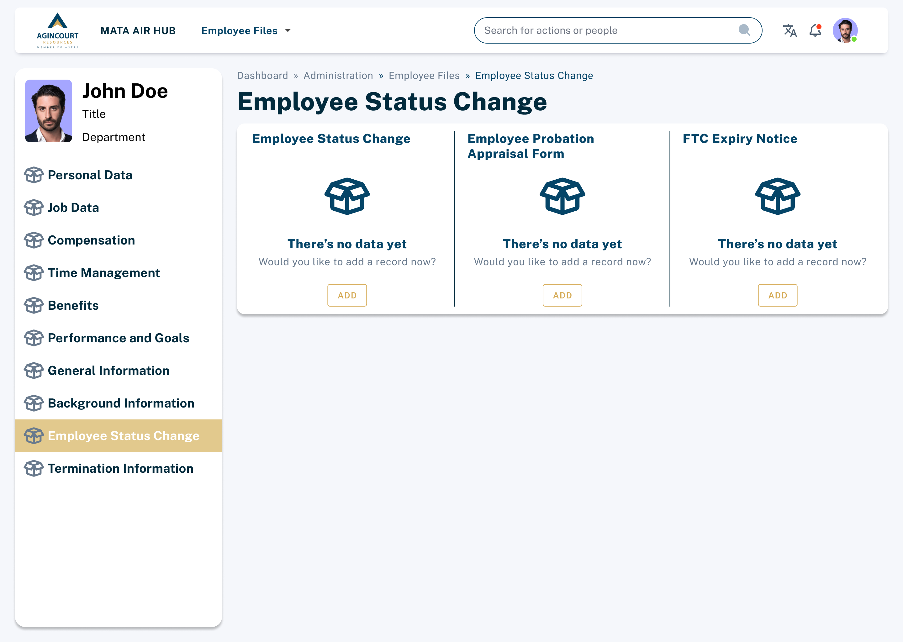

### Employee Files – Employee Status Change (With Last History)

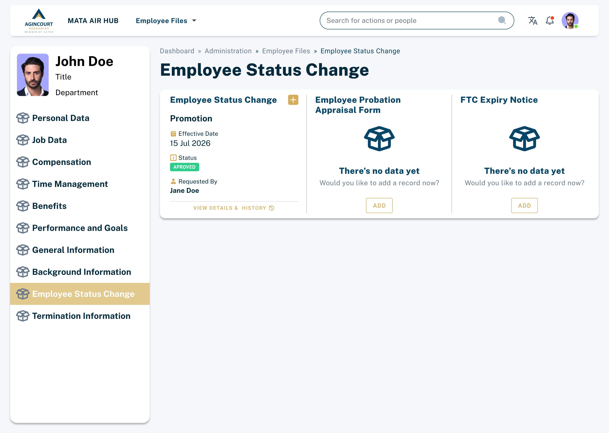

### Employee Status Change Request Form

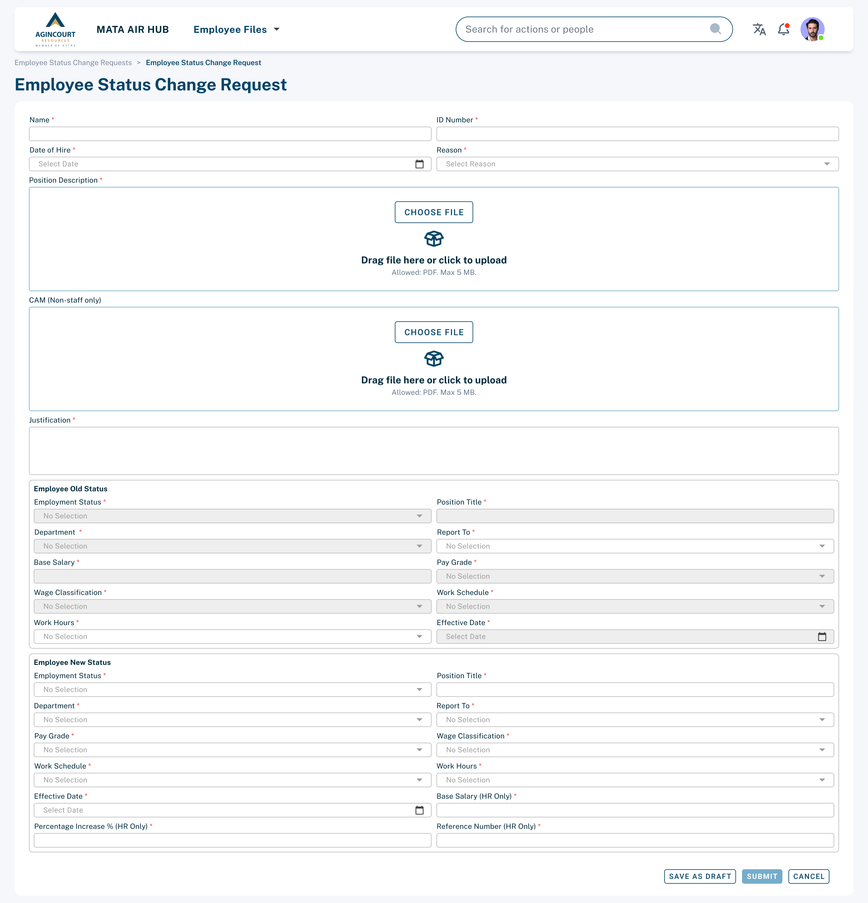

### Employee Status Change History & Details

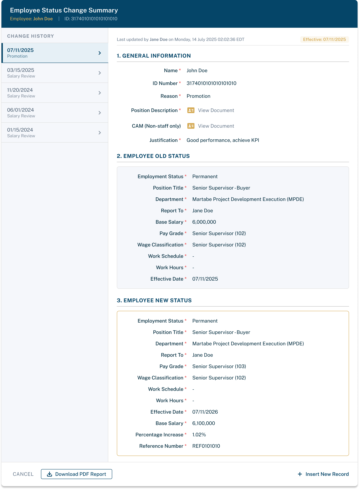

### ESC Pending Requests

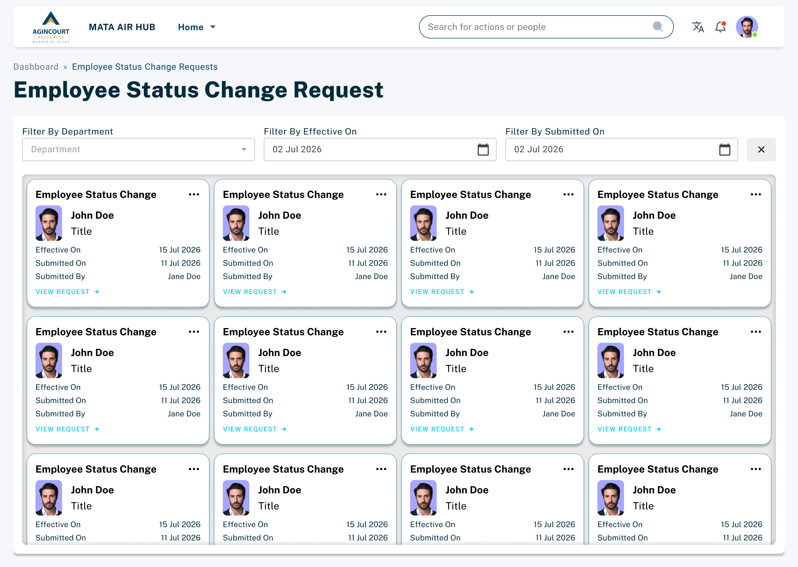

### ESC Monitoring

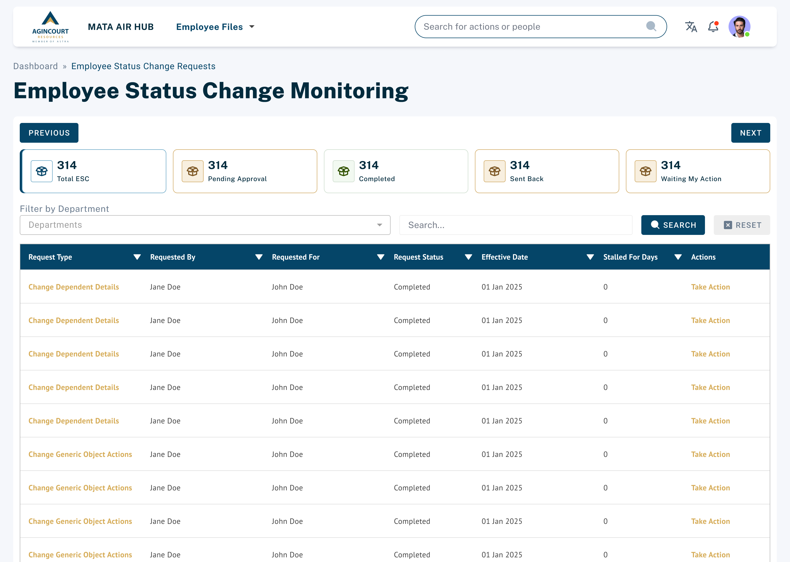

### ESC Approval

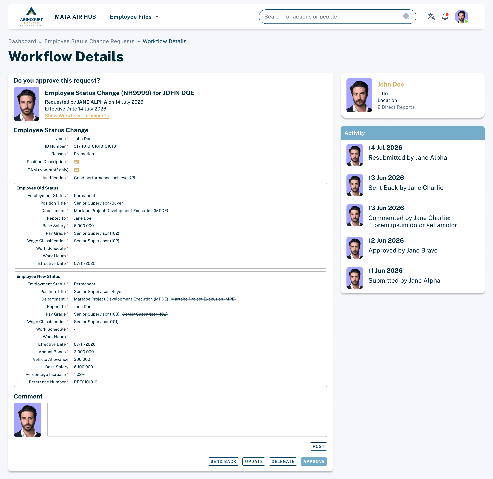

### ESC Update

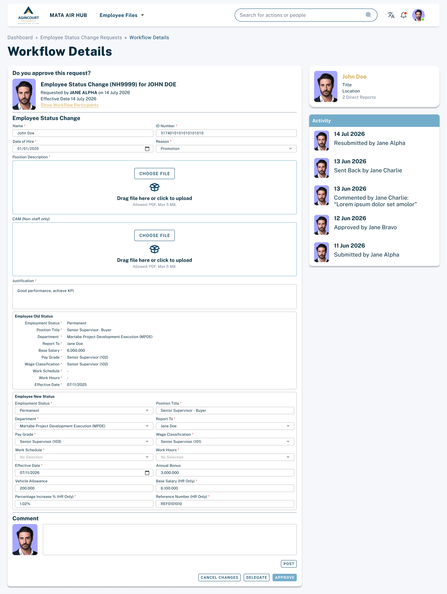

### ESC Approval (OD View)

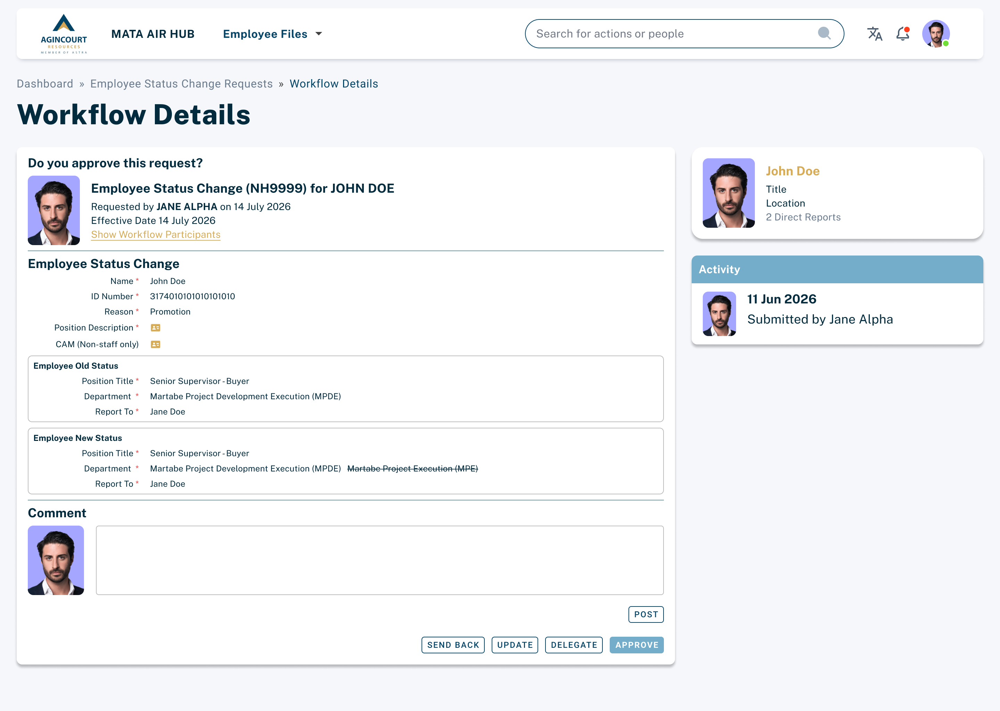

### Workflow Approval

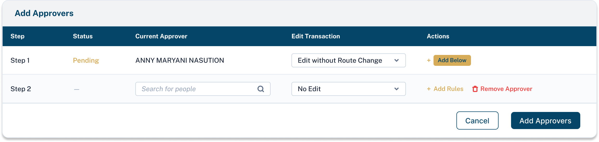

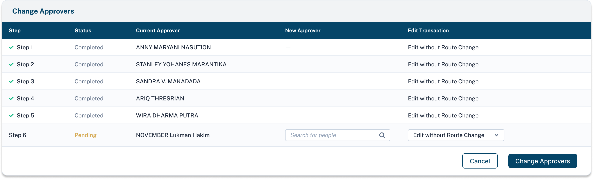

### Delegate

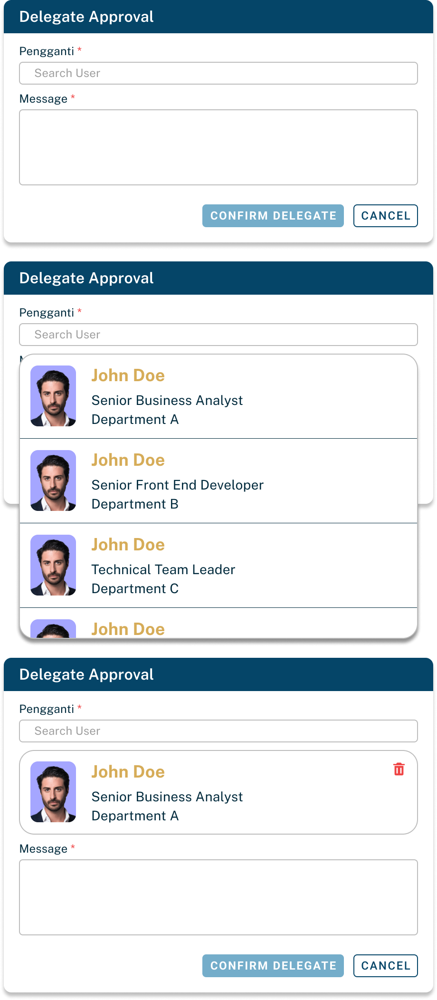

## Validation Rules

### Employee Status Change Validation

| Validation Rule | Error Message |
| --- | --- |
| Sistem hanya mengizinkan satu Employee Status Change dengan status In Progress untuk setiap karyawan. | Backdate maupun Future Date diperbolehkan sesuai kebijakan perusahaan. |
| Backdate maupun Future Date diperbolehkan sesuai kebijakan perusahaan. |  |

### Mandatory Field Validation

| Validation Rule | Error Message |
| --- | --- |
| Seluruh field pada Employee Status Change wajib diisi sebelum Submit. | Please complete all mandatory fields before submitting the request. |
| Annual Bonus dan Vehicle Allowance hanya dapat diisi oleh HR Admin. | You are not authorized to modify this field. |
| Annual Bonus dan Vehicle Allowance tidak ditampilkan kepada user selain HR Admin |  |

### Attachment Validation

| Validation Rule | Error Message |
| --- | --- |
| Position Detail (PD) wajib dilampirkan sebelum Submit. | Position Detail attachment is required. |
| Competency Assessment Matrix (CAM) wajib dilampirkan apabila employee bertipe Non-Staff. | Competency Assessment Matrix attachment is required for Non-Staff employees. |
| CAM tidak diwajibkan untuk employee bertipe Staff. |  |

### Approval Validation

| Validation Rule | Error Message |
| --- | --- |
| Comment tidak wajib diisi ketika Approve |  |
| Comment wajib diisi ketika melakukan Send Back. | Comment is required when sending back the request. |
| Delegate hanya dapat mendelegasikan approval miliknya sendiri. |  |

### Access Validation

| Validation Rule | Error Message |
| --- | --- |
| Hanya HR Admin & Karyawan yang bersangkutan yang dapat mengakses Individual ESC Report. | You are not authorized to perform this action. |
| Employee hanya dapat melihat Employee Status Change terakhir miliknya. | You are not authorized to view this record. |

### Workflow Validation

| Validation Rule | Error Message |
| --- | --- |
| Promotion dan Transfer wajib melalui proses review Organization Development (OD) sebelum memasuki approval workflow utama. |  |
| Jenis ESC selain Promotion dan Transfer langsung mengikuti approval workflow standar. |  |

### Withdrawal Validation

| Validation Rule | Error Message |
| --- | --- |
| Employee Status Change hanya dapat di-Withdraw selama proses approval berada di requester | This request can no longer be withdrawn. |
| Setelah status berubah menjadi Withdraw, pengajuan tidak dapat diproses kembali. | Withdrawn requests cannot be resubmitted. |

### Delegate Validation

| Validation Rule | Error Message |
| --- | --- |
| Hanya approver yang sedang memiliki tugas approval yang dapat melakukan delegasi approval. | Only the current approver can delegate this approval task. |
| Approver hanya dapat mendelegasikan tugas approval miliknya sendiri dan tidak dapat mendelegasikan tugas milik approver lain. | You can only delegate your own approval task. |
| Delegasi hanya dapat dilakukan selama status Employee Status Change masih In Progress. | Delegation is only allowed for requests that are currently in progress. |
| Pengguna yang dipilih sebagai delegate harus merupakan pengguna aktif di dalam sistem. | Selected delegate is not an active user. |
| Sistem hanya mengizinkan satu delegate aktif untuk setiap approval task pada waktu yang sama. | Only one active delegate is allowed for an approval task. |
| Seluruh aktivitas delegasi approval harus dicatat pada Activity Log, termasuk approver asal, delegate, serta tanggal dan waktu perubahan. |  |
| Delegasi tidak mengubah workflow approval maupun urutan approver yang telah dikonfigurasi. Delegate hanya bertindak atas nama approver yang mendelegasikan tugas. |  |
| Seluruh keputusan approval yang dilakukan oleh delegate dicatat atas nama delegate dengan referensi kepada approver yang didelegasikan pada Activity Log. |  |

## Reports

### Individual ESC Report

#### Description

Individual Employee Status Change Report merupakan dokumen resmi yang dihasilkan setelah Employee Status Change memperoleh persetujuan akhir. Dokumen ini digunakan sebagai pemberitahuan resmi kepada karyawan mengenai perubahan status yang telah disetujui oleh perusahaan.

Report dapat di-generate, dan diunduh oleh HR Admin, dan karyawan yang bersangkutan.

#### Report Access

- HR Admin
- Employee

#### Output Format

- PDF

#### Trigger

Report dapat dihasilkan setelah seluruh proses approval Employee Status Change selesai.

#### Report Content

Laporan menampilkan informasi berikut:

- **Employee Information**
  - Employee Name
  - Employee ID
  - Date of Hire
  - ESC Type

#### Comparison of Previous and New Information

| Old Information | New Information |
| --- | --- |
| Employment Status | Employment Status |
| Position Title | Position Title |
| Department | Department |
| Report To | Report To |
| Monthly Base Salary | Monthly Base Salary |
| Grade | Grade |
| Wage Classification | Wage Classification |
| Working Schedule & Hours | Working Schedule & Hours |
| Effective Date | Effective Date |

Laporan menampilkan informasi **sebelum** dan **sesudah** perubahan sehingga pengguna dapat dengan mudah membandingkan perubahan status karyawan.

### Employee Status Change Monitoring Report

Employee Status Change Monitoring Report digunakan untuk memantau seluruh pengajuan Employee Status Change berdasarkan status dan periode tertentu.

#### Report Owner

HR Admin

#### Output Format

- XLSX

#### Report Content

- Request Number
- Employee Name
- Employee ID
- ESC Type
- Department
- Effective Date
- Current Status
- Current Pending Approver
- Request Date

### Memorandum

Organization Announcement Memorandum merupakan dokumen resmi perusahaan yang digunakan untuk mengumumkan Employee Status Change yang telah memperoleh persetujuan kepada seluruh karyawan.

Berbeda dengan Individual ESC Report yang hanya menampilkan satu employee, memorandum memuat daftar seluruh Employee Status Change dalam periode tertentu dalam bentuk pengumuman organisasi.

#### Report Owner

HR Admin

#### Output Format

- Microsoft Word
- PDF

#### Trigger

Generate dilakukan secara manual oleh HR Admin dengan memilih periode yang diinginkan.

#### Report Content

Memorandum minimal memuat informasi berikut:

- **Header**
  - Company Logo
  - Memorandum Number
  - Date
  - From
  - To
  - Subject
- **Introduction**
  - Paragraf pembuka yang menjelaskan bahwa perusahaan mengumumkan perubahan organisasi atau Employee Status Change pada periode tersebut.
- **Employee Status Change List**
  - Untuk setiap employee, memorandum menampilkan:
    - Employee Name
    - Department
    - ESC Type
    - New Position
    - New Responsibilities (Narrative)
    - Reporting Line
  - Disusun dalam format bilingual (Bahasa Indonesia dan Bahasa Inggris) sesuai template perusahaan.
- **Closing Statement**
  - Ucapan selamat kepada employee serta harapan perusahaan atas peran dan tanggung jawab baru.
- **Signature**

## Security Requirements

### Encryption

#### Digital Signature

Sistem menyediakan fasilitas Digital Signature pada Employee Status Change Monitoring Report sebagai tanda tangan resmi pejabat yang berwenang.

Authorized Signatory dapat mengunggah (upload) gambar tanda tangan dalam format PNG melalui sistem. Tanda tangan yang telah diunggah akan disimpan secara aman dalam bentuk Base64 yang dienkripsi oleh sistem dan akan digunakan secara otomatis pada saat report di-generate.

Digital Signature hanya dapat dikelola oleh pengguna yang memiliki hak akses sesuai kewenangannya.

### Confidential Field

Beberapa informasi pada Employee Status Change dikategorikan sebagai Confidential Information dan hanya dapat diakses oleh pengguna yang memiliki otorisasi.

Confidential field meliputi:

- Salary
- Annual Bonus
- Vehicle Allowance
- Paygrade

### Report Access

Hak akses terhadap laporan Employee Status Change diatur berdasarkan peran pengguna.

Pengguna tanpa hak akses tidak dapat melakukan:

- Generate report
- Download report
- Share report

### Document Access

Akses terhadap dokumen Employee Status Change mengikuti prinsip **Role-Based Access Control (RBAC)**.

Dokumen hanya dapat diakses oleh pengguna yang memiliki hak akses sesuai proses bisnis.

### Audit Trail

Sistem harus mencatat seluruh aktivitas penting selama proses Employee Status Change berlangsung.

Audit Trail minimal mencatat informasi berikut:

- Create Employee Status Change
- Edit Employee Status Change
- Submit
- Approve
- Send Back
- Withdraw
- Approval Delegation
- Generate Report
- Update Digital Signature

Setiap aktivitas harus menyimpan informasi berikut:

- User
- Role
- Activity
- Date & Time

Audit Trail bersifat **read-only**, tidak dapat diubah maupun dihapus oleh pengguna.

## Sign-off

| Role | Name | Signature | Date |
| --- | --- | --- | --- |
| Business Analyst | Maheswara Sinatriyo |  | 22 Agustus 2026 |
| Project Coordinator | Darren Nurachmad |  |  |
| Business User Expert | Anny Nasution |  |  |
| Business User Expert | Irna Hasibuan |  |  |

> **By signing this document, all items contained herein are confirmed as mandatory requirements to be delivered as the agreed-upon product. Any changes or modifications to these requirements will be managed through the change request process.**
