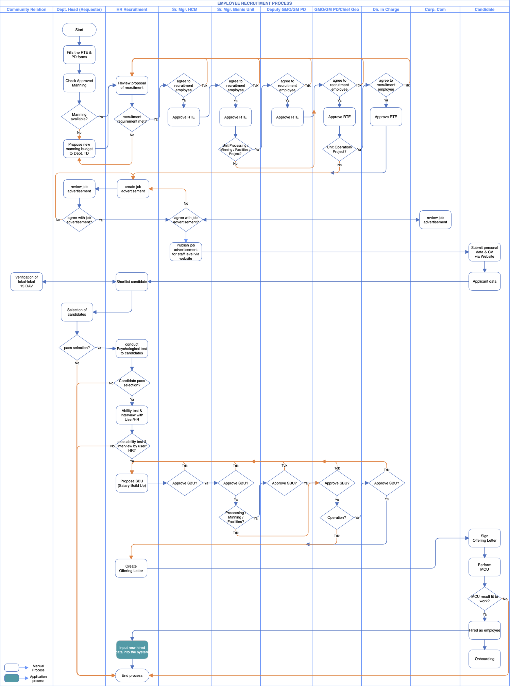
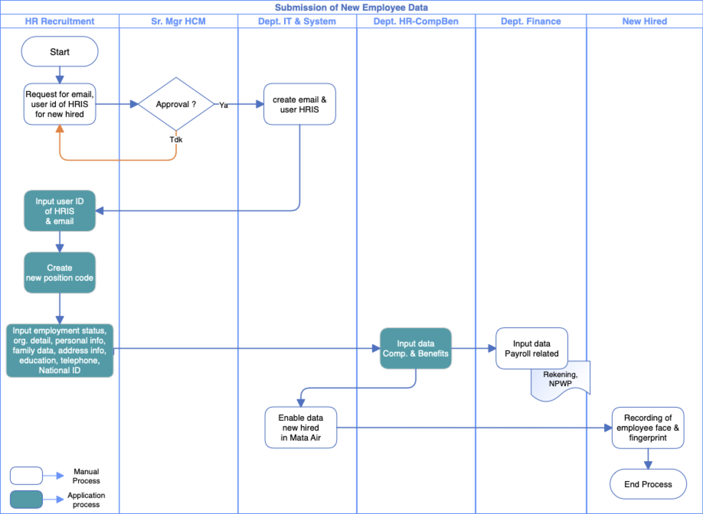
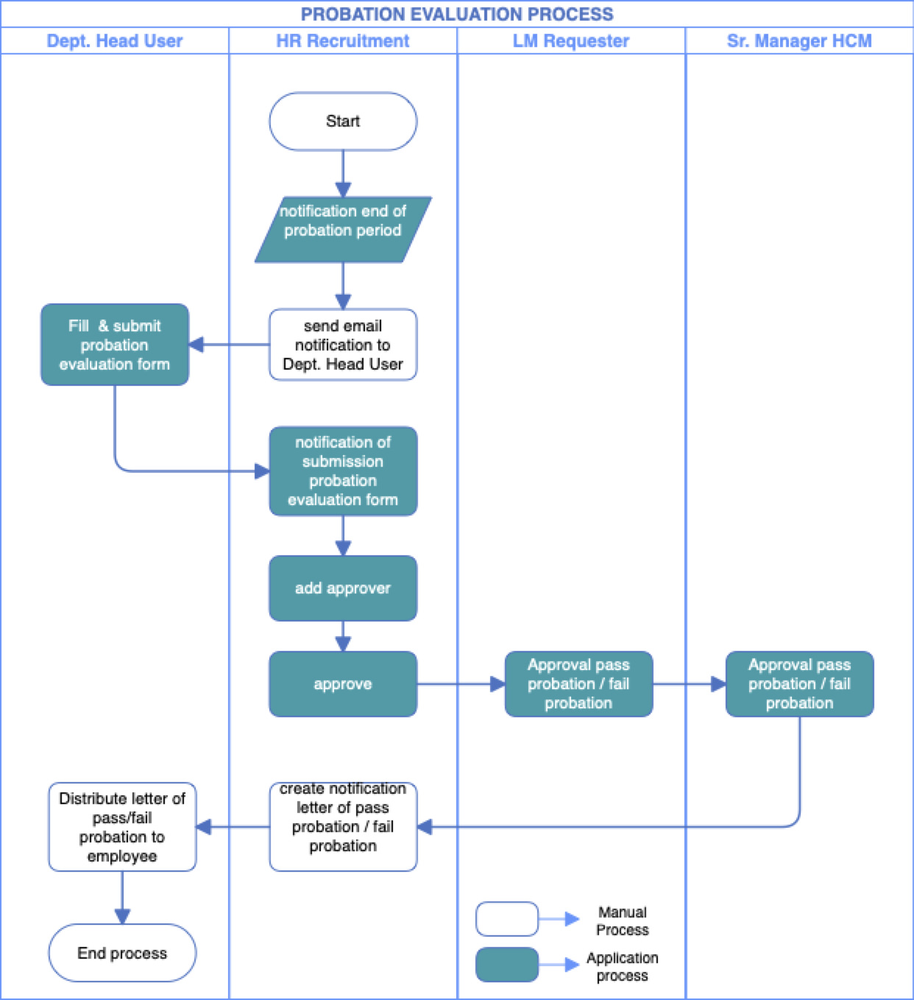
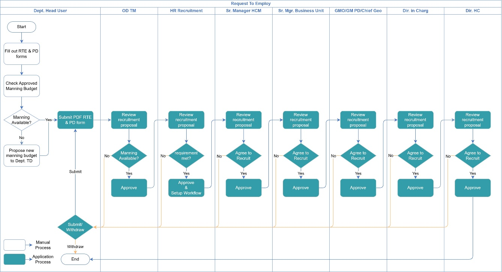
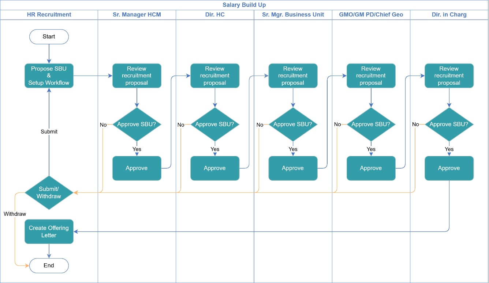
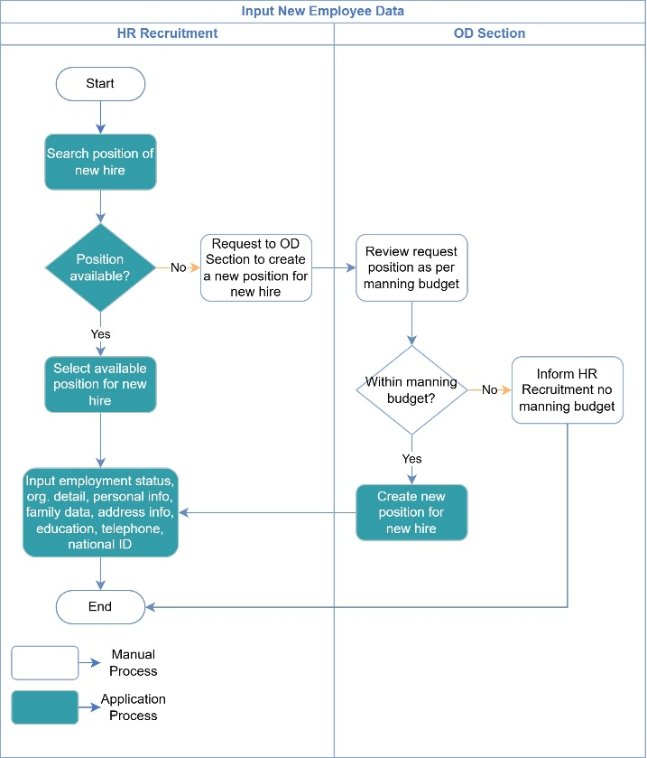
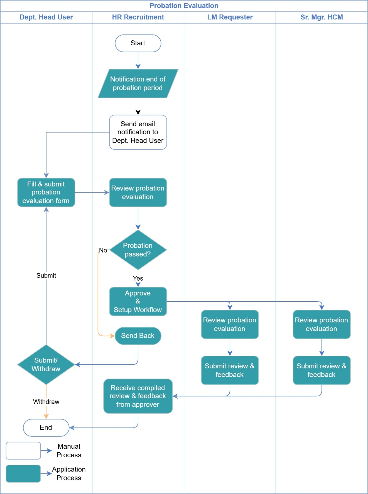

# Business Requirement Assessment - Manage Hiring

**Project:** Mata Air Hub  
**Module:** Manage Hiring  
**Document version:** 1.1  
**Source:** BRD - EC Manage Hiring.docx

## Business Requirement Record

| Start Date | End Date | Author | Version Doc | Change Reference |
| --- | --- | --- | --- | --- |
| 9 Oct 2026 |  | Maheswara Sinatriyo | 0.1 | Drafting |
|  |  | Maheswara Sinatriyo | 1.0 | Issued for Review |

## Log Changes

**Description:** Describe the changes which impact to the Module

***Guidance:***

* Provide the name, detail changes and severity of the changes, e.g. Mr. X request for change on workflow due to new policy on dd/mmm/yyyy, etc

* Please identify all the changes clearly include impact to another module or infrastructure (if any).

### Change Record

| Date | Requested by | Description | Severity (major/minor) | Status |
| --- | --- | --- | --- | --- |
|  |  |  |  |  |
|  |  |  |  |  |

## Project Description

**Project:** Mata Air Hub  
**Business User Expert:** Anny Nasution / Agung Wahyudiono  
**Assessment Date:** 8 Sep 2026  
**Module Description:** Manage Hiring

## Requirement Identification

### WHY - Module Objectives/Goals and Benefits

> Explain why this module is needed

***Guidance:***

\*Module Objectives/Goals: Your expected objectives on this module

e.g. decreasing numbers of paper used

* Module Benefits: The outcome of successful objectives/goals e.g. reducing the paper consumption cost

| Module Objectives/Goals | Module Benefits |
| --- | --- |
| Memastikan proses pengajuan Request to Employ (RTE) dan Salary Build Up (SBU) berjalan secara terstruktur sesuai alur dan kewenangan approval yang berlaku. | Meningkatkan keteraturan proses pengajuan dan memastikan setiap permintaan hiring ditinjau oleh pihak yang berwenang. |
| Memastikan kebutuhan hiring sesuai dengan approved manning budget dan ketersediaan posisi dalam struktur organisasi. | Mengurangi risiko hiring di luar anggaran atau menggunakan posisi yang belum tersedia dan membantu menjaga kesesuaian kebutuhan tenaga kerja dengan perencanaan organisasi. |
| Menyediakan mekanisme pengisian dan pengelolaan informasi SBU secara terstruktur, termasuk informasi demografi hiring, perbandingan internal, riwayat pekerjaan sebelumnya, serta salary dan compensation. | Memudahkan proses evaluasi dan review kandidat melalui informasi yang terorganisasi dan mendukung pertimbangan penawaran kompensasi secara lebih konsisten. |
| Memastikan informasi posisi dan data karyawan baru dicatat secara lengkap berdasarkan posisi yang tersedia atau posisi baru yang telah ditinjau oleh OD Section. | Mengurangi risiko ketidaksesuaian data posisi dan meningkatkan konsistensi informasi karyawan baru pada proses administrasi HR. |
| Memfasilitasi proses evaluasi probation melalui pengisian formulir, review, dan pengumpulan feedback dari pihak terkait. | Membantu HR dan atasan terkait memantau penyelesaian evaluasi probation serta mendokumentasikan hasil evaluasi dan feedback dalam satu proses yang terstruktur. |
| Menyediakan visibilitas terhadap status pengajuan, hasil approval, dan aktivitas proses hiring sesuai kewenangan masing-masing pihak. | Memudahkan pemantauan progres hiring, meningkatkan transparansi proses, dan membantu penelusuran riwayat aktivitas pengajuan. |

### WHAT - Features and Scope

> Describe the expected function or features on the app

***Guidance:***

* In scope: Explain the expected function / feature to be included e.g.the reporting must in excel, must be easy to use in mobile, etc

* Out scope: Explain what function that exist on the current/manual system that should not be considered e.g. no need to add 3rd party account on login, etc

* Make sure to put anything that you can think about the scope

#### In Scope

##### Request to Employ (RTE)

Pembuatan dan pengajuan Request to Employ oleh Department Head User, meliputi:

- Workflow approval Request to Employ (RTE) dan Position Description (PD).
- Pengajuan RTE beserta PD form dalam format PDF untuk proses review dan approval.
- Penyediaan informasi pengajuan RTE untuk mendukung proses review kebutuhan hiring.

- Penyampaian informasi kepada HR Recruitment apabila permintaan posisi tidak memenuhi ketentuan manning budget.

##### Approval Workflow

Pengelolaan proses review, approval, dan pengembalian pengajuan hiring, meliputi:

- Penyediaan workflow approval RTE secara berjenjang dari OD TM, HR Recruitment, Sr. Manager HCM, Sr. Manager Business Unit, GMO/GM PD/Chief Geo, Director in Charge, hingga Director of HC sesuai alur yang berlaku.
- Penyediaan workflow approval SBU sesuai urutan approver pada diagram Salary Build Up.
- Penyediaan tindakan Approve, Send Back, Submit, dan Withdraw sesuai kewenangan dan status pengajuan.
- Pengembalian pengajuan melalui mekanisme Send Back apabila terdapat informasi yang perlu diperbaiki.
- Kewajiban pemberian komentar oleh user apabila terdapat perubahan form selama proses approval.
- Pembatasan akses OD TM untuk melihat status approval sampai dengan level kewenangannya.

- Pembatasan hak edit approver pada form RTE dan SBU; perbaikan dilakukan melalui mekanisme Send Back.

##### Salary Build Up (SBU)

Penyediaan form SBU untuk mendukung evaluasi dan review informasi kandidat serta kompensasi, meliputi:

- Pengisian informasi SBU dan pengajuan untuk review serta approval sesuai workflow.
- Penyediaan Hiring Demographic Information dalam bentuk infografis berdasarkan struktur organisasi Division, Department, dan Section.
- Penyajian informasi demografi Gender untuk Staff dan Non-Staff.
- Penyajian informasi Religion dan Manpower khusus untuk Staff.
- Penyajian informasi Grade kepada approver sebagai referensi tanpa hak untuk mengubah Grade.
- Penyediaan Internal Comparison yang memungkinkan user menambahkan lebih dari satu data pembanding.
- Penyediaan Previous Employment dalam bentuk tabel yang mendukung lebih dari satu riwayat perusahaan atau tempat kerja.
- Penyediaan informasi previous salary dan salary components sebelumnya sebelum bagian PTAR Offer.
- Penyediaan penambahan Salary Component secara manual sesuai kebutuhan.

- Penyediaan pilihan dropdown/list untuk Employment Status dan Work Roster Cycle pada bagian PTAR Offer.

##### Input New Employee Data

Penyediaan proses pencatatan data karyawan baru setelah kebutuhan posisi ditentukan, meliputi:

- Pencarian posisi yang tersedia untuk karyawan baru oleh HR Recruitment.
- Pemilihan posisi yang tersedia.
- Pencatatan data karyawan baru setelah posisi tersedia atau dibuat melalui proses yang berlaku.

- Pengisian informasi karyawan baru, meliputi employment status, organizational details, personal information, family data, address information, education, telephone, dan national ID.

##### Probation Evaluation

Pengelolaan evaluasi karyawan pada akhir masa probation, meliputi:

- Penyampaian notifikasi berakhirnya masa probation kepada Department Head User.
- Pengisian dan pengajuan formulir probation evaluation oleh Department Head User.
- Pengembalian evaluasi kepada Department Head User melalui mekanisme Send Back apabila evaluasi belum memenuhi kebutuhan review.
- Review probation evaluation dan penyampaian feedback oleh LM Requester dan Sr. Manager HCM.

- Penerimaan dan kompilasi hasil review serta feedback oleh HR Recruitment.

##### Notification

Penyediaan notifikasi untuk mendukung kelancaran proses hiring, meliputi:

- Notifikasi kepada Department Head User mengenai berakhirnya masa probation.

- Notifikasi melalui email kepada pihak terkait sesuai pemicu dan tahapan proses yang ditentukan.

**\*Detail notifikasi akan dibahas pada bagian Functional**

##### Data Migration

- Migrasi data historis Manage Hiring 2021-latest

##### Integration

- Integrasi dengan Employee Central – Position Management, untuk pengambilan data position.
- Integrasi dengan Employee Central – Organization Structure, untuk penampilan demogafis karyawan.
- Integrasi dengan Employee Central, untuk pengambilan data karyawan sebagai pembanding.

#### Out Scope

##### Recruitment & Candidate Sourcing

- Publikasi lowongan kerja, pencarian kandidat, dan pengelolaan database kandidat.
- Proses seleksi kandidat, termasuk psikotes, interview, dan penilaian kandidat sebelum penetapan kandidat untuk proses hiring.

##### Organizational Structure

- Perubahan atau pemeliharaan struktur organisasi dan master data posisi di luar proses permintaan posisi baru untuk kebutuhan hiring.

**\*** Proses tersebut tetap dikelola melalui modul **Organization Structure.**

##### Manning Budget Maintenance

- Penetapan, perubahan, atau persetujuan kebijakan dan alokasi manning budget di luar mekanisme pengajuan yang telah didefinisikan.

##### Employee Personal Information Maintenance

- Perubahan atau pemeliharaan data personal, keluarga, alamat, pendidikan, nomor telepon, dan national ID karyawan setelah data awal karyawan baru dicatat.

**\*** **Pemeliharaan data karyawan setelah proses input awal dilakukan melalui modul yang menangani Personal Information, sesuai kewenangan yang berlaku**

##### Payroll & Salary Payment Processing

- Perhitungan payroll, pemrosesan pembayaran gaji, dan pelaksanaan pembayaran kompensasi kepada karyawan.
- Pengelolaan administrasi payroll setelah proses hiring dan penawaran kompensasi selesai.

##### Employment Agreement & Pre-Employment Administration

- Pengelolaan dan pemrosesan dokumen perjanjian kerja, termasuk pengiriman, penandatanganan, dan pengarsipan perjanjian.
- Pengelolaan administrasi pra-kerja di luar pencatatan data karyawan baru yang telah didefinisikan dalam Manage Hiring.

##### Probation Policy & Employment Decision

- Penetapan atau perubahan kebijakan masa probation, kriteria kelulusan, dan ketentuan evaluasi karyawan.
- Proses tindak lanjut ketenagakerjaan setelah hasil evaluasi probation, seperti perpanjangan probation, pemutusan hubungan kerja, atau perubahan status karyawan, apabila tidak termasuk dalam workflow yang disepakati.

### WHEN - Milestones

> Describe the expected completion dates on required milestone

***Guidance:***

* Explain the expected milestone complete with expected start and end dates e.g. system must ready to used in dd/mm/yyyy, should be presented on management meeting on dd/mm/yyyy

| Milestones | Due Date | Remarks |
| --- | --- | --- |
| User Requirement | 15 Jul 2026 | Benefits Submission |
|  |  |  |

### WHO - Roles and Accessibilities

> Describe how many roles will be interact with this Module

***Guidance:***

* Provide the role, assigned to and accessibilities on each role that will be included in the module e.g. HR as admin apps will be responsible to provide setting on the current process.

* Please identify all the participated person in your area to have a clear roles assignment.

#### Department Head User

##### Request to Employ (RTE)

- Mengisi form RTE dan Position Description (PD).
- Memeriksa ketersediaan approved manning budget.
- Mengajukan usulan manning budget baru apabila diperlukan.
- Submit pengajuan RTE dan PD form.

##### Probation Evaluation

- Mengisi dan submit formulir probation evaluation.
- Memperbaiki dan submit ulang evaluasi yang dikembalikan melalui Send Back.

#### OD TM / OD Section

##### Request to Employ (RTE)

- View dan review pengajuan RTE beserta PD form.
- Memeriksa ketersediaan manning budget pada tahap review.
- Approve atau Send Back pengajuan sesuai workflow.
- Melihat status approval sesuai kewenangan yang diberikan.

#### HR Recruitment

##### Request to Employ (RTE)

- View dan review pengajuan RTE.
- Memeriksa kesesuaian kebutuhan recruitment.
- Approve atau Send Back pengajuan sesuai workflow.

##### Input New Employee Data

- Mencari dan memilih posisi yang tersedia untuk karyawan baru.
- Mengajukan permintaan pembuatan posisi kepada OD Section apabila posisi belum tersedia.
- Menginput data karyawan baru sesuai field yang disediakan.

##### Probation Evaluation

- Menerima notifikasi menjelang akhir masa probation Employee.
- Review hasil evaluasi probation.
- Menerima dan mengompilasi review serta feedback dari approver terkait.

#### Hiring Approver

**Assigned to:** Sr. Manager HCM, Sr. Manager Business Unit, GMO/GM PD/Chief Geo, Director in Charge, dan Director of HC

##### Request to Employ (RTE)

- View dan review pengajuan RTE.
- Approve atau Send Back pengajuan sesuai tahapan dan kewenangan masing-masing.

##### Salary Build Up (SBU)

- View dan review informasi SBU.
- Approve atau Send Back pengajuan sesuai tahapan dan kewenangan masing-masing.
- Melihat informasi Grade tanpa mengubah nilainya.

#### Probation Reviewer

**Assigned to:** LM Requester dan Sr. Manager HCM

##### Probation Evaluation

- View dan review hasil evaluasi probation.
- Submit review dan feedback terhadap evaluasi probation.

### WHAT IF - Risks and Mitigation

> Identify the risk and impact of the module

***Guidance:***

* Explain the risk that might be a barrier / obstacle for this module. e.g. the procedure does not exist, need to be confirmed by BOD, etc

* Please think of any risk that might be impacted related to this module

| Risks | Level (Hi, Med, Low) |
| --- | --- |
| Pengajuan Request to Employ (RTE) dilakukan tanpa ketersediaan approved manning budget sehingga kebutuhan hiring tidak sesuai dengan perencanaan tenaga kerja. | Hi |
| Data karyawan baru yang dimasukkan tidak lengkap atau tidak sesuai dengan posisi dan informasi organisasi yang dipilih. | Med |
| Pengajuan dikembalikan melalui Send Back tetapi tidak diperbaiki dan disubmit ulang sehingga proses hiring tidak dapat dilanjutkan. | Med |

#### Mitigasi

- Sistem menyediakan workflow kepada Tim OD untuk melakukan validasi ketersediaan approved manning budget sebelum pengajuan RTE dilanjutkan ke tahap berikutnya.

- Sistem menyediakan field input data karyawan baru berdasarkan kategori informasi yang telah ditentukan dan validasi kelengkapan field wajib sesuai ketentuan yang disepakati.

- Sistem menyediakan status Send Back beserta komentar reviewer agar pengaju mengetahui perbaikan yang diperlukan sebelum melakukan submit ulang.

## Current System Business Flow (As-Is)

**Guidance:**

* Please describe the current system that running / being used in essay.

* To maximize the understanding of current system, consider explaining with process flow in mind.

* Do it step by step from beginning to the end of process

* Example on essay (in Bahasa) :

“Mr. X mengisi formulir exit form kemudian memintakan approval kepada department head. Setelah di approve, form kemudian diserahkan pada security pada saat user x berada di gerbang dan akan keluar dari area camp.”

* More complete the explanation will affect the next visual modelling process.

### Request to Employ (RTE)

Proses Request to Employ (RTE) saat ini masih dilakukan secara manual, mulai dari pengisian form RTE dan Position Description (PD), pemeriksaan approved manning budget, hingga proses review dan approval berjenjang. Seluruh aktivitas dilakukan di luar aplikasi Employee Central.

### Salary Build Up (SBU)

Proses Salary Build Up (SBU) saat ini masih dilakukan secara manual, mulai dari penyusunan SBU, pengaturan workflow, hingga proses review dan approval berjenjang. Seluruh aktivitas dilakukan di luar aplikasi Employee Central.

### Input New Employee data

#### 1. Start dan Permintaan Akun HRIS

**Pelaksana:** HR Recruitment  
**Jenis Proses:** Manual Process

HR Recruitment memulai proses dengan mengajukan permintaan email dan user ID HRIS untuk karyawan baru kepada Sr. Manager HCM.

#### 2. Approval Permintaan Akun

**Pelaksana:** Sr. Manager HCM  
**Jenis Proses:** Manual Process

Sr. Manager HCM melakukan review dan menentukan apakah permintaan email dan user ID HRIS untuk karyawan baru disetujui.

- **Yes:** Permintaan disetujui dan dilanjutkan kepada Department IT & System untuk pembuatan akun.
- **No:** Permintaan dikembalikan kepada HR Recruitment untuk ditindaklanjuti dan diajukan kembali.

#### 3. Pembuatan Email dan User HRIS

**Pelaksana:** Department IT & System  
**Jenis Proses:** Manual Process

Department IT & System membuat email dan user HRIS untuk karyawan baru, kemudian menyampaikan informasi akun kepada HR Recruitment.

#### 4. Input User ID HRIS dan Email

**Pelaksana:** HR Recruitment  
**Jenis Proses:** Application Process

HR Recruitment memasukkan user ID HRIS dan email karyawan baru ke dalam aplikasi.

#### 5. Pembuatan Position Code Baru

**Pelaksana:** HR Recruitment  
**Jenis Proses:** Application Process

HR Recruitment membuat position code baru untuk kebutuhan pencatatan data karyawan baru.

#### 6. Input Data Karyawan Baru

**Pelaksana:** HR Recruitment  
**Jenis Proses:** Application Process

HR Recruitment memasukkan data karyawan baru yang meliputi employment status, organizational details, personal information, family data, address information, education, telephone, dan national ID.

Setelah data diinput, proses dilanjutkan kepada Department HR-CompBen untuk pengisian data kompensasi dan benefit.

#### 7. Input Data Compensation & Benefits

**Pelaksana:** Department HR-CompBen  
**Jenis Proses:** Application Process

Department HR-CompBen memasukkan data kompensasi dan benefit karyawan baru. Setelah itu, proses dilanjutkan kepada Department IT & System untuk mengaktifkan data karyawan baru di Mata Air.

#### 8. Aktivasi Data Karyawan Baru di Mata Air

**Pelaksana:** Department IT & System  
**Jenis Proses:** Manual Process

Department IT & System mengaktifkan data karyawan baru di Mata Air agar data tersebut dapat digunakan dalam proses selanjutnya.

#### 9. Input Data Payroll

**Pelaksana:** Department Finance  
**Jenis Proses:** Manual Process

Department Finance memasukkan data yang berkaitan dengan payroll karyawan baru, termasuk proses rekening dan NPWP sesuai alur yang ditampilkan.

#### 10. Pencatatan Wajah dan Sidik Jari

**Pelaksana:** New Hired  
**Jenis Proses:** Manual Process

Karyawan baru melakukan pencatatan wajah dan sidik jari untuk kebutuhan identifikasi kehadiran.

#### 11. End Process

Proses Submission of New Employee Data berakhir setelah pencatatan wajah dan sidik jari karyawan baru selesai dilakukan.

### Probation Evaluation Process (As-Is)

#### 1. Start dan Notifikasi Akhir Masa Probation

**Pelaksana:** HR Recruitment  
**Jenis Proses:** Application Process

HR Recruitment memulai proses dengan menerima pemicu notifikasi berakhirnya masa probation melalui aplikasi.

#### 2. Pengiriman Notifikasi kepada Department Head User

**Pelaksana:** HR Recruitment  
**Jenis Proses:** Manual Process

HR Recruitment mengirimkan email notifikasi kepada Department Head User untuk melakukan evaluasi probation karyawan.

#### 3. Mengisi dan Submit Probation Evaluation Form

**Pelaksana:** Department Head User  
**Jenis Proses:** Application Process

Department Head User mengisi dan submit formulir probation evaluation melalui aplikasi.

#### 4. Notifikasi Submission Probation Evaluation Form

**Pelaksana:** HR Recruitment  
**Jenis Proses:** Application Process

Setelah formulir disubmit, aplikasi mengirimkan notifikasi submission probation evaluation form kepada HR Recruitment untuk diproses lebih lanjut.

#### 5. Menambahkan Approver

**Pelaksana:** HR Recruitment  
**Jenis Proses:** Application Process

HR Recruitment menambahkan approver yang akan melakukan review dan memberikan keputusan atas hasil evaluasi probation.

#### 6. Approval oleh HR Recruitment

**Pelaksana:** HR Recruitment  
**Jenis Proses:** Application Process

HR Recruitment melakukan approval terhadap pengajuan evaluasi probation. Setelah itu, proses dilanjutkan kepada LM Requester.

#### 7. Approval oleh LM Requester

**Pelaksana:** LM Requester  
**Jenis Proses:** Application Process

LM Requester memberikan keputusan atas hasil evaluasi probation dengan memilih hasil **pass** atau **fail**, kemudian proses dilanjutkan kepada Sr. Manager HCM.

#### 8. Approval oleh Sr. Manager HCM

**Pelaksana:** Sr. Manager HCM  
**Jenis Proses:** Application Process

Sr. Manager HCM memberikan keputusan atas hasil evaluasi probation dengan memilih hasil **pass** atau **fail**. Setelah keputusan diberikan, proses dilanjutkan kembali kepada HR Recruitment.

#### 9. Membuat Notification Letter Probation

**Pelaksana:** HR Recruitment  
**Jenis Proses:** Application Process

HR Recruitment membuat notification letter yang berisi hasil probation, yaitu pass atau fail, berdasarkan hasil approval yang telah diberikan.

#### 10. Distribusi Notification Letter kepada Karyawan

**Pelaksana:** Department Head User  
**Jenis Proses:** Manual Process

Department Head User mendistribusikan notification letter hasil probation kepada karyawan.

#### 11. End Process

Proses Probation Evaluation berakhir setelah notification letter hasil probation didistribusikan kepada karyawan.

### Employee Recruitment Process (RTE & SBU) Activity Diagram

### Input New Employee Data Activity Diagram

### Probation Evaluation Activity Diagram

## Expected New System Business Flow (To-Be)

**Guidance:**

* Please describe the expected improved system flow.

* To maximize the understanding of expected new system, consider explaining with process flow in mind.

* Do it step by step from beginning to the end of process

* More complete the explanation will affect the next visual modelling process.

### Request to Employ (RTE)

#### 1. Department Head User memeriksa approved manning budget.

- Yes: Proses langsung dilanjutkan ke Submit PDF RTE & PD Form.
- No: Department Head User mengusulkan manning budget baru kepada Dept. TD. Setelah itu, proses kembali ke Submit PDF RTE & PD Form.

#### 2. OD TM melakukan review dan validasi manning budget.

- Yes: OD TM memberikan approval dan melanjutkan workflow ke HR Recruitment.
- No: Pengajuan di-send-back ke Requestor.

#### 3. HR Recruitment melakukan review persyaratan recruitment.

- Yes: Pengajuan di-approve dan workflow dilanjutkan ke Sr. Manager HCM.
- No: Pengajuan di-send-back ke Requestor.

#### 4. Approval berjenjang tetap mengikuti urutan berikut:

Sr. Manager HCM → Sr. Manager Business Unit → GMO/GM PD/Chief Geo → Director in Charge → Director of HC.

Pada setiap tahap, approver melakukan review dan memutuskan apakah kebutuhan recruitment disetujui.

Jika **Yes**, pengajuan dilanjutkan ke approver berikutnya.

Jika **No**, pengajuan di-send-back ke Requestor.

#### 5. Submit/Withdraw

- Submit: Pengajuan kembali ke tahap Submit PDF RTE & PD Form untuk diproses kembali.
- Withdraw: Proses berakhir.

#### 6. End

Proses berakhir apabila pengajuan ditarik melalui Withdraw atau telah memperoleh approval akhir dari Director of HC.

### Salary Build Up (SBU)

#### 1. Start dan Pengajuan SBU

**Pelaksana:** HR Recruitment  
**Jenis Proses:** Application Process

HR Recruitment memulai proses dengan mengisi dan mengajukan Salary Build Up (SBU), serta menyiapkan workflow approval untuk ditinjau oleh Sr. Manager HCM.

#### 2. Review SBU oleh Sr. Manager HCM

**Pelaksana:** Sr. Manager HCM  
**Jenis Proses:** Application Process

Sr. Manager HCM melakukan review terhadap pengajuan SBU dan menentukan apakah pengajuan disetujui.

- **Yes:** Sr. Manager HCM memberikan approval dan pengajuan dilanjutkan kepada Director of HC.
- **No:** Pengajuan dikembalikan melalui mekanisme Submit/Withdraw.

#### 3. Review SBU oleh Director of HC

**Pelaksana:** Director of HC  
**Jenis Proses:** Application Process

Director of HC melakukan review terhadap pengajuan SBU yang telah disetujui oleh Sr. Manager HCM.

- **Yes:** Director of HC memberikan approval dan pengajuan dilanjutkan kepada Sr. Manager Business Unit.
- **No:** Pengajuan dikembalikan melalui mekanisme Submit/Withdraw.

#### 4. Review SBU oleh Sr. Manager Business Unit

**Pelaksana:** Sr. Manager Business Unit  
**Jenis Proses:** Application Process

Sr. Manager Business Unit melakukan review terhadap pengajuan SBU yang telah disetujui oleh Director of HC.

- **Yes:** Sr. Manager Business Unit memberikan approval dan pengajuan dilanjutkan kepada GMO/GM PD/Chief Geo.
- **No:** Pengajuan dikembalikan melalui mekanisme Submit/Withdraw.

#### 5. Review SBU oleh GMO/GM PD/Chief Geo

**Pelaksana:** GMO/GM PD/Chief Geo  
**Jenis Proses:** Application Process

GMO/GM PD/Chief Geo melakukan review terhadap pengajuan SBU yang telah disetujui oleh Sr. Manager Business Unit.

- **Yes:** GMO/GM PD/Chief Geo memberikan approval dan pengajuan dilanjutkan kepada Director in Charge.
- **No:** Pengajuan dikembalikan melalui mekanisme Submit/Withdraw.

#### 6. Review SBU oleh Director in Charge

**Pelaksana:** Director in Charge  
**Jenis Proses:** Application Process

Director in Charge melakukan review terhadap pengajuan SBU yang telah disetujui oleh GMO/GM PD/Chief Geo.

- **Yes:** Director in Charge memberikan approval akhir dan pengajuan dilanjutkan ke tahap Create Offering Letter.
- **No:** Pengajuan dikembalikan melalui mekanisme Submit/Withdraw.

#### 7. Submit atau Withdraw Pengajuan

**Pelaksana:** HR Recruitment  
**Jenis Proses:** Application Process

Apabila pengajuan tidak disetujui oleh approver, pengajuan diarahkan ke tahap Submit/Withdraw untuk menentukan tindakan selanjutnya.

- **Submit:** HR Recruitment mengajukan kembali SBU melalui tahap Propose SBU & Setup Workflow untuk diproses kembali melalui workflow approval.
- **Withdraw:** Pengajuan ditarik dan proses berakhir.

#### 8. Create Offering Letter

**Pelaksana:** HR Recruitment  
**Jenis Proses:** Application Process

Setelah pengajuan SBU memperoleh approval dari seluruh approver, HR Recruitment membuat Offering Letter.

#### 9. End

Proses Salary Build Up berakhir setelah Offering Letter dibuat atau pengajuan ditarik melalui Withdraw.

### Input New Employee Data

#### 1. Start dan Pencarian Posisi

**Pelaksana:** HR Recruitment  
**Jenis Proses:** Application Process

HR Recruitment memulai proses dengan mencari posisi yang akan digunakan untuk karyawan baru.

#### 2. Keputusan: Position Available?

**Pelaksana:** HR Recruitment  
**Jenis Proses:** Application Process

HR Recruitment memeriksa apakah posisi yang dibutuhkan tersedia.

- **Yes:** HR Recruitment memilih posisi yang tersedia untuk karyawan baru, kemudian melanjutkan ke tahap Input New Employee Data.
- **No:** HR Recruitment mengajukan permintaan kepada OD Section untuk membuat posisi baru bagi karyawan baru.

#### 3. Review Permintaan Posisi Baru

**Pelaksana:** OD Section  
**Jenis Proses:** Manual Process

OD Section menerima dan melakukan review terhadap permintaan pembuatan posisi baru berdasarkan manning budget.

#### 4. Keputusan: Within Manning Budget?

**Pelaksana:** OD Section  
**Jenis Proses:** Manual Process

OD Section memeriksa apakah permintaan pembuatan posisi baru sesuai dengan manning budget.

- **Yes:** OD Section membuat posisi baru untuk karyawan baru. Setelah posisi dibuat, proses dilanjutkan kembali kepada HR Recruitment untuk Input New Employee Data.
- **No:** OD Section menginformasikan kepada HR Recruitment bahwa tidak tersedia manning budget untuk permintaan posisi tersebut. Proses kemudian berakhir.

#### 5. Input New Employee Data

**Pelaksana:** HR Recruitment  
**Jenis Proses:** Application Process

HR Recruitment menginput data karyawan baru, meliputi employment status, organizational details, personal information, family data, address information, education, telephone, dan national ID.

Tahap ini dilakukan setelah HR Recruitment memilih posisi yang tersedia atau setelah OD Section membuat posisi baru.

#### 6. End

Proses Input New Employee Data berakhir setelah HR Recruitment selesai menginput data karyawan baru, atau ketika permintaan pembuatan posisi baru tidak dapat dilanjutkan karena tidak memenuhi ketentuan manning budget.

### Probation Evaluation

#### 1. Notifikasi Masa Probation

**Pelaksana:** HR Recruitment  
**Jenis Proses:** Application Process

Sistem memicu notifikasi 30 hari dan 14 hari sebelum masa probation berakhir. HR Recruitment kemudian mengirimkan email kepada Department Head User untuk melakukan evaluasi probation.

#### 2. Mengisi dan Submit Probation Evaluation Form

**Pelaksana:** Department Head User  
**Jenis Proses:** Application Process

Department Head User mengisi dan submit formulir probation evaluation melalui aplikasi. Formulir yang telah disubmit diteruskan kepada HR Recruitment untuk direview.

#### 3. Review Probation Evaluation

**Pelaksana:** HR Recruitment  
**Jenis Proses:** Application Process

HR Recruitment melakukan review terhadap formulir probation evaluation yang telah disubmit. Setelah review, HR Recruitment melakukan approval dan mengatur workflow untuk meneruskan evaluasi kepada LM Requester dan Sr. Manager HCM.

#### 4. Review oleh LM Requester

**Pelaksana:** LM Requester  
**Jenis Proses:** Application Process

LM Requester melakukan review terhadap probation evaluation dan submit hasil review serta feedback melalui aplikasi. Proses kemudian dilanjutkan kepada Sr. Manager HCM.

#### 5. Review oleh Sr. Manager HCM

**Pelaksana:** Sr. Manager HCM  
**Jenis Proses:** Application Process

Sr. Manager HCM melakukan review terhadap probation evaluation dan submit hasil review serta feedback melalui aplikasi. Hasil review diteruskan kepada HR Recruitment.

#### 6. Menerima Hasil Review dan Mengunduh Template Notifikasi

**Pelaksana:** HR Recruitment  
**Jenis Proses:** Application Process

HR Recruitment menerima kompilasi hasil review dan feedback dari approver, kemudian mengunduh template notifikasi untuk proses selanjutnya.

#### 7. Pengiriman Email Notifikasi

**Pelaksana:** HR Recruitment  
**Jenis Proses:** Manual Process

HR Recruitment mengirimkan email notifikasi kepada Department Head User setelah menerima hasil review dan mengunduh template notifikasi.

#### 8. End

Proses Probation Evaluation berakhir setelah HR Recruitment mengirimkan email notifikasi kepada Department Head User.

### Request To Employ (RTE) Activity Diagram

### Salary Build Up (SBU) Activity Diagram

### Input New Employee Data Activity Diagram

### Probation Evaluation Activity Diagram

## Business Rules

### Business Rules – Request to Employ (RTE)

- Pengajuan Request to Employ (RTE) dilakukan oleh Department Head User untuk mengajukan kebutuhan hiring.
- Pengajuan RTE harus dilengkapi dengan form RTE dan Position Description (PD).
- Department Head User melakukan pemeriksaan awal terhadap ketersediaan approved manning budget sebelum mengajukan RTE.
- Apabila manning budget belum tersedia, Department Head User mengusulkan manning budget baru kepada Department terkait sebelum melanjutkan pengajuan RTE.
- Pengajuan RTE harus melalui proses review dan approval secara berjenjang sesuai workflow yang berlaku.
- OD TM bertanggung jawab melakukan review terhadap pengajuan RTE dan memvalidasi ketersediaan manning budget pada tahap review.
- HR Recruitment melakukan review terhadap kebutuhan recruitment sebelum pengajuan dilanjutkan kepada approver berikutnya.
- Kebutuhan recruitment harus memperoleh approval dari seluruh approver yang ditetapkan dalam workflow sebelum proses RTE dinyatakan selesai.

### Business Rules – Salary Build Up (SBU)

- Pengajuan SBU dibuat oleh HR Recruitment dan harus mengikuti workflow approval yang berlaku.
- Pengajuan SBU harus melalui review dan approval berjenjang oleh Sr. Manager HCM, Director of HC, Sr. Manager Business Unit, GMO/GM PD/Chief Geo, dan Director in Charge sesuai urutan workflow yang ditetapkan.
- Setiap approver melakukan review dan memberikan keputusan terhadap pengajuan SBU pada tahap kewenangannya.
- Approver tidak dapat melanjutkan pengajuan ke tahap berikutnya apabila pengajuan belum memperoleh approval pada tahap yang sedang berjalan.
- Pengajuan SBU yang tidak disetujui dikembalikan melalui mekanisme Send Back.
- HR Recruitment dapat melakukan submit ulang terhadap pengajuan yang telah diperbaiki melalui mekanisme Submit/Withdraw.
- Offering Letter dibuat oleh HR Recruitment setelah pengajuan SBU memperoleh seluruh approval yang diwajibkan.

### Business Rules – SBU Information

- Informasi Hiring Demographic harus disajikan berdasarkan Division, Department, dan Section.
- Informasi Gender mencakup Staff dan Non-Staff.
- Informasi Religion dan Manpower hanya mencakup Staff.
- Informasi Grade ditampilkan kepada approver untuk keperluan review dan tidak dapat diubah oleh approver.
- Internal Comparison harus mendukung penambahan lebih dari satu data pembanding.
- Previous Employment harus disajikan dalam bentuk tabel untuk menampung riwayat pekerjaan sebelumnya.
- Informasi previous salary dan salary components sebelumnya ditampilkan sebelum bagian PTAR Offer.
- Penambahan Salary Component dilakukan secara manual sesuai kebutuhan.
- Employment Status dan Work Roster Cycle pada bagian PTAR Offer disediakan dalam bentuk dropdown/list.

### Business Rules – Position Availability & Manning Budget

- HR Recruitment harus mencari posisi yang tersedia sebelum melakukan input data karyawan baru.
- Apabila posisi tersedia, HR Recruitment memilih posisi tersebut untuk karyawan baru.
- Apabila posisi tidak tersedia, HR Recruitment mengajukan permintaan pembuatan posisi baru kepada OD TM/OD Section.
- OD TM/OD Section melakukan review terhadap permintaan pembuatan posisi berdasarkan manning budget.
- Posisi baru hanya dibuat apabila permintaan memenuhi ketentuan manning budget.
- Apabila permintaan tidak memenuhi ketentuan manning budget, OD TM/OD Section menginformasikan kepada HR Recruitment bahwa manning budget tidak tersedia.

### Business Rules – New Employee Data

- HR Recruitment melakukan input data karyawan baru setelah posisi tersedia atau telah dibuat oleh OD TM/OD Section.
- Data karyawan baru mencakup employment status, organizational details, personal information, family data, address information, education, telephone, dan national ID.
- Input data karyawan baru harus menggunakan posisi yang tersedia atau posisi baru yang telah dibuat melalui proses yang berlaku.

### Business Rules – Probation Evaluation

- Notifikasi masa probation dijadwalkan pada 30 hari dan 14 hari sebelum masa probation berakhir.
- Department Head User bertanggung jawab mengisi dan submit formulir probation evaluation.
- Formulir probation evaluation yang telah disubmit harus melalui review HR Recruitment.
- LM Requester dan Sr. Manager HCM melakukan review serta menyampaikan hasil evaluasi dan feedback melalui aplikasi.
- HR Recruitment menerima dan mengompilasi hasil review serta feedback dari approver.
- HR Recruitment mengunduh template notifikasi setelah menerima kompilasi hasil review dan feedback dari approver.
- Department Head User bertanggung jawab mendistribusikan notification letter hasil probation kepada karyawan.

### Business Rules – Approval Workflow

- Setiap pengajuan RTE dan SBU harus mengikuti urutan approval sesuai workflow yang ditetapkan.
- Setiap approver hanya melakukan review dan memberikan keputusan pada tahap yang menjadi kewenangannya.
- Pengajuan yang tidak disetujui dikembalikan melalui mekanisme Send Back sesuai workflow.
- Pengajuan yang dikembalikan dapat disubmit ulang oleh pihak pengaju sesuai mekanisme yang berlaku.
- Mekanisme Submit/Withdraw digunakan untuk menentukan apakah pengajuan yang dikembalikan akan diajukan kembali atau ditarik.
- Pengajuan yang ditarik melalui Withdraw mengakhiri proses pengajuan tersebut.

### Business Rules – Notification

- HR Recruitment mengirimkan email notifikasi kepada Department Head User ketika masa probation berakhir.
- Aplikasi mengirimkan notifikasi submission probation evaluation form kepada HR Recruitment setelah formulir disubmit.
- Pihak terkait menerima pengajuan sesuai workflow untuk menjalankan aktivitas review dan approval.
- Detail penerima notifikasi, pemicu notifikasi lainnya, dan isi pesan notifikasi masih perlu dikonfirmasi.

## Functional Requirements

### Request to Employ (RTE)

#### RTE Submission Form

- Sistem menyediakan form atau mekanisme pengajuan Request to Employ (RTE) yang dapat digunakan oleh Department Head User.
- Sistem mendukung pengajuan dokumen RTE dan Position Description (PD) dalam format PDF.
- Sistem menyediakan mekanisme submit pengajuan RTE untuk diteruskan ke proses review oleh OD TM / OD Section.
- Sistem menampilkan informasi pengajuan RTE yang diperlukan oleh pihak terkait untuk melakukan review dan memberikan keputusan.
- Sistem menyediakan fitur pencarian posisi yang dapat digunakan oleh HR Recruitment untuk menemukan posisi bagi karyawan baru.
- Sistem menampilkan informasi posisi yang tersedia untuk membantu HR Recruitment melakukan pemilihan posisi.
- Sistem menyediakan fitur pemilihan posisi yang akan digunakan dalam proses input data karyawan baru.

#### RTE Review & Approval Workflow

- Sistem menyediakan workflow untuk meneruskan pengajuan RTE kepada OD TM / OD Section dan HR Recruitment sesuai tahapan proses yang ditetapkan.
- Sistem menyediakan halaman atau tampilan bagi approver untuk melihat informasi pengajuan RTE yang perlu direview.
- Sistem menyediakan tindakan Approve dan Send Back sesuai kewenangan pengguna pada setiap tahap workflow.
- Sistem meneruskan pengajuan yang telah disetujui ke tahap berikutnya sesuai urutan workflow.
- Sistem menyediakan mekanisme Submit/Withdraw untuk pengajuan yang dikembalikan agar dapat diajukan kembali atau ditarik oleh pihak yang berwenang.
- Sistem menyediakan mekanisme bagi OD TM / OD Section untuk melakukan review permintaan posisi baru berdasarkan informasi manning budget.
- Sistem mendukung penyampaian informasi kepada HR Recruitment apabila permintaan posisi baru tidak dapat dilanjutkan karena manning budget tidak tersedia.

### Salary Build Up (SBU)

#### SBU Form

- Sistem menyediakan form Salary Build Up (SBU) yang dapat diakses oleh HR Recruitment untuk menyusun proposal salary.
- Sistem menyediakan bagian Hiring Demographic Information yang memuat informasi Division, Department, dan Section.
- Sistem menyediakan informasi Gender untuk kategori Staff dan Non-Staff, serta Religion dan Manpower untuk kategori Staff.
- Sistem menyediakan bagian Grade yang dapat dilihat oleh approver sebagai referensi review.
- Sistem menyediakan bagian Internal Comparison yang mendukung penambahan lebih dari satu data pembanding.
- Sistem menyediakan bagian Previous Employment dalam bentuk tabel untuk menampung riwayat pekerjaan sebelumnya.
- Sistem menampilkan informasi previous salary dan salary components sebelum bagian PTAR Offer.
- Sistem menyediakan mekanisme penambahan Salary Component secara manual.
- Sistem menyediakan pilihan Employment Status dan Work Roster Cycle dalam bentuk dropdown/list pada bagian PTAR Offer.

#### SBU Review & Approval Workflow

- Sistem menyediakan workflow approval SBU dengan urutan approver sesuai alur yang ditetapkan.
- Sistem menampilkan informasi dan data SBU yang diperlukan oleh approver untuk melakukan review.
- Sistem menyediakan tindakan Approve dan Send Back pada tahapan workflow yang relevan.
- Sistem meneruskan pengajuan SBU ke approver berikutnya setelah memperoleh approval pada tahap berjalan.
- Sistem menyediakan mekanisme Submit/Withdraw untuk pengajuan yang dikembalikan.
- Sistem menyediakan fitur pembuatan Offering Letter oleh HR Recruitment setelah workflow approval SBU selesai.

### Input New Employee Data

#### Employee Data Entry Form

- Sistem menyediakan form input data karyawan baru yang dapat digunakan oleh HR Recruitment.
- Sistem menyediakan field untuk memasukkan employment status, organizational details, personal information, family data, address information, education, telephone, dan national ID.
- Sistem menyediakan mekanisme pemilihan posisi yang telah tersedia atau dibuat melalui proses pengelolaan posisi.
- Sistem menyediakan field untuk memasukkan user ID HRIS dan email karyawan baru.

#### Employee Data Processing

- Sistem mendukung penyimpanan data karyawan baru yang telah diinput oleh HR Recruitment.
- Sistem menyediakan mekanisme bagi Department HR-CompBen untuk memasukkan data Compensation & Benefits karyawan baru.
- Sistem mendukung proses aktivasi data karyawan baru di Mata Air oleh Department IT & System sesuai alur yang berlaku.
- Sistem mendukung proses input data payroll oleh Department Finance sesuai ruang lingkup data yang ditetapkan.

### Probation Evaluation

#### Probation Evaluation Form

- Sistem menyediakan formulir Probation Evaluation yang dapat diisi dan disubmit oleh Department Head User.
- Sistem menyediakan tampilan bagi HR Recruitment untuk melihat dan melakukan review terhadap formulir probation evaluation yang telah disubmit.
- Sistem menyediakan mekanisme bagi HR Recruitment untuk menambahkan approver ke dalam workflow probation evaluation.
- Sistem menyediakan tampilan bagi LM Requester dan Sr. Manager HCM untuk melakukan review terhadap evaluasi probation.
- Sistem menyediakan mekanisme bagi LM Requester dan Sr. Manager HCM untuk menyampaikan hasil review dan feedback melalui aplikasi.
- Sistem menyediakan tampilan bagi HR Recruitment untuk menerima dan mengompilasi hasil review serta feedback dari approver.

#### Probation Evaluation Workflow

- Sistem mendukung proses review dan approval probation evaluation sesuai urutan workflow yang ditetapkan.
- Sistem menyediakan tindakan Approve dan Send Back sesuai tahapan proses yang berlaku.
- Sistem mendukung pengajuan ulang formulir probation evaluation setelah perbaikan oleh Department Head User.
- Sistem menyediakan mekanisme pembuatan notification letter hasil probation oleh HR Recruitment berdasarkan hasil approval yang berlaku.

### Benefits Submission Field Details

#### Education Claim Form

| **Column/Field Name** | **Data Type** | **Editable** | **Mandatory** | **Note** |
| --- | --- | --- | --- | --- |
| Claim Date | Date Picker | Yes | Yes |  |
| Selected Benefit | Picklist | Yes | Yes | Education Assistance Only |
| Currency | Picklist | No | Yes |  |
| Entitlement Amount | Amount | No | Yes | Calculated by system based on benefit eligibility |
| Name of Student | Text | No | Yes |  |
| Student's Identity Number | Text | Yes | Yes |  |
| Age | Number | No | Yes |  |
| Date of Birth | Date Picker | No | No |  |
| School | Picklist | Yes | Yes |  |
| Grade | Picklist | Yes | No |  |
| Education Year | Text/Number | No | Yes |  |
| Gender of Student | Picklist | No | No |  |
| School's Name | Text | No | Yes |  |
| School Address | Text Area | Yes | No |  |
| Attachment | Attachment | Yes | Yes | Supporting document in PDF format |
| Remarks | Text Area | Yes | No |  |

### Supporting Document

#### Supporting Document Upload

- Sistem menyediakan fitur upload dokumen pendukung pada RTE & Input New Hire Data.
- Sistem hanya menerima dokumen dengan format PDF atau JPG sesuai ketentuan.
- Sistem melakukan validasi terhadap kelengkapan dokumen yang diwajibkan.

### Workflow Management

#### Approval Routing

- Sistem mendukung proses review dan approval probation evaluation sesuai urutan workflow yang ditetapkan.
- Sistem menyediakan tindakan Approve dan Send Back sesuai tahapan proses yang berlaku.
- Sistem mendukung pengajuan ulang formulir probation evaluation setelah perbaikan oleh Department Head User.
- Sistem menyediakan mekanisme pembuatan notification letter hasil probation oleh HR Recruitment berdasarkan hasil approval yang berlaku.

#### Submission & Withdrawal Management

- Sistem mendukung proses review dan approval probation evaluation sesuai urutan workflow yang ditetapkan.
- Sistem menyediakan tindakan Approve dan Send Back sesuai tahapan proses yang berlaku.
- Sistem mendukung pengajuan ulang formulir probation evaluation setelah perbaikan oleh Department Head User.
- Sistem menyediakan mekanisme pembuatan notification letter hasil probation oleh HR Recruitment berdasarkan hasil approval yang berlaku.

### Notification

#### RTE & SBU Notifications

- Sistem mendukung penyampaian informasi pengajuan kepada pihak terkait melalui workflow.
- Sistem menyediakan informasi mengenai pengajuan yang memerlukan review atau tindakan approver.

#### Probation Evaluation Notifications

- Sistem memicu notifikasi 30 hari dan 14 hari sebelum masa probation berakhir.
- Sistem mendukung pengiriman email notifikasi kepada Department Head User untuk melakukan evaluasi probation.

### Data Integration & Dependency

#### Organizational Position Data

- Sistem mendukung penggunaan informasi posisi dan struktur organisasi yang diperlukan dalam proses pengajuan hiring.
- Sistem menyediakan mekanisme penggunaan posisi yang telah tersedia atau dibuat melalui proses pengelolaan posisi.

#### Employee Data Dependency

- Sistem mendukung pengelolaan data karyawan baru yang diperlukan untuk proses administrasi selanjutnya.
- Sistem mendukung alur pemrosesan data karyawan baru oleh HR Recruitment, Department HR-CompBen, Department IT & System, dan Department Finance sesuai tanggung jawab masing-masing.

### Execption Handling

Sistem harus menangani kondisi khusus yang dapat terjadi selama proses **Hiring**.

#### Withdraw

Apabila Requestor melakukan Withdraw, sistem akan:

- Mengubah status pengajuan menjadi **Withdrawn**.
- Mengirimkan notifikasi kepada HR Recruitment.
- Menyimpan aktivitas tersebut pada Activity Log.

### Notification/Notifikasi

#### 1. RTE Submission – Submitted

**Trigger** : Department Head User telah submit pengajuan Request to Employ (RTE).

**Recipient** : HR OD TM / OD Section

**Subject** : Request to Employ (RTE) for **{Department Name}** Requires Your Review

**Email Body :**

---

Hello **{Approver Name}**,

A Request to Employ (RTE) for **{Department Name}** has been submitted by **{Requestor Name}** on **{Submission Date}** and requires your review.

Please review the RTE and Position Description (PD) documents and take the necessary action through the Manage Hiring application.

**Application Link:**  
{Application URL}

#### 2. RTE Send Back

**Trigger** : An approver returns an RTE request for revision.

**Recipient** : Department Head User

**Subject** : Request to Employ (RTE) Requires Revision – **{Department Name}**

**Email Body :**

---

Hello **{Requestor Name}**,

Your Request to Employ (RTE) for {Department Name}, submitted on **{Submission Date}**, has been returned for revision by **{Approver Name}**.

**Application Link:**  
{Application URL}

#### 3. RTE Approval Required

**Trigger** : An RTE request has been approved by the previous approver and forwarded to the next approver.

**Recipient** : Approver

**Subject** : Request to Employ (RTE) Requires Your Approval – {Department Name}

**Email Body :**

---

Hello **{Approver Name}**,

A Request to Employ (RTE) for **{Department Name}** has been reviewed by **{Previous Approver Name}** and is awaiting your review and approval.

**Application Link:**  
{Application URL}

#### 4. SBU Submission – Submitted

**Trigger** : HR Recruitment submits an SBU proposal for approval.

**Recipient** : Sr. Manager HCM

**Subject** : Salary Build Up (SBU) for **{Employee Name}** Requires Your Review

**Email Body :**

---

Hello **{Approver Name}**,

A Salary Build Up (SBU) proposal for **{Employee Name}** has been submitted by **{Requestor Name}** on **{Submission Date}** and requires your review.

**Application Link**  
{Application URL}

#### 5. SBU Send Back

**Trigger** : An approver returns an SBU proposal for revision.

**Recipient**: HR Recruitment

**Subject** : Salary Build Up (SBU) Requires Revision – {Employee Name}

**Email Body :**

---

Hello **{Requestor Name}**,

The Salary Build Up (SBU) proposal for **{Employee Name}**, submitted on **{Submission Date}**, has been returned for revision by **{Approver Name}**.

**Application Link**

{Application URL}

#### 6. SBU Approval Required

**Trigger** : An SBU proposal has been approved by the previous approver and forwarded to the next approver.

**Recipient**: Approver

**Subject** : Salary Build Up (SBU) Requires Your Approval – **{Employee Name}**

**Email Body :**

---

Hello **{Approver Name}**,

A Salary Build Up (SBU) proposal for **{Employee Name}** has been reviewed by **{Previous Approver Name}** and is awaiting your review and approval.

**Application Link**

{Application URL}

#### 7. Probation Reminder – 30 Days

**Trigger** : The employee's probation period is 30 days away from its end date.

**Recipient**: HR Recruitment

**Subject** : Reminder: Probation Evaluation Due in 30 Days – **{Employee Name}**

**Email Body :**

---

Hello **{HR Recruitment Name}**,

The probation period for {Employee Name} is scheduled to end on {Probation End Date}, which is 30 days from now.

**Application Link**

{Application URL}

#### 8. Probation Reminder – 14 Days

**Trigger** : The employee's probation period is 14 days away from its end date.

**Recipient**: HR Recruitment

**Subject** : Reminder: Probation Evaluation Due in 14 Days – **{Employee Name}**

**Email Body :**

---

Hello **{HR Recruitment Name}**,

The probation period for {Employee Name} is scheduled to end on {Probation End Date}, which is 14 days from now.

**Application Link**

{Application URL}

#### 9. Probation Evaluation – Submitted

**Trigger** : Department Head User submits a probation evaluation form.

**Recipient**: HR Recruitment

**Subject** : Probation Evaluation Submitted – **{Employee Name}**

**Email Body :**

---

Hello HR Recruitment,

The probation evaluation form for **{Employee Name}** has been submitted by **{Department Head Name}** on **{Submission Date}** and is ready for your review.

**Application Link**

{Application URL}

#### 10. Probation Review Required – LM Requester

**Trigger** : HR Recruitment approves the probation evaluation and sets up the workflow, forwarding it to Reviewer.

**Recipient**: Reviewer

**Subject** : Probation Evaluation Submitted – **{Employee Name}**

**Email Body :**

---

Hello {Reviewer Name},

The probation evaluation for {Employee Name} has been forwarded to you for review and feedback.

**Application Link**

{Application URL}

#### 11. Probation Review Completed

**Trigger** : Final Reviewer have submitted their reviews and feedback.

**Recipient**: HR Recruitment

**Subject** : Probation Evaluation Reviews Completed – **{Employee Name}**

**Email Body :**

---

Hello HR Recruitment,

The review and feedback for the probation evaluation of **{Employee Name}** have been submitted by the assigned approvers.

**Application Link**

{Application URL}

#### Notification Matrix

| **Event** | **Recipient** |
| --- | --- |
| RTE Submission | OD TM / OD Section |
| RTE Send Back | Department Head User (Requestor) |
| RTE Approval – Next Review | Approver berikutnya sesuai workflow |
| SBU Submission / Approval Required | Sr. Manager HCM |
| SBU Send Back | HR Recruitment (Requestor) |
| SBU Approval – Next Review | Approver berikutnya sesuai workflow |
| Probation Evaluation Reminder – 30 Days | HR Recruitment |
| Probation Evaluation Reminder – 14 Days | HR Recruitment |
| Probation Evaluation Submission | HR Recruitment |
| Probation Review Required | Reviewer berikutknya sesuai workflow |
| Probation Review Completed | HR Recruitment |

## User Interface

- RTE Request & Monitoring

- RTE Request Form

- RTE Approval/Review Form

- SBU Request & Monitoring

- SBU Request Form

- SBU Approval/Review Form

- New Employee Data Entry Form

- New Employee Data Workbench (For draft data)

- Probation Evaluation Request & Monitoring

- Probation Evaluation Form

- Probation Evaluation Review Form

## Validation Rules

### Request to Employ (RTE) Validation

| **Validation Rule** | **Error Message** |
| --- | --- |
| Pengajuan RTE wajib dilengkapi dengan dokumen RTE dan Position Description (PD) sebelum disubmit. | *Please complete the RTE and Position Description (PD) documents before submitting the request.* |
| Pengajuan RTE harus melalui proses review oleh OD TM / OD Section untuk memeriksa ketersediaan manning budget. | *The RTE request must be reviewed by the OD team before proceeding to the next step.* |
| Apabila pengajuan dikembalikan (Send Back) oleh approver, pengajuan harus diperbaiki sebelum disubmit kembali. | *This request has been sent back for revision. Please review the comments and resubmit the request.* |

### Salary Build Up (SBU) Validation

| **Validation Rule** | **Error Message** |
| --- | --- |
| Pengajuan SBU harus memiliki informasi recruitment proposal yang diperlukan untuk proses review dan approval. | *Please complete the required recruitment proposal information before submitting the SBU request.* |
| Pengajuan SBU harus melalui approval berjenjang sesuai workflow yang berlaku. | *This request must be approved by the designated approvers before the process can proceed.* |
| Apabila pengajuan dikembalikan (Send Back) oleh approver, pengajuan harus diperbaiki sebelum disubmit kembali. | *This request has been sent back for revision. Please review the comments and resubmit the request.* |

### Input New Employee Data Validation

| **Validation Rule** | **Error Message** |
| --- | --- |
| HR Recruitment harus memilih posisi yang tersedia untuk new hire sebelum menginput data karyawan. | *Please select an available position for the new hire before entering employee data.* |
| Apabila posisi yang dibutuhkan belum tersedia, HR Recruitment harus meminta OD Section membuat posisi baru. | *The requested position is not available. Please submit a request to OD Section to create a new position.* |
| OD Section harus memeriksa kesesuaian permintaan posisi baru dengan manning budget sebelum membuat posisi. | *The requested position cannot be created because it is not within the approved manning budget.* |
| Apabila permintaan posisi baru tidak sesuai dengan manning budget, OD Section menginformasikan HR Recruitment bahwa tidak terdapat manning budget. | *The requested position is not within the manning budget. Please contact OD Section for further information.* |

### Probation Evaluation Validation

| **Validation Rule** | **Error Message** |
| --- | --- |
| Probation evaluation harus diisi dan disubmit oleh Department Head User sebelum dapat direview oleh HR Recruitment. | *Please complete and submit the probation evaluation form before it can be reviewed.* |
| HR Recruitment harus melakukan review dan setup workflow sebelum evaluasi diteruskan kepada approver berikutnya. | *The probation evaluation must be reviewed and the workflow must be set up before proceeding.* |
| Review dan feedback dari LM Requester harus disubmit sebelum proses diteruskan kepada Sr. Manager HCM. | *Please submit your review and feedback before the evaluation can proceed to the next approver.* |
| Review dan feedback dari Sr. Manager HCM harus disubmit sebelum hasil review dikompilasi oleh HR Recruitment. | *Please submit your review and feedback before the probation evaluation can be completed.* |

### Approval Workflow Validation

| **Validation Rule** | **Error Message** |
| --- | --- |
| Approver hanya dapat memberikan keputusan pada pengajuan yang menjadi tanggung jawabnya dalam workflow. | *You are not authorized to take action on this request.* |

## Security Requirements

### Data Confidentiality

Data Manage Hiring merupakan informasi internal perusahaan yang hanya dapat diakses oleh pengguna sesuai dengan role, kewenangan, dan kebutuhan proses bisnis.

Confidential data meliputi, namun tidak terbatas pada:

- Employee Personal Information, termasuk alamat, data keluarga, pendidikan, nomor telepon, dan National ID.
- Employment Information, termasuk employment status, organizational details, dan Date of Hire.
- Request to Employ (RTE) dan Position Description (PD).
- Salary Build Up (SBU), termasuk informasi proposal dan salary.
- Manning Budget dan informasi ketersediaan posisi.
- Probation Evaluation, termasuk hasil evaluasi dan feedback dari approver.
- Approval Information, termasuk keputusan dan komentar approver.

Akses terhadap data tersebut harus mengikuti prinsip **Role-Based Access Control (RBAC)**.

### Sensitive Data Access

Akses terhadap informasi personal, salary, dan hasil evaluasi karyawan harus dibatasi berdasarkan kebutuhan pekerjaan.

- Informasi salary pada SBU hanya dapat diakses oleh pengguna yang memiliki kewenangan terhadap proses tersebut.
- Data personal dan employment information hanya dapat diakses oleh pengguna yang memiliki kewenangan sesuai proses bisnis.
- Hasil Probation Evaluation dan feedback approver hanya dapat diakses oleh pihak yang berwenang.
- Pengguna yang tidak memiliki hak akses tidak diperbolehkan melihat, mengunduh, atau mengubah informasi confidential.
- Dokumen RTE, PD, dan dokumen terkait proses hiring hanya dapat diakses oleh pihak yang berwenang.

### Authentication & Session Security

Akses ke aplikasi Manage Hiring harus menggunakan mekanisme autentikasi yang berlaku pada Employee Central atau platform yang digunakan perusahaan.

- Informasi salary pada SBU hanya dapat diakses oleh pengguna yang memiliki kewenangan terhadap proses tersebut.
- Data personal dan employment information hanya dapat diakses oleh pengguna yang memiliki kewenangan sesuai proses bisnis.
- Hasil Probation Evaluation dan feedback approver hanya dapat diakses oleh pihak yang berwenang.
- Pengguna yang tidak memiliki hak akses tidak diperbolehkan melihat, mengunduh, atau mengubah informasi confidential.
- Dokumen RTE, PD, dan dokumen terkait proses hiring hanya dapat diakses oleh pihak yang berwenang.

### Document Access & Protection

Dokumen yang digunakan dalam proses Manage Hiring merupakan bagian dari informasi internal perusahaan dan harus dilindungi dari akses yang tidak sah.

- Informasi salary pada SBU hanya dapat diakses oleh pengguna yang memiliki kewenangan terhadap proses tersebut.
- Data personal dan employment information hanya dapat diakses oleh pengguna yang memiliki kewenangan sesuai proses bisnis.
- Hasil Probation Evaluation dan feedback approver hanya dapat diakses oleh pihak yang berwenang.
- Pengguna yang tidak memiliki hak akses tidak diperbolehkan melihat, mengunduh, atau mengubah informasi confidential.
- Dokumen RTE, PD, dan dokumen terkait proses hiring hanya dapat diakses oleh pihak yang berwenang.

### Audit Trail

Sistem harus menyediakan pencatatan aktivitas untuk mendukung penelusuran proses Manage Hiring dan kebutuhan audit.

Audit Trail minimal mencatat aktivitas berikut apabila aktivitas tersebut dilakukan melalui aplikasi:

- Submit.
- Approve.
- Send Back.
- Resubmit.
- Perubahan data pengajuan.
- Perubahan atau tindakan terhadap workflow.
- Input dan perubahan data karyawan baru.
- Pembuatan posisi baru melalui aplikasi.

Setiap aktivitas harus mencatat informasi berikut:

- User ID.
- Role pengguna.
- Jenis aktivitas.
- Tanggal dan waktu aktivitas.
- Request ID atau referensi data terkait.
- Informasi perubahan data, apabila relevan.

Audit Trail harus bersifat read-only bagi pengguna operasional dan tidak dapat diubah atau dihapus melalui fungsi aplikasi biasa.

### Data Integrity

Sistem harus menjaga integritas data Manage Hiring agar informasi yang tersimpan tetap konsisten dan dapat ditelusuri.

- Perubahan data harus dilakukan oleh pengguna yang memiliki kewenangan.
- Informasi pengajuan dan keputusan approval harus tetap terhubung dengan pengajuan yang bersangkutan.
- Data karyawan baru harus dikaitkan dengan posisi yang dipilih atau posisi baru yang telah dibuat sesuai proses.
- Informasi review dan feedback Probation Evaluation harus dapat ditelusuri ke pengajuan serta approver terkait.
- Perubahan data tidak boleh menyebabkan hilangnya riwayat aktivitas yang diperlukan untuk audit.

### Data Privacy & Retention

Informasi personal dan employment information yang diproses dalam Manage Hiring harus dikelola sesuai dengan kebijakan privasi dan retensi data perusahaan.

- Data personal hanya digunakan untuk kebutuhan proses hiring dan administrasi kepegawaian yang relevan.
- Penyimpanan data harus mengikuti kebijakan retensi yang berlaku.
- Penghapusan atau pemusnahan data harus mengikuti kebijakan perusahaan dan tidak boleh menghilangkan catatan yang wajib dipertahankan untuk audit.

## Signatures

| Role | Name | Signature | Date |
| --- | --- | --- | --- |
| Business Analyst | Maheswara Sinatriyo |  | 28 September 2026 |
| Project Coordinator | Darren Nurachmad |  |  |
| Business User Expert | Anny Nasution |  |  |
| Business User Expert | Agung Wahyudiono |  |  |

*By signing this document, all items contained herein are confirmed as mandatory requirements to be delivered as the agreed-upon product. Any changes or modifications to these requirements will be managed through the change request process.*
