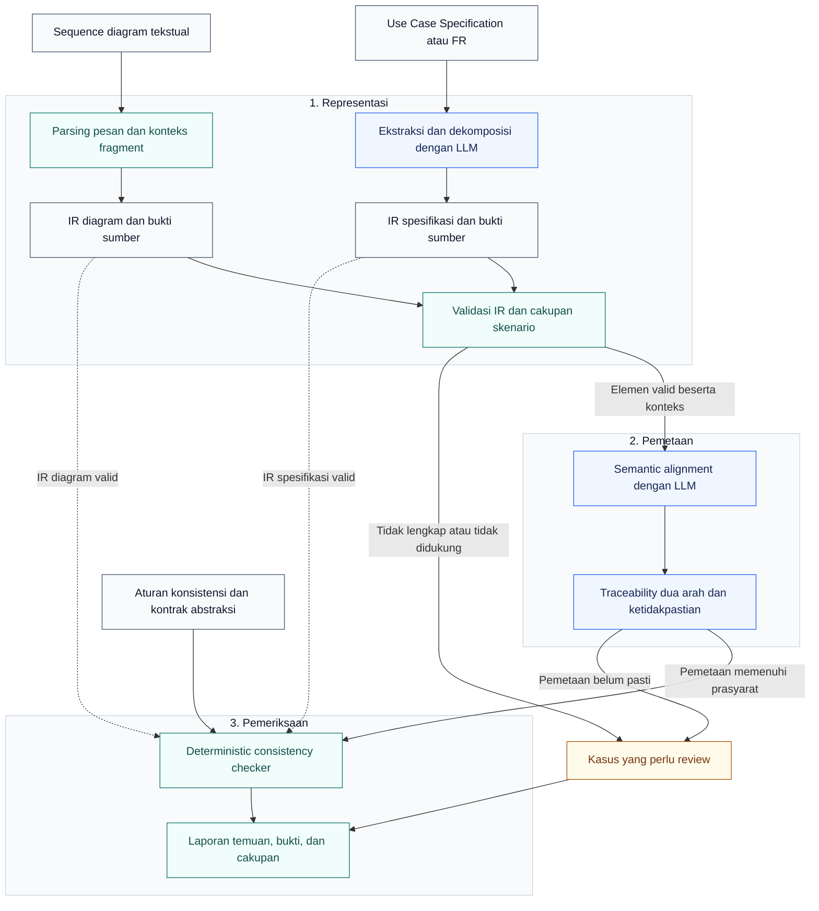
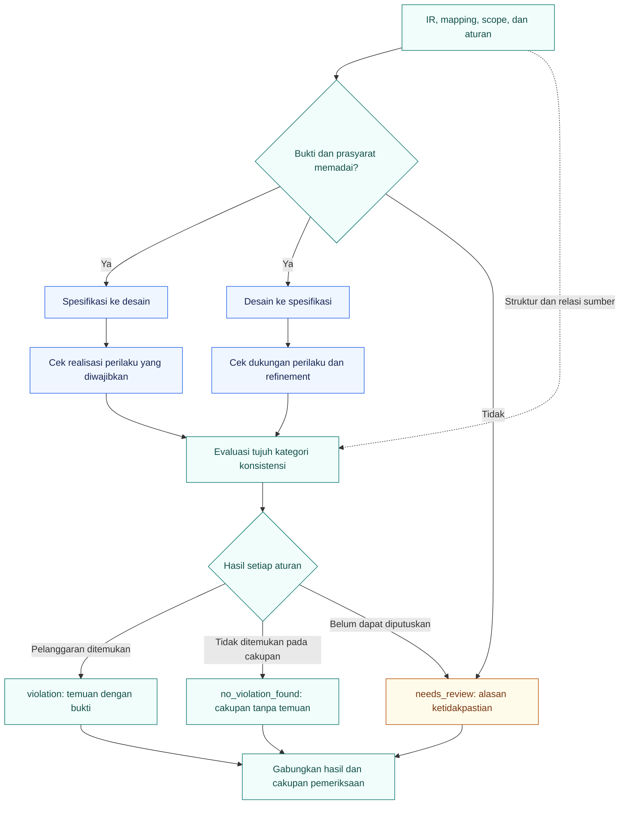
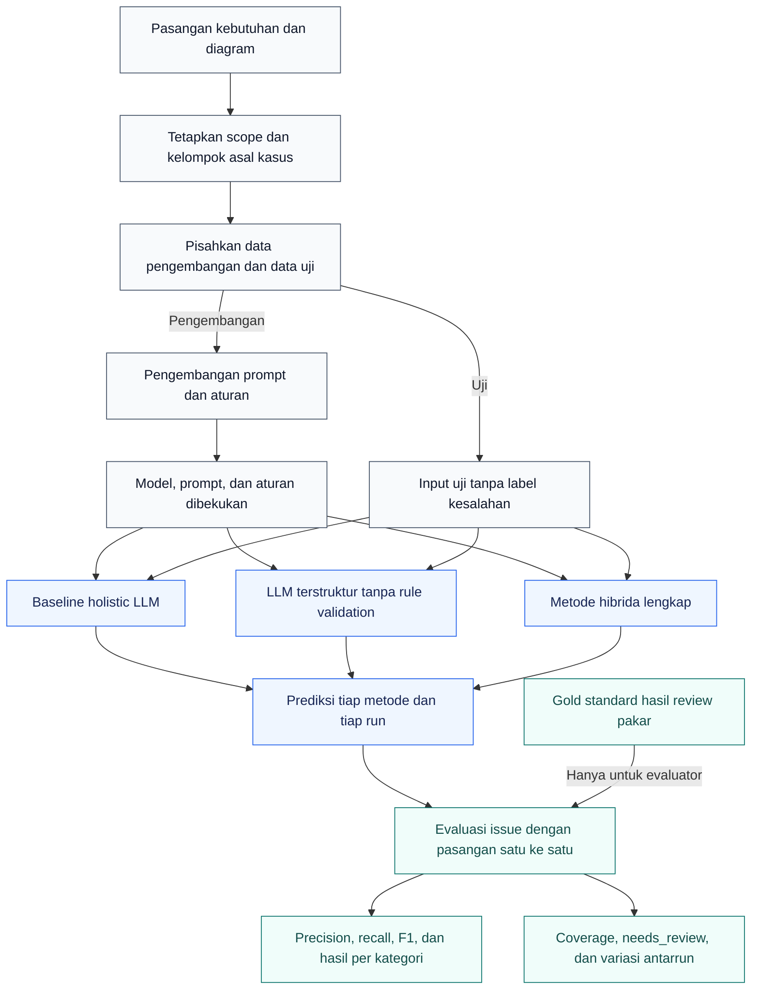

# Arsitektur sistem pemeriksaan konsistensi spesifikasi dan sequence diagram

Dokumen ini menyajikan **rancangan Structure-Aware Hybrid Consistency Checking** untuk memeriksa kesesuaian Use Case Specification (UCS) atau functional requirements dengan sequence diagram. Sistem membentuk representasi terstruktur, menyelaraskan makna dengan LLM, membangun keterlacakan dua arah, lalu menerapkan aturan konsistensi dan melaporkan bukti pada artefak asal.

**Status:** rancangan usulan berdasarkan Bab 1–2 draf tesis, disusun pada 27 Oktober 2026. Diagram ini menjelaskan metode penelitian yang akan diimplementasikan; peningkatan akurasi dan pengurangan false positive masih merupakan sasaran evaluasi.

## 1. Dasar rancangan dan diagram rujukan

Draf yang digunakan adalah lampiran `Template-TA(1).docx`. Isinya identik dengan [draf v1.2 pada repository](../../docs/v2/draft_thesis/v1.2/Template-TA.docx), dengan Git blob `a01931180cc5831b9ce5b9ec1f351c60eea19fd5`. Sumber repository dibaca pada commit [`a05b474`](https://github.com/RizdkyOktaviari/final-project-thesis/commit/a05b474712cd816ed8dab0a2f3e7b81121aeb33e).

Bagian yang menjadi dasar ialah **Bab 1 Latar Belakang**, **Rumusan Masalah**, **Batasan Penelitian**, dan sintesis pada akhir **Bab 2 Tinjauan Pustaka** [D1]. Abstrak Indonesia masih membahas rekonstruksi ERD, abstrak Inggris masih berisi contoh template, dan Bab 3 baru berisi heading. Karena itu, rancangan mengikuti fokus UCS–sequence diagram pada Bab 1–2. Perbedaan isi tersebut perlu diselaraskan ketika naskah tesis direvisi.

| Sumber | Diagram yang diperiksa | Gagasan yang digunakan dalam rancangan |
| --- | --- | --- |
| **MCeT**, Ahmed dkk. [R1] | Fig. 2, *Overview of MCeT*, PDF hlm. 4 / cetak 87; Fig. 3, *Cross-checking and combining results of different checks*, PDF hlm. 5 / cetak 88 | Dua masukan, dekomposisi terperinci, perhatian terhadap konteks, dan pemeriksaan dari beberapa perspektif. |
| **LBF-UML**, Naffar dkk. [R2] | Fig. 5, *LBF-UML framework*, hlm. 9; Fig. 13, *LBF-UML architecture*, hlm. 18 | Representasi elemen dan hubungan lintas model secara eksplisit, aturan konsistensi, serta pemisahan representasi, validasi, dan pelaporan. |
| **Consistent Data and Checker Generation**, Chen dkk. [R3] | Fig. 1, *Approach overview*, PDF hlm. 3 / cetak 233 | Pemisahan proses generatif dari pemeriksaan hasilnya. |

Pada MCeT, holistic check menggunakan seluruh requirements dan diagram. Diagram-atom check memeriksa satu interaksi terhadap seluruh requirements dengan diagram utuh sebagai konteks; requirement-atom check memeriksa satu requirement atom terhadap diagram utuh. MCeT-X menggunakan requirement atoms yang dianggap telah terpenuhi untuk menyaring holistic issues dan diagram-atom issues melalui LLM, kemudian menggabungkan temuan yang dipertahankan dengan requirement-atom issues [R1]. **Deterministic checker pada rancangan tesis adalah pengembangan tersendiri**, bukan nama lain untuk MCeT-X. Rancangan ini juga tidak mewajibkan Modelio, XMI, Alloy, atau pembangkitan kode checker sebagaimana digunakan pada paper pendukung [R2–R3].

Integrasi dekomposisi yang mempertahankan struktur, semantic alignment, bidirectional traceability, dan deterministic validation berasal dari usulan draf [D1]. Pemilihan adaptor Mermaid, kontrak IR, status hasil, dan protokol evaluasi di bawah merupakan **rincian desain yang diusulkan untuk mengisi Bab 3**.

## 2. Arsitektur utama

**Gambar 1. Rancangan arsitektur Structure-Aware Hybrid Consistency Checking.** Disusun berdasarkan [D1] dengan adaptasi konsep dari [R1–R3]. Garis putus-putus menunjukkan bahwa checker mengakses struktur kedua artefak secara langsung, selain menerima hasil alignment. Berkas sumber: [01-system-architecture.mmd](01-system-architecture.mmd).

### Pembentukan representasi terstruktur

Pada jalur spesifikasi, LLM mengekstrak perilaku dan memecahnya menjadi unit yang dapat diperiksa. Setiap unit mempertahankan aktor, tindakan, objek, modalitas wajib atau opsional, kondisi, negasi, precondition, postcondition, dan hubungan dengan main, alternative, atau exception flow. Ekstraksi harus menyimpan ID kebutuhan dan potongan sumber agar interpretasinya dapat diperiksa kembali [D1].

Pada jalur desain, parser membaca participant, sender, receiver, jenis dan isi pesan, serta struktur fragment. Urutan dipertahankan bersama guard, cabang, dan fragment induknya. **IR** adalah *intermediate representation*, yaitu representasi perantara yang dapat dibaca mesin. IR diagram tetap berbentuk struktur interaksi; meratakan seluruh pesan menjadi satu daftar akan menghilangkan konteks alternatif dan pengulangan.

Mermaid dipilih sebagai adaptor awal karena dataset repository menggunakan `.mmd`. Dukungan PlantUML dapat ditambahkan untuk benchmark yang memerlukannya. Subset awal yang direncanakan mencakup pesan, `alt`, `opt`, dan `loop`; fitur di luar subset parser ditandai sebagai belum didukung. Sintaks berhasil di-parse belum menjadi bukti konsistensi semantik. Pemaknaan fragment dan subset yang dipilih perlu didokumentasikan dan diuji sebelum eksperimen [D1, R4].

Validasi IR memeriksa kelengkapan field, referensi participant, sumber setiap elemen, struktur fragment, dan cakupan skenario. Sistem menyimpan ketidakpastian ketika sumber tidak menyediakan informasi yang cukup. Parse error, ekstraksi yang tidak lengkap, atau fitur yang belum didukung dilaporkan sebagai keterbatasan pemeriksaan.

### Semantic alignment dan keterlacakan

LLM mencari kesepadanan makna antarelemen, misalnya istilah “pegawai” dan “karyawan”, atau tindakan “menyimpan permohonan” dengan pesan `saveRequest()`. Konteks kebutuhan, kondisi, dan struktur diagram tetap tersedia untuk menilai padanan tersebut. Pemetaan mendukung hubungan **banyak ke banyak**: satu kebutuhan dapat direalisasikan oleh beberapa pesan dan satu pesan dapat mewakili beberapa langkah.

Pemetaan menyimpan elemen sumber, elemen tujuan, jenis hubungan, bukti tekstual, dan ketidakpastian. Hubungan dapat berupa realisasi langsung, realisasi melalui beberapa pesan, atau rincian implementasi yang diperbolehkan oleh kontrak abstraksi. Hasil pemetaan menjadi dasar penelusuran kebutuhan ke desain dan desain ke kebutuhan [D1].

### Validasi deterministik dan pelaporan

Checker menerima **IR spesifikasi, IR diagram, mapping, cakupan, dan aturan**. Dengan demikian, aturan arah pesan atau urutan dapat memeriksa sender, receiver, kondisi, dan relasi urutan pada struktur yang tersimpan. Keputusan semantik yang belum dapat dibuktikan tidak dipaksakan menjadi keputusan biner.

Istilah *deterministik* berarti aturan menghasilkan keputusan yang sama untuk IR, mapping, cakupan, dan versi aturan yang sama. Ketepatan hasil tetap bergantung pada ketepatan ekstraksi dan alignment. Status **tidak ditemukan pelanggaran** hanya berlaku pada elemen dan aturan yang berhasil diperiksa; itu bukan jaminan konsistensi menyeluruh.

## 3. Kontrak data antarkomponen

Field di bawah adalah rancangan minimum, bukan skema implementasi yang sudah tersedia.

| Artefak | Informasi yang perlu dipertahankan |
| --- | --- |
| **Cakupan pemeriksaan** | ID skenario, ID kebutuhan yang dicakup, kelompok diagram, tingkat abstraksi, asumsi eksplisit, dan fitur yang didukung. |
| **IR spesifikasi** | ID unit, ID kebutuhan asal, actor, action, object, modalitas, kondisi, precondition, postcondition, jenis flow, hubungan urutan yang diwajibkan, dan lokasi sumber. |
| **IR diagram** | ID pesan dan participant, sender, receiver, message type, action/payload, relasi urutan, guard, fragment induk, cabang, dan lokasi pada berkas diagram. |
| **Mapping keterlacakan** | Kumpulan ID unit kebutuhan dan pesan, padanan peran, jenis realisasi/refinement, bukti pendukung, dan status pemetaan. |
| **Temuan** | Rule ID, kategori, status, elemen yang terlibat, expected versus observed behavior, bukti sumber, dan alasan yang dapat diperiksa. |
| **Catatan eksekusi** | Commit dataset, versi parser/IR/aturan, model dan versinya, versi prompt, parameter inferensi, ID run, dan output mentah yang diperlukan untuk reproduksi. |

Kebutuhan `REQ-*` yang mencakup banyak tindakan dapat dipecah menjadi beberapa unit IR tanpa mengubah ID atau dokumen asal. Ketentuan pendukung dan ambiguitas sumber tetap disertakan sebagai konteks yang relevan.

## 4. Pemeriksaan dua arah

**Gambar 2. Alur keputusan setiap aturan pada cakupan yang ditetapkan.** Kedua arah pemeriksaan menggunakan struktur dan mapping yang sama. Satu pasangan artefak dapat menghasilkan temuan sekaligus bagian yang perlu review. Berkas sumber: [02-bidirectional-validation.mmd](02-bidirectional-validation.mmd).

**Spesifikasi ke desain** menilai realisasi perilaku wajib dalam cakupan. **Desain ke spesifikasi** menilai apakah perilaku desain didukung kebutuhan atau merupakan rincian implementasi yang sah. Satu diagram untuk satu skenario tidak dinilai terhadap semua kebutuhan sebuah modul; pemeriksaan kelengkapan pada tingkat modul menggunakan kelompok diagram yang relevan.

Kategori R1–R7 berikut mengikuti draf [D1]. ID aturan dan kriteria operasionalnya merupakan usulan desain.

| ID | Kategori | Dasar pemeriksaan dan batas keputusan |
| --- | --- | --- |
| R1 | **Missing behavior** | Perilaku wajib dalam scope tidak direalisasikan oleh pesan atau gabungan pesan pada jalur yang relevan. Tidak adanya satu padanan langsung belum cukup jika alignment atau cakupan belum jelas. |
| R2 | **Additional behavior** | Perilaku bisnis melanggar batasan eksplisit atau kontrak skenario yang dinyatakan lengkap. Pesan tanpa padanan adalah kandidat untuk diperiksa; komunikasi internal atau refinement yang sah tidak otomatis menjadi pelanggaran. |
| R3 | **Participant/lifeline mismatch** | Peran pelaku atau penerima bertentangan dengan spesifikasi setelah padanan peran dan rincian lapisan sistem diperhitungkan. Perbedaan nama saja tidak cukup. |
| R4 | **Message mismatch** | Tindakan, objek, polaritas, atau efek bisnis pada realisasi yang dipetakan bertentangan dengan kebutuhan. Sinonim dan pemecahan atau penggabungan pesan diperbolehkan. |
| R5 | **Incorrect message direction** | Sender dan receiver pada interaksi yang sepadan membalik aliran yang diwajibkan. Jenis request, response, notification, dan callback dibedakan. |
| R6 | **Incorrect order** | Jalur yang dapat terjadi melanggar relasi urutan yang diwajibkan. Perbandingan menggunakan precedence dan konteks cabang, bukan sekadar nomor pesan global. |
| R7 | **Condition/alternative-flow mismatch** | Guard atau efek cabang mengizinkan keadaan terlarang atau menghilangkan perilaku wajib. Kondisi bahasa alami yang belum dapat dinormalisasi diarahkan ke review. |

Untuk `alt`, pesan pada cabang berbeda tidak diperlakukan sebagai rangkaian serial. `opt` mempertahankan sifat opsional, sedangkan `loop` mempertahankan batas dan konteks iterasi. Jika verifikasi loop menggunakan batas eksplorasi, batas tersebut harus dicatat. Konstruksi parallel hanya diperiksa setelah semantik dan dukungan parsernya ditetapkan [R4–R5].

Setiap aturan menghasilkan salah satu status berikut:

- **`violation`**: pelanggaran terdeteksi terhadap IR dan mapping yang memenuhi prasyarat, dengan bukti yang dapat ditelusuri.
- **`no_violation_found`**: tidak ditemukan pelanggaran pada cakupan aturan yang berhasil diperiksa.
- **`needs_review`**: scope, ekstraksi, alignment, kondisi, atau fitur belum memadai untuk memutuskan. Status ini tidak dihitung sebagai kasus konsisten.

Temuan dengan akar masalah yang sama digabung sambil mempertahankan kategori terkait. Sebagai contoh, pembalikan penerima dapat memicu gejala participant mismatch dan missing behavior; keduanya tidak otomatis dihitung sebagai dua kesalahan independen.

## 5. Integrasi dengan korpus repository

| Sumber | Penggunaan dalam rancangan |
| --- | --- |
| [`requirements text/`](../requirements%20text/) | Masukan kebutuhan yang telah dinormalisasi; pilih kebutuhan dan ketentuan pendukung sesuai scope skenario. |
| [`raw/`](../raw/) | Bukti BRD anonim untuk menelusuri interpretasi dan meninjau ambiguitas. |
| [`sequence-diagrams/diagrams/`](../sequence-diagrams/diagrams/) | Masukan diagram Mermaid yang akan diperiksa. |
| [`sequence-diagrams/manifest.json`](../sequence-diagrams/manifest.json) | Metadata penyusunan pasangan di sisi penyiapan dataset. Manifest saat ini juga memuat informasi injeksi, sehingga tidak diberikan langsung kepada model. |
| [`sequence-diagrams/ground_truth.csv`](../sequence-diagrams/ground_truth.csv) | Catatan injeksi untuk kurasi dan evaluasi. Gold standard akhir membutuhkan review pakar terhadap cakupan yang disepakati. |

Inventaris saat sumber dibaca memuat **30 diagram**, terdiri dari **26 tanpa injeksi kesalahan disengaja** dan **4 dengan injeksi terkontrol**, sebagaimana dicatat pada [README dataset](../sequence-diagrams/README.md). Label tanpa injeksi tidak membuktikan diagram sudah sepenuhnya konsisten. Jumlah tersebut juga belum membuktikan bahwa ketujuh kategori telah memiliki contoh evaluasi yang cukup.

Pada penyiapan eksperimen, metadata pasangan diturunkan menjadi daftar yang hanya memuat ID skenario, kebutuhan, diagram, dan scope yang telah ditinjau. Label, kategori mutasi, lokasi kesalahan, serta penjelasan jawaban dipisahkan dari input inferensi. Penentuan scope dapat diperbaiki melalui kurasi tanpa mengubah dokumen sumber secara diam-diam.

## 6. Rancangan evaluasi

**Gambar 3. Rancangan evaluasi untuk menjawab pertanyaan penelitian.** Ground truth hanya masuk ke evaluator. Diagram ini menunjukkan rencana eksperimen, bukan hasil eksperimen. Berkas sumber: [03-evaluation-flow.mmd](03-evaluation-flow.mmd).

Perbandingan minimum mengikuti rumusan masalah draf [D1]:

| Metode | Perilaku yang dibandingkan |
| --- | --- |
| **Holistic LLM** | LLM memeriksa pasangan kebutuhan dan diagram secara utuh. |
| **LLM terstruktur tanpa rule validation** | Menggunakan IR dan alignment yang sama, kemudian LLM menilai kandidat temuan. Ini menguji kontribusi validator aturan terhadap konfigurasi terstruktur. |
| **Hibrida lengkap** | Menggunakan IR, semantic alignment, traceability dua arah, dan deterministic checker. |

MCeT dapat ditambahkan sebagai pembanding terpisah setelah reproduksi implementasi dan kesesuaian format input diperiksa. FBENCH merupakan kandidat benchmark dalam draf, belum diklaim telah dimasukkan atau dievaluasi pada repository ini.

Unit penilaian utama yang diusulkan adalah **issue pada pasangan skenario–diagram atau kelompok diagram**. Prediksi dan gold issue dipasangkan satu ke satu menurut perilaku yang dilanggar dan bukti lokasinya. Duplikat tidak dihitung sebagai true positive tambahan. Pakar meninjau perbedaan semantik tanpa diberi tahu metode yang menghasilkan prediksi bila prosedur anotasi memungkinkan.

Laporkan precision `TP/(TP+FP)`, recall `TP/(TP+FN)`, dan F1, beserta hasil per kategori dan jumlah kasusnya. Kasus dengan penyebut nol ditandai sebagai tidak terdefinisi beserta jumlah dukungannya. Laporkan pula cakupan yang berhasil diperiksa, proporsi `needs_review`, kegagalan parsing, fitur yang belum didukung, dan variasi hasil LLM antarrun. Gold issue pada kasus uji yang tidak berhasil ditemukan tetap mengurangi recall pada evaluasi keseluruhan; abstention tidak boleh membuat kasus sulit hilang dari pelaporan.

Diagram asal dan variannya ditempatkan dalam kelompok asal yang sama ketika membagi data pengembangan dan data uji. Prompt, aturan, model, dan subset fitur dibekukan sebelum evaluasi. Konfigurasi model yang sebanding digunakan antarmetode; perbedaan jumlah pemanggilan LLM dan biaya eksekusi dicatat. Jumlah pengulangan, prosedur anotasi, dan batas eksplorasi ditetapkan sebelum eksperimen dilakukan.

## 7. Berkas dan pemakaian

| Berkas | Fungsi |
| --- | --- |
| [01-system-architecture.mmd](01-system-architecture.mmd) | Diagram arsitektur utama untuk penjelasan metode pada Bab 3. |
| [02-bidirectional-validation.mmd](02-bidirectional-validation.mmd) | Detail pemeriksaan dua arah dan status keputusan. |
| [03-evaluation-flow.mmd](03-evaluation-flow.mmd) | Pemisahan inferensi dan evaluasi serta konfigurasi pembanding. |
| [README.md](README.md) | Diagram yang dirender GitHub, penjelasan komponen, batas rancangan, dan referensi. |

Blok Mermaid pada README identik dengan berkas `.mmd` masing-masing. Jika diagram diubah, perbarui kedua representasinya. Tiga diagram ini adalah dokumentasi arsitektur penelitian dan tidak menjadi bagian dari 30 sequence diagram dalam dataset eksperimen.

## Referensi

- **[D1]** Draf tesis v1.2, `Template-TA.docx`, Bab 1–2. [Versi sumber yang dibaca](https://github.com/RizdkyOktaviari/final-project-thesis/blob/a05b474712cd816ed8dab0a2f3e7b81121aeb33e/docs/v2/draft_thesis/v1.2/Template-TA.docx).
- **[R1]** Ahmed, K., Song, J., Chen, B., Wei, O., dan Zheng, B. (2025). *MCeT: Behavioral Model Correctness Evaluation using Large Language Models*. MODELS, hlm. 84–95. [DOI](https://doi.org/10.1109/MODELS67397.2025.00014) · [PDF repository](../../docs/v2/ref/MCeT_Behavioral_Model_Correctness_Evaluation_using_Large_Language_Models.pdf). Diagram rujukan: Fig. 2–3.
- **[R2]** Naffar, E., Hudaib, A., Obeid, N., dan Ghoul, S. (2026). *A Logic-Based Framework for Detecting Inconsistencies of UML Models*. Information, 17(7), 620. [DOI](https://doi.org/10.3390/info17070620) · [PDF repository](../../docs/v2/ref/A%20Logic-Based%20Framework%20for%20Detecting%20Inconsistencies%20of%20UML%20Models.pdf). Diagram rujukan: Fig. 5 dan 13.
- **[R3]** Chen, B., Babikian, A. A., Feng, S., Varró, D., dan Mussbacher, G. (2025). *LLM-based Satisfiability Checking of String Requirements by Consistent Data and Checker Generation*. RE, hlm. 231–243. [DOI](https://doi.org/10.1109/RE63999.2025.00030) · [PDF repository](../../docs/v2/ref/LLM-based_Satisfiability_Checking_of_String_Requirements_by_Consistent_Data_and_Checker_Generation.pdf). Diagram rujukan utama: Fig. 1; rincian pemeriksaan: Fig. 2 dan 4.
- **[R4]** Mermaid. *Sequence diagrams*. [Dokumentasi sintaks resmi](https://mermaid.js.org/syntax/sequenceDiagram.html). Rujukan sintaks adaptor, bukan bukti bahwa pemeriksa semantik telah diimplementasikan.
- **[R5]** Eclipse UML2. *InteractionOperatorKind*. [Dokumentasi operator interaksi](https://download.eclipse.org/modeling/mdt/uml2/javadoc/5.2.0/org/eclipse/uml2/uml/InteractionOperatorKind.html). Rujukan pendukung untuk membedakan konteks cabang, urutan, dan pengulangan; pemetaan subset Mermaid ke IR tetap harus ditetapkan.
