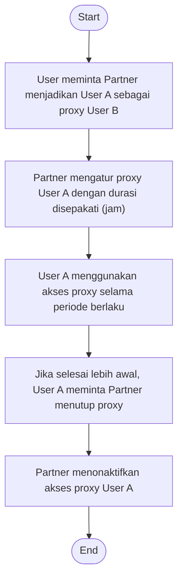
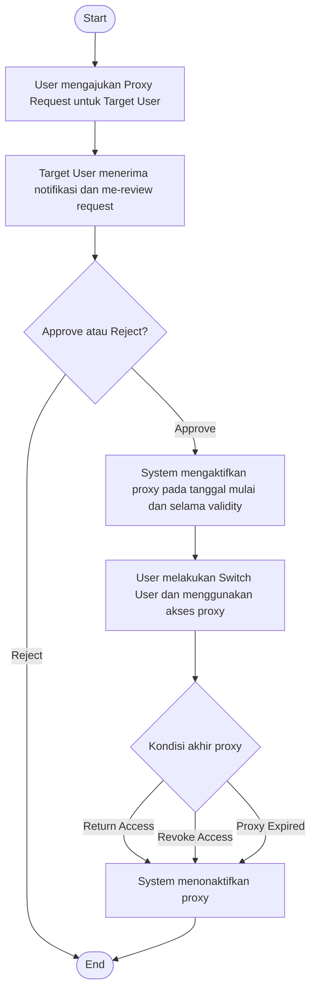

# BRD — EC Foundation

**IT SYSTEM DEVELOPMENT**  
**BUSINESS REQUIREMENT ASSESSMENT**

- **Project:** Mata Air Hub - Employee Central
- **Module:** Foundation
- **Assessment Date:** 17 Juni 2026
- **Document version (footer):** 1.0
- **Business User Expert:** Janel Runtu; Waode Shelly Adinda; Darren Nurachmad; Anny Nasution; Agung Wahyudiono

## Business Requirement Record

| Start Date | End Date | Author | Version Doc | Change Reference |
| --- | --- | --- | --- | --- |
| 17 Jun 2026 |  | Maheswara Sinatriyo | 0.1 | Drafting |
| 4 Aug 2026 |  | Maheswara Sinatriyo | 1.0 | Issued for Review |
| 21 Sep 2026 |  | Maheswara Sinatriyo | 1.1 | Update After Revision |

## Log Changes

*Describe the changes which impact to the Module.*

> **Guidance (dokumen sumber):**  
> * Provide the name, detail changes and severity of the changes, e.g. Mr. X request for change on workflow due to new policy on dd/mmm/yyyy, etc  
> * Please identify all the changes clearly include impact to another module or infrastructure (if any).

### Change Record

| Date | Requested by | Description | Severity (major/minor) | Status |
| --- | --- | --- | --- | --- |
|  |  |  |  |  |
|  |  |  |  |  |

## Project Description

| Field | Value |
| --- | --- |
| Project Description | Mata Air Hub - Employee Central |
| Business User Expert | Janel Runtu / Waode Shelly Adinda / Darren Nurachmad / Anny Nasution / Agung Wahyudiono |
| Assessment Date | 17 Juni 2026 |
| Module Description | Foundation |

## Requirement Identification

### WHY

*Explain why this module is needed*

> **Guidance (dokumen sumber):**  
> *Module Objectives/Goals: Your expected objectives on this module  
> e.g. decreasing numbers of paper used  
> * Module Benefits: The outcome of successful objectives/goals e.g. reducing the paper consumption cost

| Module Objectives/Goals | Module Benefits |
| --- | --- |
| Menyediakan konfigurasi multi company yang mendukung pengelolaan lebih dari satu entitas perusahaan dalam satu platform terintegrasi. | Memastikan konsistensi pengelolaan data dan proses pada seluruh entitas perusahaan yang dikelola dalam sistem. |
| Menyediakan framework workflow approval yang dapat digunakan secara konsisten oleh seluruh modul Human Capital. | Meningkatkan efisiensi proses persetujuan melalui workflow yang terstandarisasi dan terdokumentasi. |
| Menyediakan mekanisme proxy untuk mendukung delegasi tugas dan proses approval selama pengguna tidak dapat mengakses sistem. | Mengurangi risiko keterlambatan proses bisnis akibat ketidakhadiran approver melalui fitur proxy delegation. |
| Menyediakan fondasi konfigurasi yang fleksibel dan mudah dikelola untuk mendukung kebutuhan bisnis perusahaan. | Mempermudah pengelolaan dan pengembangan modul Human Capital lainnya yang bergantung pada konfigurasi foundation |
| Menyediakan platform Human Capital Management yang terintegrasi sebagai pengganti SAP SuccessFactors Employee Central untuk mengelola data organisasi, posisi, dan karyawan secara terpusat | Meningkatkan konsistensi dan akurasi data Human Capital melalui penggunaan satu sumber data utama (single source of truth) |
| Membangun fondasi data dan proses yang dapat digunakan Bersama oleh seluruh modul Human Capital | Mengurangi duplikasi data dan mempermudah integrasi antar modul maupun sistem pendukung lainnya. |
| Menyediakan framework workflow, approval, dan notifikasi yang dapat digunakan secara konsisten pada seluruh proses Human Capital. | Mempercepat proses administrasi dan mengurangi ketergantungan pada proses manual berbasis email atau dokumen. |
| Mendukung migrasi data dan proses bisnis dari SAP SuccessFactors ke platform yang lebih fleksibel dan dapat dikembangkan sesuai kebutuhan perusahaan. | Mengurangi ketergantungan terhadap platform pihak ketiga serta meningkatkan fleksibilitas dalam pengembangan fitur dan proses bisnis. |
| Menyediakan mekanisme keamanan, audit trail, dan pengelolaan hak akses yang sesuai dengan struktur organisasi perusahaan. | Meningkatkan keamanan data dan memastikan akses informasi dilakukan sesuai kewenangan pengguna. |
| Menyediakan fondasi integrasi dengan sistem internal maupun eksternal perusahaan. | Mempermudah pertukaran data antar aplikasi dan mendukung digitalisasi proses Human Capital secara menyeluruh. |
| Mendukung pengelolaan data organisasi dan kepegawaian yang scalable untuk kebutuhan bisnis saat ini maupun pengembangan di masa mendatang. | Menurunkan biaya operasional jangka panjang serta meningkatkan kemampuan sistem untuk beradaptasi terhadap perubahan kebutuhan bisnis. |

### WHAT

*Describe the expected function or features on the app*

> **Guidance (dokumen sumber):**  
> * In scope: Explain the expected function / feature to be included e.g. the reporting must in excel, must be easy to use in mobile, etc  
> * Out scope: Explain what function that exist on the current/manual system that should not be considered e.g. no need to add 3 rd party account on login, etc  
> * Make sure to put anything that you can think about the scope

#### In Scope

##### Functional Scope

Fitur dan kapabilitas yang akan dikembangkan dalam Modul Foundation.

- Pembuatan dan pengelolaan **Multi Company**.
- Pembuatan dan pengelolaan **Company Assignment**.
- Pembuatan dan pengelolaan **Workflow Configuration**.
- Pembuatan dan pengelolaan **Workflow Approval**.
- Pembuatan dan pengelolaan **Workflow Delegation**.
- Pembuatan dan pengelolaan **Workflow Notification**.
- Pembuatan dan pengelolaan **Proxy Assignment**.
- Pembuatan dan pengelolaan **Proxy Delegation**.

##### Governance Scope

Penyediaan framework, kebijakan, dan konfigurasi bersama yang akan digunakan oleh seluruh modul Employee Central.

##### Security & Access

- Penyediaan framework Role-Based Access Control (RBAC).
- Penyediaan mekanisme autentikasi dan otorisasi pengguna.
- Penyediaan kebijakan perlindungan data pribadi dan data sensitif.

##### Audit & Logging

- Penyediaan mekanisme Audit Trail untuk mencatat aktivitas sistem.
- Penyediaan kebijakan monitoring dan logging aktivitas pengguna.

##### Integration

- Integrasi data master dengan sistem eksternal seperti Mata Air V2, Entra ID, dan Training Event Calendar (TEC).

##### Data Migration

- Migrasi data master dari SAP SuccessFactors Employee Central ke platform baru. Hanya mencakup proses Transform, Load & Validate.

##### Data Protection

- Penyediaan prinsip perlindungan data pribadi dan data sensitif melalui mekanisme Enkripsi *At Rest*.
- Penyediaan kebijakan pengelolaan data sensitif yang berlaku secara konsisten pada seluruh modul Employee Central.

#### Out Scope

- Payroll calculation dan payroll processing.
- Pengelolaan leave request, timesheet, dan time-off calendar.
- Succession Planning dan Talent Management.
- Learning Management System (LMS).
- Workforce Planning dan Manpower Planning.

Pembuatan Modul Employee centrail lainnya termasuk:

- Manage Organization Structure
- Manage Position Management
- Manage Hiring
- Update Personal Data
- Employee Status Change
- Update Recurring/Non-recurring Payment
- Manage Termination
- Manage Time-off Calendar
- Submit Benefit Request
- Reporting
- Performance Management dan Goal Management

**\* Module-module tersebut akan dikembangkan dan didokumentasikan dalam BRD terpisah sesuai dengan roadmap dan timeline implementasi proyek Employee Central.**

### WHEN

*Describe the expected completion dates on required milestone*

> **Guidance (dokumen sumber):**  
> * Explain the expected milestone complete with expected start and end dates e.g. system must ready to used in dd/mm/yyyy, should be presented on management meeting on dd/mm/yyyy

| Milestones | Due Date | Remarks |
| --- | --- | --- |
| User Requirement | 18 Jun 2026 | Employee Central |

### WHO

*Describe how many roles will be interact with this Module*

> **Guidance (dokumen sumber):**  
> * Provide the role, assigned to and accessibilities on each role that will be included in the module e.g. HR as admin apps will be responsible to provide setting on the current process.  
> * Please identify all the participated person in your area to have a clear roles assignment.

| Role | Description |
| --- | --- |
| System Administrator | Mengelola konfigurasi sistem, integrasi, dan administrasi teknis aplikasi. |
| HR Administrator | Bertanggung jawab mengelola konfigurasi Foundation sesuai kewenangan, seperti Multi Company, Workflow, dan Proxy Management. |
| Other Business Roles | Detail peran, tanggung jawab, dan hak akses pengguna lainnya akan dijelaskan pada BRD modul terkait sesuai proses bisnis masing-masing. |

### WHAT IF

*Identify the risk and impact of the module*

> **Guidance (dokumen sumber):**  
> * Explain the risk that might be a barrier / obstacle for this module. e.g. the procedure does not exist, need to be confirmed by BOD, etc  
> * Please think of any risk that might be impacted related to this module

| Risks | Level (Hi, Med, Low) |
| --- | --- |
| Perbedaan business rule antara SAP SuccessFactors dan aplikasi baru. | Hi |
| Pengguna mengalami kesulitan beradaptasi dengan aplikasi baru. | Med |
| Integrasi dengan sistem lain (Mata-Air, dll.) tidak berjalan dengan baik. | Hi |
| Fitur yang tersedia pada SAP SuccessFactors tidak seluruhnya teridentifikasi saat analisis kebutuhan. | Med |
| Performa aplikasi custom tidak setara dengan SAP SuccessFactors ketika jumlah pengguna meningkat. | Med |

#### Mitigasi

- Melakukan business process mapping dan gap analysis terhadap seluruh proses yang akan dimigrasikan.
- Menyediakan pelatihan, user guide, dan masa pendampingan setelah implementasi.
- Melakukan integration testing end-to-end dan monitoring pasca implementasi.
- Melakukan requirement validation bersama business user dan SME terhadap seluruh proses yang ada pada SAP SuccessFactors.
- Melakukan performance testing dan capacity planning sebelum implementasi.

## Current Condition

### Overall Condition

Saat ini PTAR menggunakan SAP SuccessFactors Employee Central sebagai sistem utama untuk mengelola data organisasi, data posisi, dan data kepegawaian. Sistem digunakan untuk mendukung proses Human Capital seperti pengelolaan struktur organisasi, position management, hiring, perubahan status karyawan, benefit, termination, dan reporting.

Namun demikian, terdapat beberapa tantangan yang dihadapi, antara lain:

- Tingginya biaya lisensi dan pemeliharaan SAP SuccessFactors.
- Keterbatasan fleksibilitas dalam melakukan penyesuaian proses bisnis dan pengembangan fitur baru.
- Ketergantungan terhadap konfigurasi dan vendor SAP.
- Integrasi dengan aplikasi internal memerlukan effort dan biaya tambahan.
- Beberapa proses bisnis telah dipindahkan ke aplikasi lain seperti Mata-Air sehingga sebagian fungsi Employee Central tidak lagi digunakan secara optimal.

### Proxy Flow

1. Proses dimulai ketika User membutuhkan akses proxy untuk mewakili User lain.
2. User meminta bantuan kepada Partner untuk membuat User A sebagai proxy dari User B.
3. Partner melakukan konfigurasi proxy pada sistem SAP untuk User A berdasarkan permintaan yang diberikan oleh User.
4. Partner menetapkan durasi akses proxy berdasarkan kesepakatan dengan User. Durasi proxy ditentukan dalam satuan jam.
5. Setelah konfigurasi selesai, User A dapat menggunakan akses proxy untuk mewakili User B selama periode yang telah ditentukan.
6. Apabila pekerjaan yang membutuhkan akses proxy telah selesai sebelum periode proxy berakhir, User A menghubungi Partner untuk meminta penutupan akses proxy.
7. Partner melakukan penutupan atau deaktivasi akses proxy User A pada sistem SAP.
8. Setelah akses proxy ditutup, User A tidak lagi dapat menggunakan akses proxy untuk mewakili User B.

**Proxy Flow (As-Is) — diagram dalam format Mermaid**

**Proxy Flow (As-Is) — visual source**

## Expected Business Improvement

### General Expectation

PTAR membutuhkan platform Human Capital Management yang dapat menggantikan fungsi SAP SuccessFactors Employee Central sebagai sumber data utama (*single source of truth*) untuk pengelolaan data organisasi, posisi, dan karyawan. Selain itu, sistem baru diharapkan mampu menyediakan kapabilitas foundation yang setara dengan SAP SuccessFactors, termasuk pengelolaan **Multi Company**, **Workflow Approval**, dan **Proxy Management** secara terintegrasi untuk mendukung operasional Human Capital di seluruh entitas perusahaan.

Sistem baru diharapkan dapat:

- Mendukung dan mengakomodasi proses bisnis Human Capital yang saat ini dijalankan melalui SAP SuccessFactors Employee Central.
- Mendukung pengelolaan lebih dari satu entitas perusahaan (*Multi Company*) dalam satu platform terintegrasi dengan tetap menjaga pemisahan data dan kewenangan akses sesuai struktur organisasi yang berlaku.
- Menyediakan framework *Workflow Approval* yang fleksibel, terstandarisasi, dan dapat digunakan secara konsisten oleh seluruh modul Human Capital.
- Menyediakan mekanisme *Proxy Management* untuk mendukung delegasi tugas dan proses persetujuan ketika pengguna yang berwenang tidak dapat mengakses sistem.
- Menyediakan fleksibilitas yang lebih tinggi dalam pengembangan, konfigurasi, dan penyesuaian proses bisnis sesuai kebutuhan perusahaan.
- Mengurangi ketergantungan terhadap platform pihak ketiga serta menurunkan biaya lisensi dan biaya operasional sistem dalam jangka panjang.
- Mendukung integrasi yang aman dan terstandarisasi dengan aplikasi internal maupun eksternal perusahaan.
- Menyediakan mekanisme pengelolaan histori data, audit trail, effective dating, serta kontrol akses yang mendukung kebutuhan operasional dan kepatuhan perusahaan.
- Menyediakan pengalaman pengguna yang intuitif, konsisten, dan mudah digunakan oleh seluruh pengguna sistem.
- Menyediakan fondasi yang scalable dan maintainable untuk mendukung pengembangan modul Human Capital lainnya di masa mendatang.
- Meningkatkan kualitas, konsistensi, dan keandalan data Human Capital melalui pengelolaan data yang terpusat dan terintegrasi.
- Pengamanan data sensitif dengan enkripsi data *at rest* untuk menjaga kerahasiaan dan keamanan data pribadi yang telah disepakati.
- Menyediakan mekanisme perlindungan data pribadi dan data sensitif sesuai dengan kebijakan keamanan perusahaan, termasuk penerapan perlindungan terhadap kategori data yang ditetapkan dalam Lampiran Klasifikasi Data Pribadi dan Data Sensitif Employee Central.

### Proxy Flow

1. Proses dimulai ketika User membutuhkan akses proxy untuk mewakili Target User.
2. User mengakses menu **Proxy Access** dan mengajukan permohonan proxy dengan menentukan Target User yang akan diwakili.
3. User mengisi informasi yang diperlukan untuk pengajuan proxy, meliputi:

   - a. Target User.
   - b. Proxy Validity dalam satuan hari.
   - c. Reason pengajuan proxy.
4. Target User menerima notifikasi dan permintaan persetujuan proxy. Target User kemudian melakukan review terhadap permintaan yang diajukan.
5. Target User menentukan tindakan terhadap request:

   - a. **Approve** → request dilanjutkan dan proxy akan diaktifkan berdasarkan tanggal mulai yang telah ditentukan.
   - b. **Reject** → request ditolak dan proses berakhir.
6. Setelah request disetujui, System mengaktifkan akses proxy sesuai dengan periode validity yang telah disetujui.
7. Selama proxy masih aktif, User dapat mengakses menu proxy dan melakukan **Switch User** untuk bertindak sebagai Target User. Seluruh aktivitas yang dilakukan setelah switch akan dijalankan dalam konteks proxy.
8. Akses proxy dapat berakhir melalui salah satu dari tiga kondisi:

   - a. **Return Access** → User mengakhiri akses proxy lebih awal.
   - b. **Revoke Access** → Target User mencabut akses proxy sebelum masa berlaku berakhir.
   - c. **Proxy Expired** → System secara otomatis mengakhiri akses ketika periode validity telah berakhir.
9. Setelah salah satu kondisi tersebut terpenuhi, System menonaktifkan akses proxy sehingga User tidak dapat lagi melakukan switch sebagai Target User.
10. Proses proxy selesai setelah akses dinonaktifkan.

**Proxy Flow (To-Be) — diagram dalam format Mermaid**

**Proxy Flow (To-Be) — visual source**

## General Principles

- Foundation Module menyediakan konfigurasi dan layanan bersama (shared services) yang digunakan oleh seluruh modul Employee Central.
- Foundation Module tidak mengelola transaksi Human Capital secara langsung.
- Detail proses bisnis akan dijelaskan pada BRD masing-masing modul.
- Setiap modul wajib mengikuti kebijakan yang ditetapkan pada Foundation BRD.

## Business Rules & Policy

### Multi Company

- Sistem harus mendukung pengelolaan lebih dari satu perusahaan dalam satu platform.
- Setiap perusahaan harus memiliki identitas unik.
- Data dan proses bisnis dapat dibatasi berdasarkan perusahaan yang ditetapkan.
- Pengguna dapat diberikan akses ke satu atau lebih perusahaan sesuai kewenangan.

### Proxy Request

- Proxy access hanya dapat diajukan oleh pengguna yang membutuhkan akses untuk mewakili pengguna lain (*Target User*).
- Setiap pengajuan proxy harus memiliki **Target User**, **Proxy Validity**, dan **Reason**.
- Proxy Validity hanya dapat ditentukan dalam satuan **hari**.
- Proxy hanya dapat diberikan kepada pengguna yang memenuhi ketentuan akses dan status pengguna yang berlaku.
- Proxy request harus mendapatkan persetujuan dari **Target User** sebelum akses proxy dapat diaktifkan.

### Proxy Approval

- Target User harus menerima notifikasi atas proxy request yang diajukan.
- Target User dapat melakukan **Approve** atau **Reject** terhadap proxy request.
- Proxy hanya dapat berstatus aktif setelah request disetujui oleh Target User dan sudah berada pada effective date/start date.
- Request yang ditolak tidak dapat digunakan untuk mengakses akun Target User.

### Proxy Activation

- System mengaktifkan proxy berdasarkan periode validity yang telah disetujui.
- Proxy hanya dapat digunakan selama periode validity masih aktif.
- Setelah periode validity berakhir, System harus secara otomatis menonaktifkan proxy (*Proxy Expired*).

### Proxy Access

- Selama proxy aktif, Requestor dapat melakukan **Switch User** untuk bertindak sebagai Target User.
- Setelah melakukan Switch User, aktivitas yang dilakukan oleh Requestor dijalankan dalam konteks Target User.
- Requestor hanya dapat mengakses fungsi dan data yang memang dapat diakses oleh Target User sesuai dengan kewenangan yang berlaku.
- Aktivitas yang dilakukan melalui proxy harus dapat dibedakan dari aktivitas yang dilakukan secara langsung oleh Target User.

### Proxy Deactivation

- Requestor dapat melakukan **Return Access** untuk mengakhiri proxy sebelum periode validity berakhir.
- Target User dapat melakukan **Revoke Access** untuk mencabut proxy sebelum periode validity berakhir.
- System harus melakukan **Proxy Expiry** secara otomatis ketika periode validity berakhir.
- Setelah proxy dinonaktifkan, Requestor tidak dapat lagi melakukan Switch User sebagai Target User.
- Setiap proses Return Access, Revoke Access, dan Proxy Expiry harus tercatat dalam audit trail.

### Workflow & Approval

- Setiap transaksi yang memerlukan persetujuan harus mengikuti workflow yang telah ditetapkan perusahaan.
- Workflow harus mendukung proses Submit, Approve, Delegate, Send Back, dan Withdraw.
- Setiap aktivitas approval harus tercatat dalam audit trail.
- Perubahan approver harus mengikuti struktur kewenangan yang berlaku.

### Security & Access Rules

- Aplikasi akan digunakan oleh seluruh karyawan PTAR sesuai peran dan kewenangan masing-masing.
- Pengelolaan data organisasi dan data kepegawaian dilakukan oleh fungsi Human Capital yang ditunjuk.
- Hak akses pengguna diberikan berdasarkan role yang ditetapkan perusahaan.
- Pengguna hanya dapat mengakses data yang sesuai dengan kewenangan dan ruang lingkup organisasinya.
- Detail role dan permission matrix akan dijelaskan pada BRD masing-masing modul dan dokumen desain sistem.
- Enkripsi data sensitif untuk menjaga keamanan dan kerahasian.

### Data Protection

- Sistem harus menyediakan mekanisme perlindungan data pribadi dan data sensitif melalui application-layer encryption sebelum data disimpan pada database.
- Kategori data yang wajib dilindungi mengikuti Lampiran Klasifikasi Data Pribadi dan Data Sensitif Employee Central.
- Implementasi perlindungan data dilakukan berdasarkan data yang diproses pada masing-masing modul.
- Detail field, mekanisme masking, kebutuhan pencarian, migrasi, dan integrasi akan ditetapkan pada BRD masing-masing modul.
- Kewajiban implementasi perlindungan data hanya berlaku apabila data tersebut diproses oleh modul terkait.

### Audit Trail

- Sistem harus mencatat seluruh aktivitas create, update, dan delete terhadap data master.
- Audit trail minimal mencatat pengguna, tanggal dan waktu, aktivitas yang dilakukan, nilai sebelum perubahan, dan nilai sesudah perubahan.
- Data audit trail tidak dapat diubah oleh pengguna aplikasi.

### Integration

- Sistem harus mendukung integrasi dengan aplikasi internal perusahaan.
- Master data yang berasal dari sistem lain harus mengikuti sumber data utama (source of truth) yang telah ditetapkan.
- Data yang gagal diproses melalui integrasi harus tercatat dalam log integrasi.
- Data master yang aktif pada SAP SuccessFactors harus dimigrasikan ke sistem baru.
- Histori data yang disepakati oleh business owner harus dimigrasikan sesuai periode yang ditentukan.
- Data hasil migrasi harus melalui proses validasi dan rekonsiliasi sebelum go-live.
- Sistem baru harus menjaga integritas hubungan antara Organization, Position, dan Employee setelah proses migrasi.
- Penyediaan data hasil export dari SAP SuccessFactors merupakan prasyarat yang harus diselesaikan oleh pihak internal PTAR sebelum proses pemuatan (import) ke sistem baru dapat dijalankan

### Data Migration

- Migrasi data dari SAP SuccessFactors Employee Central harus mengikuti strategi migrasi yang telah disepakati.
- Data yang dimigrasikan harus melalui proses validasi dan rekonsiliasi sebelum digunakan pada sistem baru.
- Detail data yang dimigrasikan akan ditentukan pada BRD masing-masing modul.
- Penyediaan data sumber hasil ekspor SAP SuccessFactors merupakan tanggung jawab pihak PTAR sesuai ruang lingkup proyek.

### Module Responsibility

- Foundation BRD menetapkan kebijakan, framework, dan prinsip umum yang berlaku untuk seluruh modul Employee Central.
- Setiap BRD modul wajib mengidentifikasi data, proses, dan konfigurasi yang menggunakan kapabilitas Foundation.
- Detail field, validasi, hak akses, migrasi, integrasi, pelaporan, dan acceptance criteria akan ditetapkan pada BRD masing-masing modul.
- Ketentuan pada Foundation BRD menjadi acuan bagi seluruh BRD modul selama tidak dinyatakan berbeda melalui Change Request yang telah disetujui.

### Change Control

- Perubahan pada BRD modul tidak boleh bertentangan dengan kebijakan yang ditetapkan pada Foundation BRD tanpa adanya persetujuan melalui mekanisme Change Request.

## Functional Requirements

### Multi Company

- Sistem harus memungkinkan HR Administrator membuat data perusahaan baru.
- Sistem harus memungkinkan HR Administrator memperbarui informasi perusahaan.
- Sistem harus mendukung aktivasi dan penonaktifan perusahaan tanpa menghapus histori data.
- Sistem harus mendukung pengelolaan atribut perusahaan sesuai kebutuhan bisnis.
- Sistem harus mendukung assignment pengguna ke satu atau lebih perusahaan sesuai kewenangan.
- Sistem harus memastikan konfigurasi perusahaan dapat digunakan sebagai referensi oleh seluruh modul Employee Central.

### Manage Proxy Request

- Sistem harus menyediakan menu **Proxy Access** untuk mengajukan dan mengelola proxy request.
- Sistem harus memungkinkan Requestor memilih **Target User** yang akan diwakili.
- Sistem harus memungkinkan Requestor mengisi **Proxy Validity** dalam satuan hari.
- Sistem harus memungkinkan Requestor mengisi **Reason** untuk pengajuan proxy.
- Sistem harus menampilkan informasi proxy request sebelum Requestor melakukan submit.
- Setelah request diajukan, sistem harus mengubah status request menjadi **Pending Approval**.

### Proxy Approval

- Sistem harus mengirimkan notifikasi kepada Target User setelah proxy request diajukan.
- Sistem harus menyediakan informasi proxy request yang dapat direview oleh Target User.
- Sistem harus menyediakan action **Approve** dan **Reject** bagi Target User.
- Sistem harus mengaktifkan proxy setelah Target User melakukan approval dan berada dalam masa validity.
- Sistem harus mengubah status request menjadi **Rejected** apabila Target User menolak request.

### Proxy Activation & Access

- Sistem harus mengaktifkan proxy berdasarkan periode validity yang telah disetujui.
- Sistem harus menampilkan informasi proxy yang sedang aktif, termasuk Requestor, Target User, tanggal mulai, dan tanggal berakhir.
- Sistem harus menyediakan menu atau fungsi **Switch User** bagi Requestor yang memiliki proxy aktif.
- Sistem harus memungkinkan Requestor melakukan aktivitas dalam konteks Target User setelah melakukan **Switch User**.
- Sistem harus memastikan Requestor hanya dapat menggunakan proxy selama periode validity masih aktif.
- Sistem harus mencegah penggunaan proxy apabila akses telah dinonaktifkan atau periode validity telah berakhir.

### Proxy Deactivation

- Sistem harus menyediakan fungsi **Return Access** bagi Requestor untuk mengakhiri proxy sebelum periode validity berakhir.
- Sistem harus menyediakan fungsi **Revoke Access** bagi Target User untuk mencabut proxy sebelum periode validity berakhir.
- Sistem harus secara otomatis menonaktifkan proxy setelah periode validity berakhir (**Proxy Expiry**).
- Sistem harus mengubah status proxy menjadi tidak aktif setelah dilakukan Return Access, Revoke Access, atau Proxy Expired.
- Sistem harus mencegah Requestor melakukan **Switch User** setelah proxy dinonaktifkan.

### Notification & Audit Trail

- Sistem harus mengirimkan notifikasi kepada Requestor dan Target User sesuai dengan perubahan status proxy.
- Sistem harus mencatat aktivitas pengajuan, approval, rejection, activation, Switch User, Return Access, Revoke Access, dan Proxy Expiry pada audit trail.
- Sistem harus mencatat identitas **Requestor** dan **Target User** pada aktivitas yang dilakukan melalui proxy.
- Sistem harus memastikan aktivitas yang dilakukan melalui proxy dapat dibedakan dari aktivitas yang dilakukan langsung oleh Target User.

#### Proxy Email Notification Templates

##### 1. Proxy Request Submitted

**Trigger:** Requestor successfully submits a Proxy Request.

**Recipient:** Target User

**Subject:** Proxy Access Request from {Requestor Name} Requires Your Approval

**Email Body:**

Hello {Target User Name},

A proxy access request has been submitted by **{Requestor Name}** on **{Submission Date}**. Please review the request and take the necessary action.

Please review and approve or reject the request through the application.

**Application Link**  
{Application URL}

##### 2. Proxy Request Approved

**Trigger:** Target User approves the Proxy Request.

**Recipient:** Requestor

**Subject:** Your Proxy Access Request Has Been Approved

**Email Body:**

Hello {Requestor Name},

Your proxy access request to act on behalf of **{Target User Name}** has been approved.

You may use the proxy access during the approved validity period.

You can access the Proxy Access menu to switch users and act on behalf of the Target User.

**Application Link**  
{Application URL}

##### 3. Proxy Request Rejected

**Trigger:** Target User rejects the Proxy Request.

**Recipient:** Requestor

**Subject:** Your Proxy Access Request Has Been Rejected

**Email Body:**

Hello {Requestor Name},

Your proxy access request to act on behalf of **{Target User Name}** has been rejected.

The requested proxy access will not be activated.

**Application Link**  
{Application URL}

##### 4. Proxy Access Activated

**Trigger:** System activates the proxy access after the request has been approved.

**Recipient:** Requestor

**Subject:** Proxy Access for {Target User Name} Is Now Active

**Email Body:**

Hello {Requestor Name},

Your proxy access for **{Target User Name}** is now active. You may switch users through the Proxy Access menu and perform activities on behalf of the Target User during the validity period.

Please ensure that all activities performed through proxy access are within the authorized scope.

**Application Link**  
{Application URL}

##### 5. Proxy Access Returned

**Trigger:** Requestor performs **Return Access** to end the proxy access before its expiration date.

**Recipient:** Target User

**Subject:** Proxy Access Returned by {Requestor Name}

**Email Body:**

Hello {Target User Name},

Please be informed that **{Requestor Name}** has returned the proxy access granted to act on your behalf.

The proxy access has been deactivated, and the Requestor can no longer act on your behalf through this proxy.

**Application Link**  
{Application URL}

##### 6. Proxy Access Revoked

**Trigger:** Target User performs **Revoke Access** to terminate the proxy access before its expiration date.

**Recipient:** Requestor

**Subject:** Proxy Access for {Target User Name} Has Been Revoked

**Email Body:**

Hello {Requestor Name},

Please be informed that your proxy access for **{Target User Name}** has been revoked by the Target User.

You can no longer use this proxy access to act on behalf of the Target User.

**Application Link**  
{Application URL}

##### 7. Proxy Access Expired

**Trigger:** System automatically deactivates the proxy access when its validity period expires.

**Recipient:** Requestor and Target User

**Subject:** Proxy Access for {Target User Name} Has Expired

**Email Body:**

Hello {Recipient Name},

Please be informed that the proxy access for **{Target User Name}**, assigned to **{Requestor Name}**, has expired.

The proxy access has been automatically deactivated. The Requestor can no longer act on behalf of the Target User through this proxy.

**Application Link**  
{Application URL}

### Workflow & Approval

- Sistem harus memungkinkan administrator membuat, mengubah, mengaktifkan, dan menonaktifkan konfigurasi workflow approval.
- Sistem harus mendukung workflow dengan satu atau lebih level persetujuan (multi-level approval).
- Sistem harus mendukung konfigurasi approver berdasarkan kebutuhan bisnis, antara lain:

  - User tertentu (Specific User);
  - Jabatan atau Position;
  - Atasan langsung (Line Manager);
  - Atasan bertingkat (Manager Level N);
  - Role tertentu;
  - Unit organisasi tertentu apabila diperlukan.
- Sistem harus memungkinkan administrator menentukan urutan approver secara berurutan (Sequential Approval), sesuai kebutuhan proses bisnis.
- Sistem harus mendukung aksi Submit, Approve, Delegate, Send Back, dan Withdraw sesuai hak akses pengguna.
- Sistem harus mengirimkan notifikasi kepada approver sesuai konfigurasi workflow pada setiap perubahan status proses.
- Sistem harus menyediakan mekanisme Delegate sehingga approver dapat mendelegasikan tugas persetujuan kepada pengguna lain selama periode tertentu.
- Hak Delegate hanya dapat diberikan kepada pengguna yang aktif dan memiliki hak akses sesuai kebijakan perusahaan.
- Seluruh aktivitas yang dilakukan oleh pengguna yang menerima delegasi harus tercatat sebagai aktivitas delegasi pada audit trail.
- Sistem harus mencatat seluruh aktivitas workflow, termasuk proses submit, approval, rejection, delegation, send back, dan withdraw pada audit trail.
- Workflow yang telah dikonfigurasi harus dapat digunakan kembali (reusable) oleh seluruh modul Employee Central sesuai kebutuhan masing-masing proses bisnis.

### Security & Access Rules

- Sistem harus mendukung autentikasi pengguna sebelum mengakses aplikasi.
- Sistem harus mendukung Role-Based Access Control (RBAC).
- Sistem harus membatasi akses data berdasarkan role dan kewenangan pengguna.
- Sistem harus mendukung konfigurasi hak akses yang dapat digunakan oleh seluruh modul Employee Central.
- Sistem harus menerapkan perlindungan terhadap data pribadi dan data sensitif sesuai kebijakan perusahaan.

### Data Protection

Sistem harus menyediakan mekanisme enkripsi terhadap data yang diklasifikasikan sebagai Sensitive Personal Data sesuai dengan kebijakan perusahaan. Dengan list berikut:

| Category | Example Data | Field Encryption Required | Remarks |
| --- | --- | --- | --- |
| National Identity | NIK, KTP Number, Passport, Driver License (SIM), Family Card (KK), KITAS/KITAP | Yes | High-risk identity data |
| Financial Information | Bank Account, Credit Card, Debit Card, CVV, Salary, Bonus, NPWP | Yes | Financial/personal data |
| Health Information | Medical Record, MCU, Disease History, Lab Result, Blood Types, BPJS Health | Yes | UU PDP specific data |
| Biometric Data | Fingerprint, Face Template, Iris, Retina, Palm., Voice Print | Yes | UU PDP specific data |
| Genetic Data | DNA, Genome | Yes | UU PDP specific data |
| Legal Information | Criminal Record, SKCK | Yes | Restricted access |
| Children Data | Personal data of minors | Yes | Enhanced protection |
| Location History | GPS History, live tracking, travel history | Yes | Sensitive depending on context |

### Audit Trail

- Sistem harus mencatat aktivitas Create, Update, dan Delete.
- Sistem harus mencatat pengguna, waktu, dan aktivitas yang dilakukan.
- Sistem harus menyimpan nilai sebelum dan sesudah perubahan apabila berlaku.
- Data Audit Trail tidak dapat diubah oleh pengguna aplikasi.
- Audit Trail harus dapat digunakan oleh seluruh modul Employee Central.

### Integration

- Sistem harus mendukung integrasi melalui mekanisme yang disepakati.
- Sistem harus mendukung sinkronisasi master data dengan sistem lain sesuai kebutuhan bisnis.

### Data Migration

- Sistem harus menyediakan mekanisme import data hasil migrasi.
- Sistem harus menyediakan validasi data sebelum proses import.
- Sistem harus menyediakan hasil validasi dan rekonsiliasi migrasi.
- Sistem harus mencatat log proses migrasi.

## Foundation Dependency

| Foundation Capability | Consumer Module |
| --- | --- |
| Multi Company | Organization Structure, Position Management, Hiring, ESC |
| Workflow | Hiring, ESC, Benefit, Termination |
| Proxy | Seluruh Approval Process |
| Security | Seluruh Modul |
| Audit Trail | Seluruh Modul |
| Integration | Seluruh Modul |

## Approval & Signatures

| Role | Name | Signature | Date |
| --- | --- | --- | --- |
| Business Analyst | Maheswara Sinatriyo | Tercantum pada dokumen asli | 21 September 2026 |
| Project Coordinator | Janel Runtu |  |  |
| Business User Expert | Waode Shelly Adinda |  |  |
| Business User Expert | Darren Nurachmad |  |  |
| Business User Expert | Anny Nasution |  |  |
| Business User Expert | Agung Wahyudiono |  |  |

**Business Analyst signature — visual source**

*By signing this document, all items contained herein are confirmed as mandatory requirements to be delivered as the agreed-upon product. Any changes or modifications to these requirements will be managed through the change request process.*
