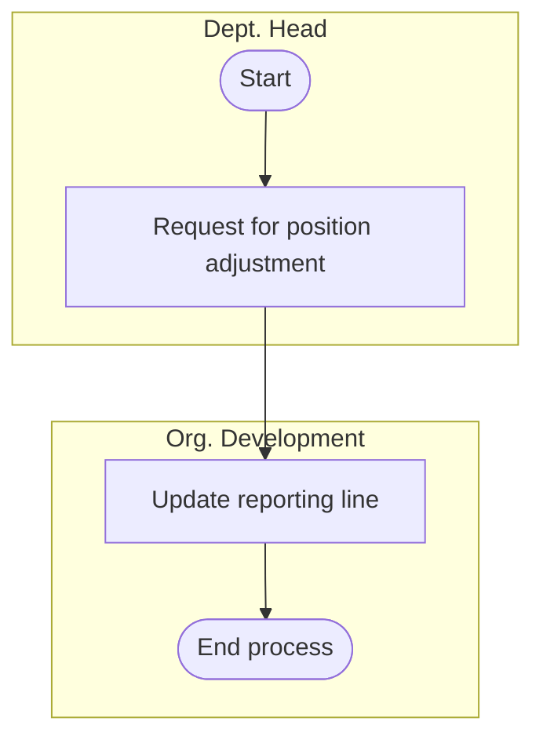
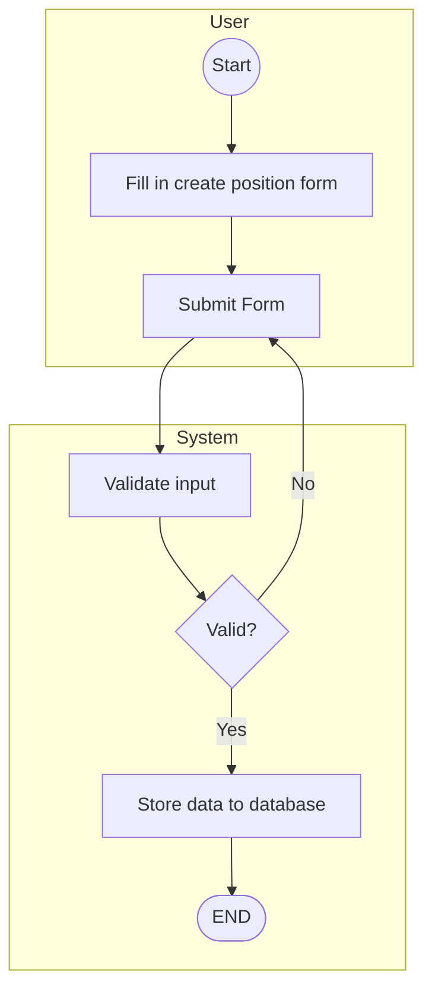
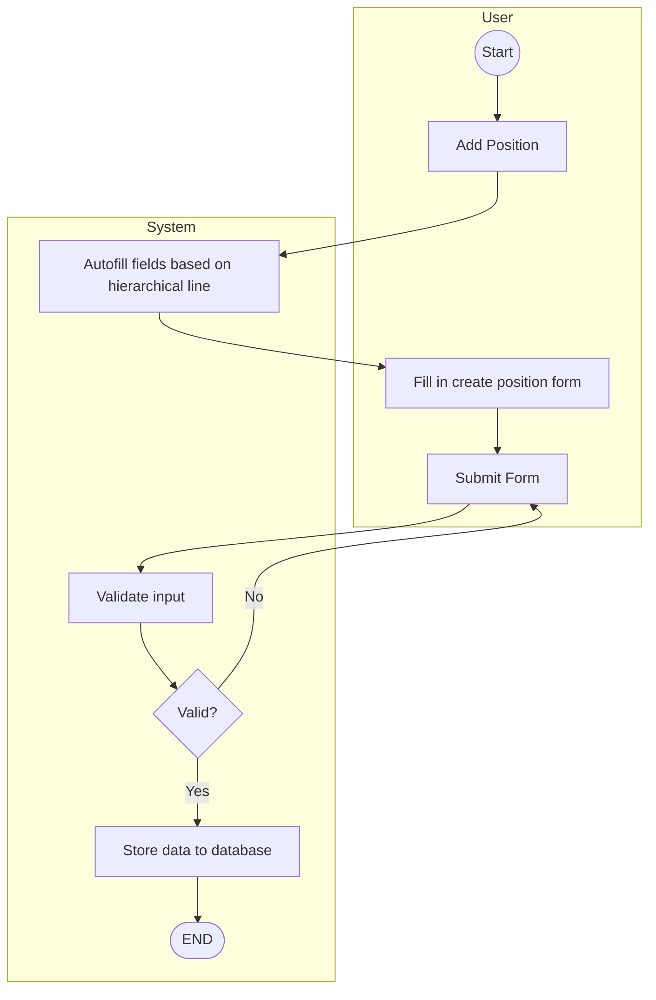
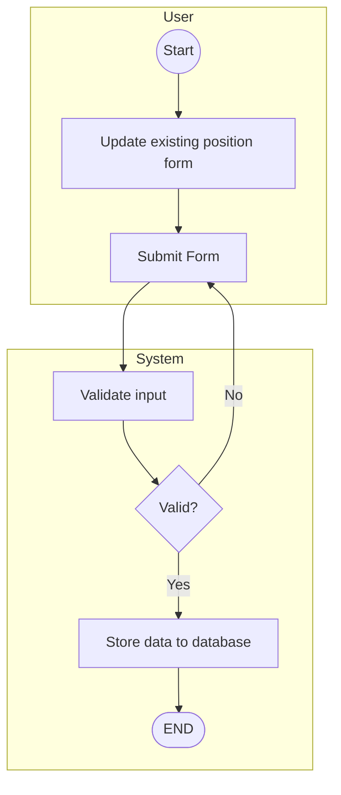

# Business Requirement Assessment — Position Management

**IT SYSTEM DEVELOPMENT**  
**Project:** Sistem HRIS  
**Module:** Position Management  
**Document:** Business Requirement Assessment Document  
**Document version (footer):** 1.1

## 1. Business Requirement Record

| Start Date | End Date | Author | Version Doc | Change Reference |
| --- | --- | --- | --- | --- |
| 16 Jun 2026 | | Analis Bisnis A | 0.1 | Drafting |
| 19 Jun 2026 | | Analis Bisnis A | 1.0 | Issued for Review |
| 24 Jun 2026 | | Analis Bisnis A | 1.1 | Updated based on Review Comments |
| 7 Jul 2026 | | Analis Bisnis A | 1.2 | Updated based on Review |

### 1.1 Log Changes

*Describe the changes which impact to the Module.*

**Guidance:**

- Provide the name, detail changes and severity of the changes, e.g. Mr. X request for change on workflow due to new policy on dd/mmm/yyyy, etc.
- Please identify all the changes clearly include impact to another module or infrastructure (if any).

**Change Record**

| Date | Requested by | Description | Severity (major/minor) | Status |
| --- | --- | --- | --- | --- |
| | | | | |
| | | | | |
| | | | | |
| | | | | |

### 1.2 Project Information

| Field | Value |
| --- | --- |
| Project Description | Sistem HRIS |
| Business User Expert | Narasumber Bisnis F / Narasumber Bisnis C |
| Assessment Date | 3 Juni 2026 - 9 Juni 2026 |
| Module Description | Position Management |

## 2. Requirement Identification

### 2.1 WHY — Module Objectives/Goals and Benefits

*Explain why this module is needed.*

**Guidance:**

- Module Objectives/Goals: Your expected objectives on this module, e.g. decreasing numbers of paper used.
- Module Benefits: The outcome of successful objectives/goals, e.g. reducing the paper consumption cost.

| Module Objectives/Goals | Module Benefits |
| --- | --- |
| Memusatkan pengelolaan posisi dalam organisasi pada satu sistem yang terintegrasi sehingga seluruh informasi posisi, struktur pelaporan, dan kebutuhan organisasi dapat dikelola secara konsisten. | Mengurangi ketidaksesuaian data posisi antar unit kerja, meningkatkan transparansi struktur organisasi, dan memastikan seluruh pihak menggunakan informasi posisi yang sama. |
| Memungkinkan tim Organization Development mengelola siklus hidup posisi, termasuk pembuatan, perubahan, penonaktifan, dan restrukturisasi posisi melalui proses yang terstandarisasi. | Meningkatkan efisiensi administrasi posisi, mengurangi ketergantungan pada proses manual, dan mempercepat implementasi perubahan organisasi. |
| Menyediakan struktur pelaporan yang jelas melalui organizational chart yang selalu diperbarui dan terdokumentasi. | Memudahkan pemahaman struktur organisasi, mempercepat proses analisis organisasi, dan meningkatkan akurasi informasi pelaporan. |
| Menyimpan riwayat perubahan posisi dan struktur organisasi secara terpusat dan terdokumentasi. | Meningkatkan auditability, mempermudah penelusuran perubahan organisasi, serta mendukung kebutuhan kepatuhan dan governance perusahaan. |

### 2.2 WHAT — Scope

*Describe the expected function or features on the app.*

**Guidance:**

- In scope: Explain the expected function / feature to be included, e.g. the reporting must in excel, must be easy to use in mobile, etc.
- Out scope: Explain what function that exist on the current/manual system that should not be considered, e.g. no need to add 3rd party account on login, etc.
- Make sure to put anything that you can think about the scope.

#### 2.2.1 In Scope

1. Pembuatan dan pengelolaan **Position** beserta hak aksesnya.
2. Pengelolaan hubungan hierarki antar posisi (**higher-level position / subordinate position**).
3. Pengelolaan **effective date** position.
4. Pengelolaan atribut dan informasi master data posisi, termasuk pembuatan, perubahan, aktivasi, dan penonaktifan data posisi.
5. Visualisasi posisi dalam bentuk **Position Chart**.
6. Pencarian posisi berdasarkan **Position Code**, nama posisi, dan nama karyawan, dan employee ID.
7. Pembuatan dan pengelolaan **Organizational Unit** (Company, Directorate, Division, Department, Section, cost code/cost center).
8. Penyimpanan riwayat perubahan posisi (**historical records**) dan audit trail (who, when, what changed).
9. Migrasi data posisi dari sistem Sistem HRIS sebelumnya SF ke Sistem HRIS.
10. Bulk Import data Posisi.
11. Export positon chart dengan format PDF, & Image(png).
12. Integrasi data posisi sebagai referensi bagi modul Employee Central lainnya.

#### 2.2.2 Out Scope

1. Pembuatan dan pengelolaan **Job Code Framework** (Auto Generate).
2. Pengelolaan proses **Recruitment** (New Hire, Replacement, Candidate Management).
3. Pengelolaan proses **Requisition to Employ (RTE)**.
4. Pengelolaan proses **Employee Status Change (Promotion, Transfer, Reclassification)**.
5. Pengelolaan data personal dan employment karyawan.
6. Pengelolaan Approved Manning Budget.
7. Pengelolaan payroll dan kompensasi karyawan.
8. Pengelolaan workflow persetujuan (perubahan/penambahan posisi).
9. Pengelolaan kontrak kerja dan perpanjangan kontrak karyawan.
10. Pengelolaan data kandidat atau talent pool.
11. Penyediaan fungsi **drag-and-drop** untuk perubahan hubungan pelaporan pada position chart.

### 2.3 WHEN — Milestones

*Describe the expected completion dates on required milestone.*

**Guidance:** Explain the expected milestone complete with expected start and end dates, e.g. system must ready to used in dd/mm/yyyy, should be presented on management meeting on dd/mm/yyyy.

| Milestones | Due Date | Remarks |
| --- | --- | --- |
| User Requirement | 18 Jun 2026 | Organization Structure |
| | | |

### 2.4 WHO — Roles and Accessibilities

*Describe how many roles will be interact with this Module.*

**Guidance:**

- Provide the role, assigned to and accessibilities on each role that will be included in the module, e.g. HR as admin apps will be responsible to provide setting on the current process.
- Please identify all the participated person in your area to have a clear roles assignment.

#### Organization Development (OD) Admin

**Assigned to:** *(tidak diisi pada dokumen sumber)*

**Accessibilities — Position:**

- Create Position
- Read Position
- Update Position
- Activate/Deactivate Position
- View Position Chart
- Manage Position Hierarchy
- Import/Export Position Data

**Accessibilities — Organization Unit (selaint cost code):**

- Create Organizational Unit
- Read Organizational Unit
- Update Organizational Unit

#### Comben

**Assigned to:** *(tidak diisi pada dokumen sumber)*

**Accessibilities — Organization Unit:**

- Create Cost Code
- Read Cost Code
- Update Cost Code

#### Employee

**Assigned to:** *(tidak diisi pada dokumen sumber)*

**Accessibilities:**

- Read Position Chart (own data)

### 2.5 WHAT IF — Risks and Mitigation

*Identify the risk and impact of the module.*

**Guidance:**

- Explain the risk that might be a barrier / obstacle for this module, e.g. the procedure does not exist, need to be confirmed by BOD, etc.
- Please think of any risk that might be impacted related to this module.

| Risks | Level (Hi, Med, Low) |
| --- | --- |
| Perubahan data posisi tanpa pencatatan histori dapat menyulitkan pelacakan perubahan dan investigasi audit. | Hi |
| Kesalahan penentuan higher-level position dapat menyebabkan struktur pelaporan yang tidak valid dan memengaruhi organizational chart. | Hi |

**Mitigasi:**

1. Menyediakan log aktivitas pengguna yang mencatat siapa melakukan perubahan, kapan perubahan dilakukan, dan data apa yang diubah.
2. Menerapkan validasi hubungan pelaporan (**higher-level position**) untuk mencegah pembentukan hierarki yang tidak valid atau circular reporting.

## 3. Current System Business Flow

**Guidance:**

- Please describe the current system that running / being used in essay.
- To maximize the understanding of current system, consider explaining with process flow in mind.
- Do it step by step from beginning to the end of process.
- Example on essay (in Bahasa):

  > “Mr. X mengisi formulir exit form kemudian memintakan approval kepada department head. Setelah di approve, form kemudian diserahkan pada security pada saat user x berada di gerbang dan akan keluar dari area camp.”

- More complete the explanation will affect the next visual modelling process.

### 3.1 Position Management

1. Dept. Head mengidentifikasi kebutuhan perubahan posisi atau reporting line dalam struktur organisasi.
2. Dept. Head mengajukan permintaan penyesuaian posisi (position adjustment) kepada tim Organization Development melalui proses di luar sistem.
3. Tim Organization Development menerima dan meninjau permintaan perubahan posisi yang diajukan.
4. Tim Organization Development melakukan update reporting line pada aplikasi sesuai dengan permintaan yang telah disetujui.
5. Sistem menyimpan perubahan reporting line dan memperbarui struktur organisasi yang terkait.
6. Proses selesai dan struktur position yang baru menjadi aktif di dalam sistem.

#### Manage Position Flow

*Representasi Mermaid dari diagram alur pada dokumen sumber (halaman 5).*

**Diagram asli:**

[Ilustrasi sumber dihapus dari korpus publik: Manage Position Flow]

## 4. Expected New System Business Flow

**Guidance:**

- Please describe the expected improved system flow.
- To maximize the understanding of expected new system, consider explaining with process flow in mind.
- Do it step by step from beginning to the end of process.
- More complete the explanation will affect the next visual modelling process.

### 4.1 Create Position

1. **User mengakses fitur Create Position** untuk membuat posisi baru dalam struktur organisasi.
2. **User mengisi form pembuatan posisi** dengan informasi yang diperlukan, seperti Position Code, Position Title, Job Code, unit organisasi, reporting line, dan atribut posisi lainnya.
3. Setelah seluruh data terisi, **user melakukan Submit Form**.
4. **Sistem melakukan validasi data** yang dikirimkan, termasuk kelengkapan data wajib, format data, keunikan Position Code, dan konsistensi informasi posisi.
5. Apabila data **tidak valid**, sistem menampilkan pesan kesalahan dan mengembalikan form kepada user untuk diperbaiki.
6. User melakukan koreksi data yang diperlukan dan mengirimkan kembali form.
7. Apabila data **valid**, sistem menyimpan data posisi ke dalam database.
8. **Posisi baru berhasil dibuat** dan dapat digunakan dalam struktur organisasi sesuai hak akses yang berlaku.
9. **Proses selesai.**

**Validasi:**

1. Memastikan seluruh mandatory field telah diisi.
2. Memastikan Position Code tidak duplikat.
3. Memastikan referensi organisasi yang dipilih valid.
4. Memastikan hubungan pelaporan (Higher-Level Position) valid apabila diisi.
5. Memastikan data memenuhi aturan bisnis Position Management yang berlaku.

#### Create Position Flow

*Representasi Mermaid dari diagram alur pada dokumen sumber (halaman 7).*

**Diagram asli:**

[Ilustrasi sumber dihapus dari korpus publik: Create Position Flow]

### 4.2 Add Position Below

1. **User memilih fitur Add Position Below** dari posisi tertentu pada Position Chart.
2. Sistem mengidentifikasi posisi induk (**higher-level position**) yang dipilih oleh user.
3. **Sistem secara otomatis mengisi (autofill) informasi hierarki** berdasarkan posisi induk yang dipilih, seperti:
   - Higher-Level Position
   - Division
   - Department
4. Informasi organisasi lainnya yang relevan sesuai konfigurasi sistem.
5. Setelah data hierarki terisi otomatis, **user melengkapi informasi posisi baru** pada form pembuatan posisi.
6. Setelah seluruh informasi selesai diisi, **user melakukan Submit Form**.
7. **Sistem melakukan validasi data** yang dikirimkan, termasuk kelengkapan data wajib, format data, keunikan Position Code, dan validitas struktur organisasi.
8. Apabila data **tidak valid**, sistem menampilkan pesan kesalahan dan mengembalikan form kepada user untuk diperbaiki.
9. User melakukan perbaikan data yang diperlukan dan mengirimkan kembali form.
10. Apabila data **valid**, sistem menyimpan data posisi baru ke dalam database.
11. Posisi baru secara otomatis menjadi bagian dari struktur organisasi di bawah posisi induk yang dipilih sebelumnya.
12. **Proses selesai.**

#### Add Position Below (Subordinate) Flow

*Representasi Mermaid dari diagram alur pada dokumen sumber (halaman 8).*

**Diagram asli:**

[Ilustrasi sumber dihapus dari korpus publik: Add Position Below (Subordinate) Flow]

### 4.3 Edit Position

1. **User memilih posisi yang akan diperbarui** dari daftar posisi atau Position Chart.
2. **Sistem menampilkan informasi posisi yang sudah ada** untuk dapat ditinjau dan diperbarui oleh user.
3. **User melakukan perubahan pada data posisi** sesuai kebutuhan, seperti Position Title, Job Code, Cost Center, Location, Position Level, maupun Reporting Line sesuai kewenangan yang dimiliki.
4. Setelah perubahan selesai dilakukan, **user melakukan Submit Form**.
5. **Sistem melakukan validasi terhadap data yang diperbarui**, termasuk:
6. Kelengkapan data wajib.
7. Konsistensi data organisasi.
8. Validitas hubungan pelaporan (Higher-Level Position).
9. Kepatuhan terhadap aturan bisnis Position Management.
10. Apabila data **tidak valid**, sistem menampilkan pesan kesalahan dan mengembalikan form kepada user untuk diperbaiki.
11. User melakukan perbaikan data yang diperlukan dan mengirimkan kembali form.
12. Apabila data **valid**, sistem menyimpan perubahan posisi ke dalam database.
13. Sistem memperbarui informasi posisi dan struktur organisasi yang terkait.
14. Sistem mencatat perubahan ke dalam **audit trail** dan menyimpan histori perubahan sesuai mekanisme **effective dating** yang berlaku.
15. **Proses selesai.**

#### Edit Position Flow

*Representasi Mermaid dari diagram alur pada dokumen sumber (halaman 8).*

**Diagram asli:**

[Ilustrasi sumber dihapus dari korpus publik: Edit Position Flow]

## 5. Module Policy

### 5.1 Position Management Policies / Business Rules

1. Setiap posisi wajib memiliki **Position Code** yang unik dan tidak boleh duplikat.
2. Setiap posisi wajib memiliki nama posisi (**Position Title**) yang sesuai dengan struktur organisasi dan kebutuhan bisnis yang berlaku.
3. Pembuatan, perubahan, aktivasi, penonaktifan, dan pengelolaan posisi hanya dapat dilakukan oleh tim OD.
4. Seluruh perubahan data posisi harus tercatat dalam **audit trail** yang memuat informasi pengguna, waktu perubahan, dan detail perubahan yang dilakukan.
5. Setiap posisi harus berada dalam struktur pelaporan (**reporting hierarchy**) yang valid.
6. Satu posisi hanya dapat memiliki satu **Higher-Level Position** yang aktif pada periode efektif yang sama.
7. **Create Position** digunakan untuk membuat posisi baru secara umum dengan seluruh informasi diisi secara manual.
8. **Add Position Below** digunakan untuk membuat posisi baru (subordinate) langsung dari Position Chart sehingga informasi hierarki organisasi terisi otomatis berdasarkan posisi yang dipilih.
9. Perubahan data posisi tidak menghapus data sebelumnya dan harus tetap menjaga histori perubahan melalui mekanisme **effective dating**.
10. Posisi yang telah memiliki histori transaksi, histori organisasi, atau pernah digunakan oleh karyawan tidak dapat dihapus, hanya dapat dinonaktifkan untuk menjaga histori data organisasi.
11. Posisi hanya dapat dinonaktifkan apabila tidak memiliki incumbent aktif, kandidat aktif, maupun subordinate position yang masih aktif.
12. Tim **Organization Development (OD)** dapat mengakses dan mengelola seluruh posisi dalam organisasi.
13. Pengguna umum hanya dapat melihat posisi dan struktur organisasi sesuai hak akses yang diberikan.
14. Sistem harus melakukan validasi terhadap seluruh data wajib (mandatory field) sebelum posisi dapat disimpan.
15. Perubahan reporting line harus secara otomatis memperbarui tampilan Position Chart & Organization Chart sesuai dengan effective dating.
16. Posisi yang dibuat harus terhubung dengan unit organisasi yang valid (Directorate, Division, Department, Section) sesuai struktur organisasi yang berlaku.
17. Sistem harus menyediakan kemampuan pencarian posisi berdasarkan Position Code, Position Title, maupun nama karyawan, dan ID karyawan yang menempati posisi tersebut.
18. Sistem harus menyediakan histori struktur organisasi dan posisi berdasarkan tanggal efektif tertentu (**historical organization view**).
19. Data posisi yang digunakan oleh proses bisnis lain harus menjadi referensi tunggal (**single source of truth**) bagi modul Sistem HRIS terkait.

## 6. Approval / Signatures

| Role | Name | Signature | Date |
| --- | --- | --- | --- |
| Business Analyst | Analis Bisnis A | [Ilustrasi sumber dihapus dari korpus publik: Tanda tangan Business Analyst] | 7 Juli 2026 |
| Project Coordinator | Koordinator Proyek A | | |
| Business User Expert | Narasumber Bisnis C | | |

> *By signing this document, all items contained herein are confirmed as mandatory requirements to be delivered as the agreed-upon product. Any changes or modifications to these requirements will be managed through the change request process.*
